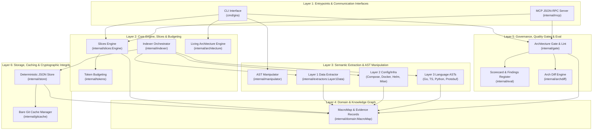
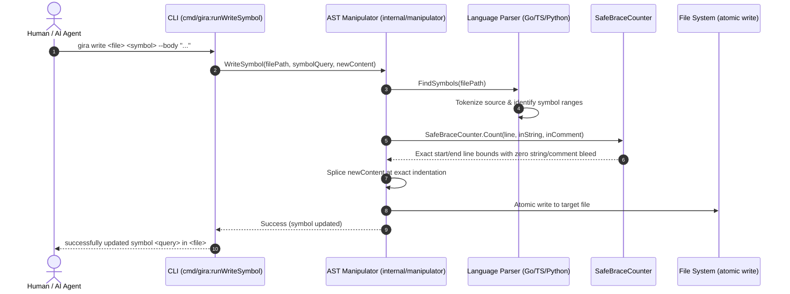
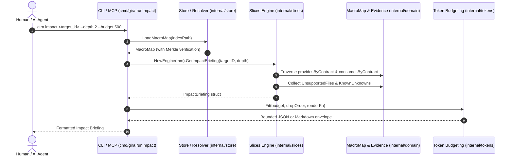
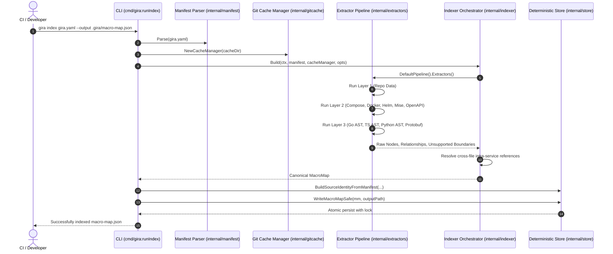
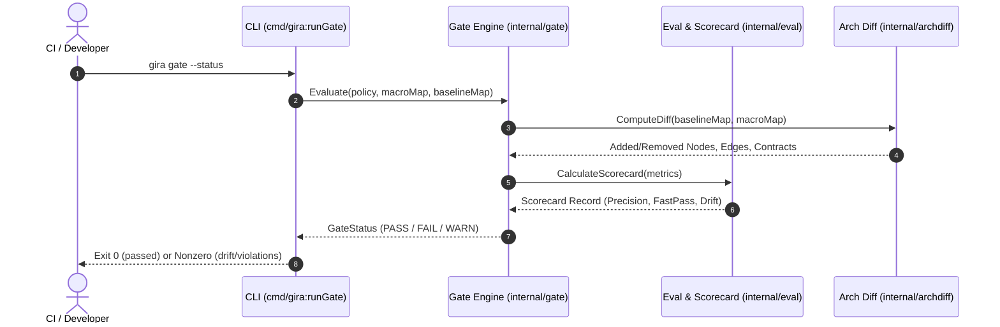

# Gira-G Architecture Harness — Architectural Reference Overview

> **Living Architecture Standard**: Deterministic, self-generating architecture and semantic engine reference. Designed for cognitive density, machine readability by AI agents, and complete navigational parity for software engineers.

## 1. Executive Overview & Core Philosophy

Gira-G is an architectural intelligence harness and deterministic semantic engine. It provides high-speed, structural codebase comprehension, multi-layer graph extraction, surgical AST editing, and governance gates without relying on multi-gigabyte language servers or heavy JavaScript runtimes.

### 1.1 Fundamental Design Invariants

| Invariant | Architectural Guarantee | Enforcement Mechanism |
| :--- | :--- | :--- |
| **Zero-Token Fast Pass** | Structural queries (impact, slices, docs, flows) resolve in <5ms without LLM token expenditure. | Pre-indexed in-memory graph traversals (`internal/slices:Engine`). |
| **Deterministic AST Manipulation** | Code symbol reading, writing, and member addition preserve surrounding formatting and indentations. | Native AST parsers + `SafeBraceCounter` token balancing (`internal/manipulator`). |
| **Append-Only Merkle Integrity** | Source maps are versioned, reproducible, and verifiable via cryptographic SHA256 hashes. | Manifest and repository tree hashing (`internal/store:BuildSourceIdentity`). |
| **Fail-Closed Boundary Modeling** | Unhandled languages and unresolvable peers are explicitly recorded, never silently dropped. | `domain.UnsupportedBoundary` records throughout all extractor layers. |
| **Dual-Surface Parity** | Human CLI (`cmd/gira`) and AI Agent Protocol (`internal/mcp`) query the identical deterministic facts. | Shared `slices.Engine` data structures and budget envelopes. |

## 2. Layered Architecture Block Diagram

The system is structured in six strictly decoupled layers, enforcing unidirectional dependency flows:



## 3. Architectural Communities & Module Breakdown

AST nodes, contracts, and packages are clustered into cohesive architectural communities. Within each community, components are classified by graph centrality as **Core Abstractions** (high in-degree hubs) or **Utilities / Leaf Nodes**.

### 3.1 CLI & MCP Entrypoints

**Mission**: Human CLI commands (gira) and agent communication interfaces (Model Context Protocol / stdio JSON-RPC).

#### Architectural Invariants

- Dual-Surface Parity: CLI and MCP adapters expose equivalent capabilities over the same core engine data.
- Standard IO Separation: Machine-readable JSON and human-friendly Markdown write to stdout; warnings and staleness to stderr.
- Fail-Closed Execution: Corrupt index files or uncommitted mutations without authorization exit with nonzero exit codes.

#### Core Abstractions (2)

| Component / Abstraction | Kind | Centrality | In/Out Degree | Code Citation |
| :--- | :---: | :---: | :---: | :--- |
| [`cmd/gira`](https://github.com/EduardoShibukawa/gira-g/blob/main/cmd/gira/architecture_cmd.go) | `Library` | **18** | in:0 / out:18 | [`cmd/gira/architecture_cmd.go`](https://github.com/EduardoShibukawa/gira-g/blob/main/cmd/gira/architecture_cmd.go) |
| [`internal/mcp`](https://github.com/EduardoShibukawa/gira-g/blob/main/internal/mcp/server.go) | `Library` | **10** | in:1 / out:8 | [`internal/mcp/server.go`](https://github.com/EduardoShibukawa/gira-g/blob/main/internal/mcp/server.go) |

#### Cross-Domain Mediation

- `CLI & MCP Entrypoints` &rarr; **imports** &rarr; `Governance & Gate` (via `internal/archdiff`)
- `CLI & MCP Entrypoints` &rarr; **imports** &rarr; `Core Engine` (via `internal/architecture`)
- `CLI & MCP Entrypoints` &rarr; **imports** &rarr; `Core Engine` (via `internal/docsite`)
- `CLI & MCP Entrypoints` &rarr; **imports** &rarr; `Core Engine` (via `internal/domain`)
- `CLI & MCP Entrypoints` &rarr; **imports** &rarr; `Governance & Gate` (via `internal/eval`)
- `CLI & MCP Entrypoints` &rarr; **imports** &rarr; `Extractors Pipeline` (via `internal/extractors`)
- `CLI & MCP Entrypoints` &rarr; **imports** &rarr; `Governance & Gate` (via `internal/gate`)
- `CLI & MCP Entrypoints` &rarr; **imports** &rarr; `Storage & Persistence` (via `internal/gitcache`)
- `CLI & MCP Entrypoints` &rarr; **imports** &rarr; `Governance & Gate` (via `internal/gitdiff`)
- `CLI & MCP Entrypoints` &rarr; **imports** &rarr; `Core Engine` (via `internal/human`)
- `CLI & MCP Entrypoints` &rarr; **imports** &rarr; `Core Engine` (via `internal/indexer`)
- `CLI & MCP Entrypoints` &rarr; **imports** &rarr; `Core Engine` (via `internal/manifest`)
- `CLI & MCP Entrypoints` &rarr; **imports** &rarr; `AST Manipulator` (via `internal/manipulator`)
- `CLI & MCP Entrypoints` &rarr; **imports** &rarr; `Core Engine` (via `internal/skills`)
- `CLI & MCP Entrypoints` &rarr; **imports** &rarr; `Core Engine` (via `internal/slices`)
- `CLI & MCP Entrypoints` &rarr; **imports** &rarr; `Storage & Persistence` (via `internal/store`)
- `CLI & MCP Entrypoints` &rarr; **imports** &rarr; `Core Engine` (via `internal/tokens`)
- `CLI & MCP Entrypoints` &rarr; **imports** &rarr; `Core Engine` (via `internal/tools`)

### 3.2 Core Engine

**Mission**: The central graph engine responsible for context slicing, impact calculations, guided tours, and deterministic querying over the MacroMap topology.

#### Architectural Invariants

- Zero-Token Fast Pass: Engine must resolve bounded slices and subgraphs in <5ms without LLM invocation.
- Deterministic Projection: Given the same MacroMap and query parameters, slices and tours emit byte-identical representations.
- Explicit Unknowns: Unsupported files or missing joins are never silently omitted; they are projected under KnownUnknowns.

#### Core Abstractions (8)

| Component / Abstraction | Kind | Centrality | In/Out Degree | Code Citation |
| :--- | :---: | :---: | :---: | :--- |
| [`internal/domain`](https://github.com/EduardoShibukawa/gira-g/blob/main/internal/domain/intra_service.go) | `Library` | **20** | in:10 / out:0 | [`internal/domain/intra_service.go`](https://github.com/EduardoShibukawa/gira-g/blob/main/internal/domain/intra_service.go) |
| [`internal/manifest`](https://github.com/EduardoShibukawa/gira-g/blob/main/internal/manifest/locator.go) | `Library` | **14** | in:7 / out:0 | [`internal/manifest/locator.go`](https://github.com/EduardoShibukawa/gira-g/blob/main/internal/manifest/locator.go) |
| [`internal/slices`](https://github.com/EduardoShibukawa/gira-g/blob/main/internal/slices/budget.go) | `Library` | **11** | in:4 / out:3 | [`internal/slices/budget.go`](https://github.com/EduardoShibukawa/gira-g/blob/main/internal/slices/budget.go) |
| [`internal/tokens`](https://github.com/EduardoShibukawa/gira-g/blob/main/internal/tokens/accounting.go) | `Library` | **11** | in:5 / out:1 | [`internal/tokens/accounting.go`](https://github.com/EduardoShibukawa/gira-g/blob/main/internal/tokens/accounting.go) |
| [`internal/indexer`](https://github.com/EduardoShibukawa/gira-g/blob/main/internal/indexer/incremental.go) | `Library` | **10** | in:3 / out:4 | [`internal/indexer/incremental.go`](https://github.com/EduardoShibukawa/gira-g/blob/main/internal/indexer/incremental.go) |
| [`internal/architecture`](https://github.com/EduardoShibukawa/gira-g/blob/main/internal/architecture/clustering.go) | `Library` | **6** | in:2 / out:2 | [`internal/architecture/clustering.go`](https://github.com/EduardoShibukawa/gira-g/blob/main/internal/architecture/clustering.go) |
| [`internal/docsite`](https://github.com/EduardoShibukawa/gira-g/blob/main/internal/docsite/builder.go) | `Library` | **5** | in:1 / out:3 | [`internal/docsite/builder.go`](https://github.com/EduardoShibukawa/gira-g/blob/main/internal/docsite/builder.go) |
| [`internal/tools`](https://github.com/EduardoShibukawa/gira-g/blob/main/internal/tools/registry.go) | `Library` | **4** | in:2 / out:0 | [`internal/tools/registry.go`](https://github.com/EduardoShibukawa/gira-g/blob/main/internal/tools/registry.go) |

#### Utilities & Leaf Nodes (2)

| Component / Package | Role | Centrality | Description |
| :--- | :---: | :---: | :--- |
| [`internal/skills`](https://github.com/EduardoShibukawa/gira-g/blob/main/internal/skills/install.go) | `Mediator / Service` | 3 | Package skills holds GIRA's skills catalog (spec A): one canonical SKILL.md per
skill, embedded in the binary, and `gira skills install`, which generates the
files each host family reads from that single source. The installer only ever
rewrites content between its own markers, so a second run changes nothing and
anything a user added outside the markers survives. |
| [`internal/human`](https://github.com/EduardoShibukawa/gira-g/blob/main/internal/human/human.go) | `Mediator / Service` | 2 | Package human renders the human-facing terminal surface. It keeps the exact
plain text the commands already emit and adds ANSI styling only when stdout is
a terminal and NO_COLOR is unset, so pipes, CI and goldens see the
byte-identical plain output (ADR 0008 §1). |

#### Cross-Domain Mediation

- `Core Engine` &rarr; **imports** &rarr; `AST Manipulator` (via `internal/manipulator`)
- `Core Engine` &rarr; **imports** &rarr; `Storage & Persistence` (via `internal/store`)
- `Core Engine` &rarr; **imports** &rarr; `Extractors Pipeline` (via `internal/extractors`)
- `Core Engine` &rarr; **imports** &rarr; `Storage & Persistence` (via `internal/gitcache`)
- `Core Engine` &rarr; **imports** &rarr; `Governance & Gate` (via `internal/gitdiff`)

### 3.3 AST Manipulator

**Mission**: Syntactic AST symbol query and surgical manipulation engine supporting Go, TypeScript, and Python without external runtimes.

#### Architectural Invariants

- LLM-Free Surgical Edits: Code symbol retrieval and replacement are strictly syntactic and deterministic.
- Safe Brace Balancing: Code blocks are tokenized with string/comment/regex evasion to prevent corrupted AST syntax.
- Exact Line Preservation: Surgical replacements do not reformat or alter unedited regions of the file.

#### Core Abstractions (1)

| Component / Abstraction | Kind | Centrality | In/Out Degree | Code Citation |
| :--- | :---: | :---: | :---: | :--- |
| [`internal/manipulator`](https://github.com/EduardoShibukawa/gira-g/blob/main/internal/manipulator/manipulator.go) | `Library` | **4** | in:2 / out:0 | [`internal/manipulator/manipulator.go`](https://github.com/EduardoShibukawa/gira-g/blob/main/internal/manipulator/manipulator.go) |

### 3.4 Extractors Pipeline

**Mission**: Multi-layer static analysis pipeline parsing manifests, Dockerfiles, compose files, OpenAPI schemas, and source ASTs into canonical nodes and mediated edges.

#### Architectural Invariants

- Three-Layer Hierarchy: Layer 1 (Repo Data) -> Layer 2 (Declarative Configs/Infra) -> Layer 3 (Language ASTs).
- Discrete Provenance: Every extracted fact carries an EvidenceRecord with Git commit SHA and line-range locator.
- Deterministic Multi-Pass: Extractors run in dependency order and resolve cross-file relations without nondeterminism.

#### Core Abstractions (1)

| Component / Abstraction | Kind | Centrality | In/Out Degree | Code Citation |
| :--- | :---: | :---: | :---: | :--- |
| [`internal/extractors`](https://github.com/EduardoShibukawa/gira-g/blob/main/internal/extractors/extractor.go) | `Library` | **8** | in:3 / out:2 | [`internal/extractors/extractor.go`](https://github.com/EduardoShibukawa/gira-g/blob/main/internal/extractors/extractor.go) |

#### Cross-Domain Mediation

- `Extractors Pipeline` &rarr; **imports** &rarr; `Core Engine` (via `internal/domain`)
- `Extractors Pipeline` &rarr; **imports** &rarr; `Core Engine` (via `internal/manifest`)

### 3.5 Governance & Gate

**Mission**: Quality gates, drift linting, architectural policy validation, and deterministic scorecard accounting.

#### Architectural Invariants

- Architectural Drift Prevention: Gate checks block circular dependencies, untracked contracts, and deleted symbols.
- Finding Accounting: Findings are recorded deterministically with rule IDs and explicit verification criteria.
- Objective Scorecard: Metric calculations (discovery, precision, zero-token fast pass) are verified against goldens.

#### Core Abstractions (5)

| Component / Abstraction | Kind | Centrality | In/Out Degree | Code Citation |
| :--- | :---: | :---: | :---: | :--- |
| [`internal/eval`](https://github.com/EduardoShibukawa/gira-g/blob/main/internal/eval/artifact.go) | `Library` | **12** | in:2 / out:8 | [`internal/eval/artifact.go`](https://github.com/EduardoShibukawa/gira-g/blob/main/internal/eval/artifact.go) |
| [`internal/archdiff`](https://github.com/EduardoShibukawa/gira-g/blob/main/internal/archdiff/archdiff.go) | `Library` | **7** | in:2 / out:3 | [`internal/archdiff/archdiff.go`](https://github.com/EduardoShibukawa/gira-g/blob/main/internal/archdiff/archdiff.go) |
| [`internal/gitdiff`](https://github.com/EduardoShibukawa/gira-g/blob/main/internal/gitdiff/gitdiff.go) | `Library` | **6** | in:3 / out:0 | [`internal/gitdiff/gitdiff.go`](https://github.com/EduardoShibukawa/gira-g/blob/main/internal/gitdiff/gitdiff.go) |
| [`internal/corpus`](https://github.com/EduardoShibukawa/gira-g/blob/main/internal/corpus/corpus.go) | `Library` | **4** | in:1 / out:2 | [`internal/corpus/corpus.go`](https://github.com/EduardoShibukawa/gira-g/blob/main/internal/corpus/corpus.go) |
| [`internal/gate`](https://github.com/EduardoShibukawa/gira-g/blob/main/internal/gate/gate.go) | `Library` | **4** | in:2 / out:0 | [`internal/gate/gate.go`](https://github.com/EduardoShibukawa/gira-g/blob/main/internal/gate/gate.go) |

#### Cross-Domain Mediation

- `Governance & Gate` &rarr; **imports** &rarr; `Core Engine` (via `internal/domain`)
- `Governance & Gate` &rarr; **imports** &rarr; `Core Engine` (via `internal/slices`)
- `Governance & Gate` &rarr; **imports** &rarr; `Core Engine` (via `internal/tokens`)
- `Governance & Gate` &rarr; **imports** &rarr; `Storage & Persistence` (via `internal/gitcache`)
- `Governance & Gate` &rarr; **imports** &rarr; `Core Engine` (via `internal/manifest`)
- `Governance & Gate` &rarr; **imports** &rarr; `Extractors Pipeline` (via `internal/extractors`)
- `Governance & Gate` &rarr; **imports** &rarr; `Core Engine` (via `internal/indexer`)

### 3.6 Storage & Persistence

**Mission**: Cryptographic source-identity hashing, cross-platform locking, and deterministic JSON persistence for architectural maps.

#### Architectural Invariants

- Append-Only Merkle Integrity: MacroMap source identities are derived via cryptographic SHA256 hashes of input trees.
- Cross-Platform Safe Locking: File locks prevent concurrent writer races across Unix and Windows runtimes.
- Byte-Identical Serialization: Keys and arrays are sorted prior to JSON encoding to prevent spurious diffs.

#### Core Abstractions (2)

| Component / Abstraction | Kind | Centrality | In/Out Degree | Code Citation |
| :--- | :---: | :---: | :---: | :--- |
| [`internal/gitcache`](https://github.com/EduardoShibukawa/gira-g/blob/main/internal/gitcache/cache.go) | `Library` | **11** | in:5 / out:1 | [`internal/gitcache/cache.go`](https://github.com/EduardoShibukawa/gira-g/blob/main/internal/gitcache/cache.go) |
| [`internal/store`](https://github.com/EduardoShibukawa/gira-g/blob/main/internal/store/key.go) | `Library` | **10** | in:3 / out:4 | [`internal/store/key.go`](https://github.com/EduardoShibukawa/gira-g/blob/main/internal/store/key.go) |

#### Cross-Domain Mediation

- `Storage & Persistence` &rarr; **imports** &rarr; `Core Engine` (via `internal/manifest`)
- `Storage & Persistence` &rarr; **imports** &rarr; `Core Engine` (via `internal/domain`)
- `Storage & Persistence` &rarr; **imports** &rarr; `Core Engine` (via `internal/indexer`)

## 4. Critical Lifecycles & Intent Flows

Execution flows in Gira-G follow deterministic lifecycles that travel predictably from entrypoints to storage:

### 4.1 Lifecycle of a Surgical AST Edit (`intent: ast_edit`)

Deterministic retrieval, brace-balanced boundary detection, and atomic surgical replacement of a code symbol without full-file reformatting or external language servers.



#### Step-by-Step Flow

| Step | Component | Domain | Action | Source Citation |
| :---: | :--- | :--- | :--- | :--- |
| 1 | `cmd/gira` | CLI & MCP Entrypoints | Parses CLI arguments (--body or piped stdin) and verifies target file existence. | [cmd/gira](https://github.com/EduardoShibukawa/gira-g/blob/main/cmd/gira/symbol_ops.go#L48-L91) |
| 2 | `internal/manipulator` | AST Manipulator | Invokes FindSymbols to detect all class, interface, function, and method ranges. | [internal/manipulator](https://github.com/EduardoShibukawa/gira-g/blob/main/internal/manipulator/manipulator.go#L36-L54) |
| 3 | `internal/manipulator (SafeBraceCounter)` | AST Manipulator | Tokenizes code boundaries with string literals and comment escapes to identify true block termination. | [internal/manipulator (SafeBraceCounter)](https://github.com/EduardoShibukawa/gira-g/blob/main/internal/manipulator/manipulator.go#L430-L500) |
| 4 | `internal/manipulator` | AST Manipulator | Slices exact lines, adjusts indentation to preserve container style, and performs atomic string join. | [internal/manipulator](https://github.com/EduardoShibukawa/gira-g/blob/main/internal/manipulator/manipulator.go#L85-L140) |
| 5 | `os.WriteFile` | Storage & Persistence | Writes updated buffer back to disk with original permissions (0644). | [os.WriteFile](https://github.com/EduardoShibukawa/gira-g/blob/main/internal/manipulator/manipulator.go#L135-L139) |

### 4.2 Lifecycle of an Impact Calculation (`intent: impact`)

Deterministic traversal of mediated contracts, upstream dependencies, and downstream consumers with bounded token envelopes.



#### Step-by-Step Flow

| Step | Component | Domain | Action | Source Citation |
| :---: | :--- | :--- | :--- | :--- |
| 1 | `cmd/gira / internal/mcp` | CLI & MCP Entrypoints | Receives target_id, depth, and budget parameters via CLI flag or MCP JSON-RPC call. | [cmd/gira / internal/mcp](https://github.com/EduardoShibukawa/gira-g/blob/main/cmd/gira/main.go#L973-L1041) |
| 2 | `internal/store` | Storage & Persistence | Loads macro-map.json, validates schema version, and inspects repository HEAD freshness. | [internal/store](https://github.com/EduardoShibukawa/gira-g/blob/main/internal/store/store.go#L30-L75) |
| 3 | `internal/slices (Engine)` | Core Engine | Executes breadth-first traversal across provides and consumes mediation edges. | [internal/slices (Engine)](https://github.com/EduardoShibukawa/gira-g/blob/main/internal/slices/engine.go#L231-L320) |
| 4 | `internal/domain` | Core Engine | Appends unhandled files and unknown language constructs to preserve known unknowns. | [internal/domain](https://github.com/EduardoShibukawa/gira-g/blob/main/internal/domain/models.go#L112-L120) |
| 5 | `internal/tokens` | Core Engine | Applies deterministic token-fitting drops if requested budget is exceeded. | [internal/tokens](https://github.com/EduardoShibukawa/gira-g/blob/main/internal/slices/budget.go#L80-L150) |

### 4.3 Lifecycle of Multi-Layer Architecture Extraction & Indexing (`intent: index`)

Full repository discovery: manifest parsing, Layer 1 repository metadata, Layer 2 infrastructure declarations, and Layer 3 source code AST extraction with Merkle hash integrity.



#### Step-by-Step Flow

| Step | Component | Domain | Action | Source Citation |
| :---: | :--- | :--- | :--- | :--- |
| 1 | `cmd/gira:runIndex` | CLI & MCP Entrypoints | Parses gira.yaml path and configuration options. | [cmd/gira:runIndex](https://github.com/EduardoShibukawa/gira-g/blob/main/cmd/gira/main.go#L393-L440) |
| 2 | `internal/manifest` | Core Engine | Parses manifest YAML, validating repository URLs, pinned commit SHAs, and path scopes. | [internal/manifest](https://github.com/EduardoShibukawa/gira-g/blob/main/internal/manifest/manifest.go#L30-L80) |
| 3 | `internal/gitcache` | Storage & Persistence | Clones or updates local bare mirrors and pins worktrees to specified commit SHAs. | [internal/gitcache](https://github.com/EduardoShibukawa/gira-g/blob/main/internal/gitcache/gitcache.go#L40-L110) |
| 4 | `internal/extractors` | Extractors Pipeline | Executes Layer 1 (Data), Layer 2 (Compose/Docker/Mise), and Layer 3 (Language ASTs: Go, TS, Py, Proto). | [internal/extractors](https://github.com/EduardoShibukawa/gira-g/blob/main/internal/extractors/extractor.go#L45-L95) |
| 5 | `internal/indexer` | Core Engine | Synthesizes mediated edges, resolves contract providers and consumers, and tags intra-service metadata. | [internal/indexer](https://github.com/EduardoShibukawa/gira-g/blob/main/internal/indexer/indexer.go#L50-L160) |
| 6 | `internal/store` | Storage & Persistence | Generates cryptographic SHA256 Merkle source identity and writes sorted, indented JSON under a cross-platform lock. | [internal/store](https://github.com/EduardoShibukawa/gira-g/blob/main/internal/store/store.go#L80-L140) |

### 4.4 Lifecycle of Governance Gate & Drift Verification (`intent: gate`)

Automated verification of architectural invariants, contract break detection, untracked construct reporting, and scorecard generation.



#### Step-by-Step Flow

| Step | Component | Domain | Action | Source Citation |
| :---: | :--- | :--- | :--- | :--- |
| 1 | `cmd/gira:runGate` | CLI & MCP Entrypoints | Initializes gate flags (--status, --reverify, --strict, --fail-on-ci). | [cmd/gira:runGate](https://github.com/EduardoShibukawa/gira-g/blob/main/cmd/gira/gate.go#L20-L70) |
| 2 | `internal/gate` | Governance & Gate | Loads policy rules and evaluates current MacroMap against baseline snapshot. | [internal/gate](https://github.com/EduardoShibukawa/gira-g/blob/main/internal/gate/gate.go#L30-L90) |
| 3 | `internal/archdiff` | Governance & Gate | Calculates structural differences: node renames, removed contracts, and newly unhandled boundaries. | [internal/archdiff](https://github.com/EduardoShibukawa/gira-g/blob/main/internal/archdiff/archdiff.go#L25-L95) |
| 4 | `internal/eval` | Governance & Gate | Computes objective scorecards and checks against regression floor guards. | [internal/eval](https://github.com/EduardoShibukawa/gira-g/blob/main/internal/eval/scorecard.go#L40-L115) |
| 5 | `cmd/gira` | CLI & MCP Entrypoints | Emits human-readable or JSON findings report; fails closed if strict gate criteria fail. | [cmd/gira](https://github.com/EduardoShibukawa/gira-g/blob/main/cmd/gira/gate.go#L75-L120) |

## 5. API Contracts & Module Directory

Direct reference to all core Go packages, their primary types, and essential exported contracts:

### Package [`cmd/gira`](https://github.com/EduardoShibukawa/gira-g/blob/main/cmd/gira)

- **Domain**: `CLI & MCP Entrypoints`
- **Internal Dependencies**: `internal/archdiff, internal/architecture, internal/docsite, internal/domain, internal/eval, internal/extractors, internal/gate, internal/gitcache, internal/gitdiff, internal/human, internal/indexer, internal/manifest, internal/manipulator, internal/mcp, internal/skills, internal/slices, internal/store, internal/tokens`

#### Key Exported Functions

```go
func Run(args []string, stdin io.Reader, stdout io.Writer, stderr io.Writer) error
```

### Package [`internal/archdiff`](https://github.com/EduardoShibukawa/gira-g/blob/main/internal/archdiff)

> Package archdiff compares two indexes of a Target System (spec A.2,
gira-arch-diff): nodes and Contracts added, removed, renamed or changed, edges
added or removed, evidence that moved, and unsupported paths that appeared or
went away. It works on the indexes alone. Renames are detected from structure,
never from a declared table, so that a diff of two real releases needs no input
besides the two indexes.

- **Domain**: `Governance & Gate`
- **Internal Dependencies**: `internal/domain, internal/slices, internal/tokens`

#### Exported Types & Contracts

| Type | Kind | Description | Locator Citation |
| :--- | :---: | :--- | :--- |
| [`Rename`](https://github.com/EduardoShibukawa/gira-g/blob/main/internal/archdiff/archdiff.go#L26-L32) | `struct` | Rename pairs a node of the first index with its counterpart in the second.
Origin is always "inferred": a rename is a structural match, not an extracted
fact (spec rule I1). | [`internal/archdiff/archdiff.go`](https://github.com/EduardoShibukawa/gira-g/blob/main/internal/archdiff/archdiff.go#L26-L32) |
| [`Edge`](https://github.com/EduardoShibukawa/gira-g/blob/main/internal/archdiff/archdiff.go#L36-L41) | `struct` | Edge is a relationship by its endpoints and verb.
Locator cites the edge's first evidence in its own index, or is "unknown". | [`internal/archdiff/archdiff.go`](https://github.com/EduardoShibukawa/gira-g/blob/main/internal/archdiff/archdiff.go#L36-L41) |
| [`Diff`](https://github.com/EduardoShibukawa/gira-g/blob/main/internal/archdiff/archdiff.go#L54-L76) | `struct` | Diff is the result of comparing index A (before) with index B (after). Removed
items use A's IDs and added items use B's IDs. | [`internal/archdiff/archdiff.go`](https://github.com/EduardoShibukawa/gira-g/blob/main/internal/archdiff/archdiff.go#L54-L76) |
| [`nb`](https://github.com/EduardoShibukawa/gira-g/blob/main/internal/archdiff/archdiff.go#L297-L299) | `struct` | - | [`internal/archdiff/archdiff.go`](https://github.com/EduardoShibukawa/gira-g/blob/main/internal/archdiff/archdiff.go#L297-L299) |
| [`prints`](https://github.com/EduardoShibukawa/gira-g/blob/main/internal/archdiff/archdiff.go#L338) | `struct` | - | [`internal/archdiff/archdiff.go`](https://github.com/EduardoShibukawa/gira-g/blob/main/internal/archdiff/archdiff.go#L338) |

#### Key Exported Functions

```go
func Compare(a, b *domain.MacroMap) *Diff
```

### Package [`internal/architecture`](https://github.com/EduardoShibukawa/gira-g/blob/main/internal/architecture)

- **Domain**: `Core Engine`
- **Internal Dependencies**: `internal/domain, internal/manipulator`

#### Exported Types & Contracts

| Type | Kind | Description | Locator Citation |
| :--- | :---: | :--- | :--- |
| [`PackageInfo`](https://github.com/EduardoShibukawa/gira-g/blob/main/internal/architecture/scanner.go#L17-L27) | `struct` | PackageInfo holds AST information for a discovered package. | [`internal/architecture/scanner.go`](https://github.com/EduardoShibukawa/gira-g/blob/main/internal/architecture/scanner.go#L17-L27) |
| [`TypeInfo`](https://github.com/EduardoShibukawa/gira-g/blob/main/internal/architecture/scanner.go#L30-L37) | `struct` | TypeInfo holds AST information for a declared type. | [`internal/architecture/scanner.go`](https://github.com/EduardoShibukawa/gira-g/blob/main/internal/architecture/scanner.go#L30-L37) |
| [`FuncInfo`](https://github.com/EduardoShibukawa/gira-g/blob/main/internal/architecture/scanner.go#L40-L47) | `struct` | FuncInfo holds AST information for a declared function or method. | [`internal/architecture/scanner.go`](https://github.com/EduardoShibukawa/gira-g/blob/main/internal/architecture/scanner.go#L40-L47) |
| [`DomainID`](https://github.com/EduardoShibukawa/gira-g/blob/main/internal/architecture/types.go#L8) | `type` | DomainID identifies an architectural domain or community in Gira-G. | [`internal/architecture/types.go`](https://github.com/EduardoShibukawa/gira-g/blob/main/internal/architecture/types.go#L8) |
| [`NodeRole`](https://github.com/EduardoShibukawa/gira-g/blob/main/internal/architecture/types.go#L21) | `type` | NodeRole classifies an entity by its centrality and structural significance. | [`internal/architecture/types.go`](https://github.com/EduardoShibukawa/gira-g/blob/main/internal/architecture/types.go#L21) |
| [`ClusteredNode`](https://github.com/EduardoShibukawa/gira-g/blob/main/internal/architecture/types.go#L30-L43) | `struct` | ClusteredNode represents a node enriched with architectural domain and centrality metrics. | [`internal/architecture/types.go`](https://github.com/EduardoShibukawa/gira-g/blob/main/internal/architecture/types.go#L30-L43) |
| [`DomainRelation`](https://github.com/EduardoShibukawa/gira-g/blob/main/internal/architecture/types.go#L46-L52) | `struct` | DomainRelation captures cross-domain mediation or dependencies. | [`internal/architecture/types.go`](https://github.com/EduardoShibukawa/gira-g/blob/main/internal/architecture/types.go#L46-L52) |
| [`Community`](https://github.com/EduardoShibukawa/gira-g/blob/main/internal/architecture/types.go#L55-L63) | `struct` | Community represents a cohesive architectural cluster of components and contracts. | [`internal/architecture/types.go`](https://github.com/EduardoShibukawa/gira-g/blob/main/internal/architecture/types.go#L55-L63) |
| [`ClusteredArchitecture`](https://github.com/EduardoShibukawa/gira-g/blob/main/internal/architecture/types.go#L66-L73) | `struct` | ClusteredArchitecture represents the complete clustered topology of a system. | [`internal/architecture/types.go`](https://github.com/EduardoShibukawa/gira-g/blob/main/internal/architecture/types.go#L66-L73) |
| [`SymbolDoc`](https://github.com/EduardoShibukawa/gira-g/blob/main/internal/architecture/types.go#L76-L86) | `struct` | SymbolDoc represents semantic documentation for an individual code symbol. | [`internal/architecture/types.go`](https://github.com/EduardoShibukawa/gira-g/blob/main/internal/architecture/types.go#L76-L86) |
| [`ModuleDoc`](https://github.com/EduardoShibukawa/gira-g/blob/main/internal/architecture/types.go#L89-L99) | `struct` | ModuleDoc represents semantic documentation for an architectural module or package. | [`internal/architecture/types.go`](https://github.com/EduardoShibukawa/gira-g/blob/main/internal/architecture/types.go#L89-L99) |
| [`LifecycleStep`](https://github.com/EduardoShibukawa/gira-g/blob/main/internal/architecture/types.go#L102-L109) | `struct` | LifecycleStep represents one discrete stage in an architectural execution flow. | [`internal/architecture/types.go`](https://github.com/EduardoShibukawa/gira-g/blob/main/internal/architecture/types.go#L102-L109) |
| [`LifecycleFlow`](https://github.com/EduardoShibukawa/gira-g/blob/main/internal/architecture/types.go#L112-L118) | `struct` | LifecycleFlow documents an end-to-end execution path across architectural layers. | [`internal/architecture/types.go`](https://github.com/EduardoShibukawa/gira-g/blob/main/internal/architecture/types.go#L112-L118) |

#### Key Exported Functions

```go
func DefaultDomainInvariants() map[DomainID][]string
func DefaultDomainDescriptions() map[DomainID]string
func ClusterMacroMap(mm *domain.MacroMap) *ClusteredArchitecture
func ClusterLocalRepository(packages []PackageInfo) *ClusteredArchitecture
func GenerateArchitectureMarkdown(repoRoot string, arch *ClusteredArchitecture, pkgs []PackageInfo) string
func DefaultLifecycles() []LifecycleFlow
func QueryDoc(repoRoot string, query string) (*ModuleDoc, *SymbolDoc, error)
func RenderModuleDocMarkdown(repoRoot string, mod *ModuleDoc) string
func RenderSymbolDocMarkdown(repoRoot string, sym *SymbolDoc) string
func QueryFlows(entryOrIntent string) *LifecycleFlow
func RenderFlowMarkdown(repoRoot string, flow *LifecycleFlow) string
func MarshalCompactJSON(v any) ([]byte, error)
func ClassifyDomain(pkgRelPath string) DomainID
func ScanRepository(repoRoot string) ([]PackageInfo, error)
```

### Package [`internal/corpus`](https://github.com/EduardoShibukawa/gira-g/blob/main/internal/corpus)

> Package corpus materializes evaluation corpora as deterministic git repositories
and derives Perturbed Variants from them. It exists so the evaluator indexes a
real repository through the same path as `gira index`, never a pre-built map.

- **Domain**: `Governance & Gate`
- **Internal Dependencies**: `internal/gitcache, internal/manifest`

#### Exported Types & Contracts

| Type | Kind | Description | Locator Citation |
| :--- | :---: | :--- | :--- |
| [`Rename`](https://github.com/EduardoShibukawa/gira-g/blob/main/internal/corpus/corpus.go#L89-L92) | `struct` | Rename maps one identifier spelling to another across paths and contents. | [`internal/corpus/corpus.go`](https://github.com/EduardoShibukawa/gira-g/blob/main/internal/corpus/corpus.go#L89-L92) |
| [`Edit`](https://github.com/EduardoShibukawa/gira-g/blob/main/internal/corpus/corpus.go#L95-L99) | `struct` | Edit replaces an exact snippet in one file, altering a relationship on purpose. | [`internal/corpus/corpus.go`](https://github.com/EduardoShibukawa/gira-g/blob/main/internal/corpus/corpus.go#L95-L99) |
| [`Perturbation`](https://github.com/EduardoShibukawa/gira-g/blob/main/internal/corpus/corpus.go#L102-L105) | `struct` | Perturbation is the full, declarative recipe for a Perturbed Variant. | [`internal/corpus/corpus.go`](https://github.com/EduardoShibukawa/gira-g/blob/main/internal/corpus/corpus.go#L102-L105) |

#### Key Exported Functions

```go
func Materialize(ctx context.Context, srcDir, repoDir string) (string, error)
func Perturb(srcDir, dstDir string, p Perturbation) error
func Leaks(p string) bool
func FetchUpstream(ctx context.Context, cm *gitcache.CacheManager, repo manifest.RepositoryDeclaration, dstDir string, offline bool) (int, error)
```

### Package [`internal/docsite`](https://github.com/EduardoShibukawa/gira-g/blob/main/internal/docsite)

- **Domain**: `Core Engine`
- **Internal Dependencies**: `internal/architecture, internal/domain, internal/store`

#### Exported Types & Contracts

| Type | Kind | Description | Locator Citation |
| :--- | :---: | :--- | :--- |
| [`Page`](https://github.com/EduardoShibukawa/gira-g/blob/main/internal/docsite/types.go#L8-L22) | `struct` | Page represents a rendered documentation page. | [`internal/docsite/types.go`](https://github.com/EduardoShibukawa/gira-g/blob/main/internal/docsite/types.go#L8-L22) |
| [`TOCItem`](https://github.com/EduardoShibukawa/gira-g/blob/main/internal/docsite/types.go#L25-L29) | `struct` | TOCItem represents a heading in the table of contents. | [`internal/docsite/types.go`](https://github.com/EduardoShibukawa/gira-g/blob/main/internal/docsite/types.go#L25-L29) |
| [`NavItem`](https://github.com/EduardoShibukawa/gira-g/blob/main/internal/docsite/types.go#L32-L37) | `struct` | NavItem represents a link in the sidebar navigation. | [`internal/docsite/types.go`](https://github.com/EduardoShibukawa/gira-g/blob/main/internal/docsite/types.go#L32-L37) |
| [`NavGroup`](https://github.com/EduardoShibukawa/gira-g/blob/main/internal/docsite/types.go#L40-L45) | `struct` | NavGroup represents a collapsible section in the sidebar. | [`internal/docsite/types.go`](https://github.com/EduardoShibukawa/gira-g/blob/main/internal/docsite/types.go#L40-L45) |
| [`SearchDoc`](https://github.com/EduardoShibukawa/gira-g/blob/main/internal/docsite/types.go#L48-L55) | `struct` | SearchDoc is indexed for client-side fuzzy search. | [`internal/docsite/types.go`](https://github.com/EduardoShibukawa/gira-g/blob/main/internal/docsite/types.go#L48-L55) |
| [`SiteConfig`](https://github.com/EduardoShibukawa/gira-g/blob/main/internal/docsite/types.go#L58-L67) | `struct` | SiteConfig holds site-wide configuration. | [`internal/docsite/types.go`](https://github.com/EduardoShibukawa/gira-g/blob/main/internal/docsite/types.go#L58-L67) |
| [`Builder`](https://github.com/EduardoShibukawa/gira-g/blob/main/internal/docsite/builder.go#L16-L23) | `struct` | - | [`internal/docsite/builder.go`](https://github.com/EduardoShibukawa/gira-g/blob/main/internal/docsite/builder.go#L16-L23) |
| [`GraphNodeData`](https://github.com/EduardoShibukawa/gira-g/blob/main/internal/docsite/graph.go#L11-L23) | `struct` | - | [`internal/docsite/graph.go`](https://github.com/EduardoShibukawa/gira-g/blob/main/internal/docsite/graph.go#L11-L23) |
| [`GraphEdgeData`](https://github.com/EduardoShibukawa/gira-g/blob/main/internal/docsite/graph.go#L25-L31) | `struct` | - | [`internal/docsite/graph.go`](https://github.com/EduardoShibukawa/gira-g/blob/main/internal/docsite/graph.go#L25-L31) |
| [`CytoscapeElement`](https://github.com/EduardoShibukawa/gira-g/blob/main/internal/docsite/graph.go#L33-L35) | `struct` | - | [`internal/docsite/graph.go`](https://github.com/EduardoShibukawa/gira-g/blob/main/internal/docsite/graph.go#L33-L35) |
| [`frontmatter`](https://github.com/EduardoShibukawa/gira-g/blob/main/internal/docsite/parser.go#L30-L35) | `struct` | - | [`internal/docsite/parser.go`](https://github.com/EduardoShibukawa/gira-g/blob/main/internal/docsite/parser.go#L30-L35) |
| [`TourStep`](https://github.com/EduardoShibukawa/gira-g/blob/main/internal/docsite/tour.go#L8-L17) | `struct` | TourStep defines a single stage in the Understand-Anything style guided architectural tour. | [`internal/docsite/tour.go`](https://github.com/EduardoShibukawa/gira-g/blob/main/internal/docsite/tour.go#L8-L17) |

#### Key Exported Functions

```go
func NewBuilder(cfg *SiteConfig) *Builder
func GenerateInteractiveGraphHTML(config *SiteConfig, mm *domain.MacroMap, arch *architecture.ClusteredArchitecture, pkgs []architecture.PackageInfo, navGroups []NavGroup) (string, error)
func GenerateLandingPageHTML(config *SiteConfig, navGroups []NavGroup) string
func ParseMarkdown(content []byte, fallbackTitle string) (*Page, error)
func GenerateTourPageHTML(config *SiteConfig, navGroups []NavGroup) string
```

### Package [`internal/domain`](https://github.com/EduardoShibukawa/gira-g/blob/main/internal/domain)

- **Domain**: `Core Engine`
- **Internal Dependencies**: ``

#### Exported Types & Contracts

| Type | Kind | Description | Locator Citation |
| :--- | :---: | :--- | :--- |
| [`RepoFreshnessState`](https://github.com/EduardoShibukawa/gira-g/blob/main/internal/domain/staleness.go#L15) | `type` | RepoFreshnessState classifies the relationship between an indexed repository
commit and a local git checkout. | [`internal/domain/staleness.go`](https://github.com/EduardoShibukawa/gira-g/blob/main/internal/domain/staleness.go#L15) |
| [`RepoFreshnessReport`](https://github.com/EduardoShibukawa/gira-g/blob/main/internal/domain/staleness.go#L30-L39) | `struct` | RepoFreshnessReport summarizes how a repository's local checkout compares to
the commits cited by the MacroMap. | [`internal/domain/staleness.go`](https://github.com/EduardoShibukawa/gira-g/blob/main/internal/domain/staleness.go#L30-L39) |
| [`GoSymbolKind`](https://github.com/EduardoShibukawa/gira-g/blob/main/internal/domain/intra_service.go#L31) | `type` | GoSymbolKind names the granularity of an intra-service symbol. | [`internal/domain/intra_service.go`](https://github.com/EduardoShibukawa/gira-g/blob/main/internal/domain/intra_service.go#L31) |
| [`GoTypeKind`](https://github.com/EduardoShibukawa/gira-g/blob/main/internal/domain/intra_service.go#L40) | `type` | GoTypeKind names the shape of a Go type declaration. | [`internal/domain/intra_service.go`](https://github.com/EduardoShibukawa/gira-g/blob/main/internal/domain/intra_service.go#L40) |
| [`GoImportScope`](https://github.com/EduardoShibukawa/gira-g/blob/main/internal/domain/intra_service.go#L52) | `type` | GoImportScope classifies one import statement deterministically:
intra-module when the path lives under a go.mod module of the same repo,
stdlib when the path has no domain dot, external otherwise. | [`internal/domain/intra_service.go`](https://github.com/EduardoShibukawa/gira-g/blob/main/internal/domain/intra_service.go#L52) |
| [`GoCallResolution`](https://github.com/EduardoShibukawa/gira-g/blob/main/internal/domain/intra_service.go#L63) | `type` | GoCallResolution says how a call site's target was classified. Exactly one
of TargetID / External is set for resolved / external; both are empty for
unresolved, which is an explicit unknown, never a dangling guess. | [`internal/domain/intra_service.go`](https://github.com/EduardoShibukawa/gira-g/blob/main/internal/domain/intra_service.go#L63) |
| [`GoPackageSymbol`](https://github.com/EduardoShibukawa/gira-g/blob/main/internal/domain/intra_service.go#L72-L78) | `struct` | GoPackageSymbol is one Go package as declared by a package clause. | [`internal/domain/intra_service.go`](https://github.com/EduardoShibukawa/gira-g/blob/main/internal/domain/intra_service.go#L72-L78) |
| [`GoTypeSymbol`](https://github.com/EduardoShibukawa/gira-g/blob/main/internal/domain/intra_service.go#L81-L87) | `struct` | GoTypeSymbol is one top-level Go type declaration. | [`internal/domain/intra_service.go`](https://github.com/EduardoShibukawa/gira-g/blob/main/internal/domain/intra_service.go#L81-L87) |
| [`GoFuncSymbol`](https://github.com/EduardoShibukawa/gira-g/blob/main/internal/domain/intra_service.go#L91-L98) | `struct` | GoFuncSymbol is one top-level Go func or method declaration. Receiver is
the dereferenced receiver type name, or "" for a plain function. | [`internal/domain/intra_service.go`](https://github.com/EduardoShibukawa/gira-g/blob/main/internal/domain/intra_service.go#L91-L98) |
| [`GoImportRecord`](https://github.com/EduardoShibukawa/gira-g/blob/main/internal/domain/intra_service.go#L101-L108) | `struct` | GoImportRecord is one Go import statement: path, local name and scope. | [`internal/domain/intra_service.go`](https://github.com/EduardoShibukawa/gira-g/blob/main/internal/domain/intra_service.go#L101-L108) |
| [`GoExternalStub`](https://github.com/EduardoShibukawa/gira-g/blob/main/internal/domain/intra_service.go#L113-L116) | `struct` | GoExternalStub names a call target outside the service's modules so the
call never dangles: every call cites either an intra-module symbol ID or
an explicit stub (import path + symbol name). | [`internal/domain/intra_service.go`](https://github.com/EduardoShibukawa/gira-g/blob/main/internal/domain/intra_service.go#L113-L116) |
| [`GoCallRecord`](https://github.com/EduardoShibukawa/gira-g/blob/main/internal/domain/intra_service.go#L121-L130) | `struct` | GoCallRecord is one Go call site. Callee is the callee name as written
(without qualifier); Caller is the enclosing func symbol ID ("" at file
scope). One record per site: repeated calls never collapse. | [`internal/domain/intra_service.go`](https://github.com/EduardoShibukawa/gira-g/blob/main/internal/domain/intra_service.go#L121-L130) |
| [`GoEntrypoint`](https://github.com/EduardoShibukawa/gira-g/blob/main/internal/domain/intra_service.go#L134-L141) | `struct` | GoEntrypoint is a func main in a package main: the rule-derived,
therefore inferred, entrypoint of a Go service. | [`internal/domain/intra_service.go`](https://github.com/EduardoShibukawa/gira-g/blob/main/internal/domain/intra_service.go#L134-L141) |
| [`IntraServiceDetail`](https://github.com/EduardoShibukawa/gira-g/blob/main/internal/domain/intra_service.go#L147-L157) | `struct` | IntraServiceDetail is the assembled per-service F2 payload: symbols
(packages, types, funcs) plus imports and calls with file+line locators.
GoModule is the repo's go.mod module path ("" when the batch has no
go.mod); without it every dotted import reads as external. | [`internal/domain/intra_service.go`](https://github.com/EduardoShibukawa/gira-g/blob/main/internal/domain/intra_service.go#L147-L157) |
| [`NodeType`](https://github.com/EduardoShibukawa/gira-g/blob/main/internal/domain/models.go#L13) | `type` | NodeType represents the concrete type of an architectural unit. | [`internal/domain/models.go`](https://github.com/EduardoShibukawa/gira-g/blob/main/internal/domain/models.go#L13) |
| [`RelationVerb`](https://github.com/EduardoShibukawa/gira-g/blob/main/internal/domain/models.go#L26) | `type` | RelationVerb defines the closed set of directional relationship verbs. | [`internal/domain/models.go`](https://github.com/EduardoShibukawa/gira-g/blob/main/internal/domain/models.go#L26) |
| [`DerivationOrigin`](https://github.com/EduardoShibukawa/gira-g/blob/main/internal/domain/models.go#L39) | `type` | DerivationOrigin designates the provenance classification of a discovered fact. | [`internal/domain/models.go`](https://github.com/EduardoShibukawa/gira-g/blob/main/internal/domain/models.go#L39) |
| [`FreshnessStatus`](https://github.com/EduardoShibukawa/gira-g/blob/main/internal/domain/models.go#L48) | `type` | FreshnessStatus indicates whether evidence aligns with current repository HEAD. | [`internal/domain/models.go`](https://github.com/EduardoShibukawa/gira-g/blob/main/internal/domain/models.go#L48) |
| [`Locator`](https://github.com/EduardoShibukawa/gira-g/blob/main/internal/domain/models.go#L57-L63) | `struct` | Locator identifies the exact file location and line range within a repository commit. | [`internal/domain/models.go`](https://github.com/EduardoShibukawa/gira-g/blob/main/internal/domain/models.go#L57-L63) |
| [`EvidenceRecord`](https://github.com/EduardoShibukawa/gira-g/blob/main/internal/domain/models.go#L77-L89) | `struct` | EvidenceRecord documents the provenance, origin, and deployment context of a fact. | [`internal/domain/models.go`](https://github.com/EduardoShibukawa/gira-g/blob/main/internal/domain/models.go#L77-L89) |
| [`Node`](https://github.com/EduardoShibukawa/gira-g/blob/main/internal/domain/models.go#L92-L99) | `struct` | Node represents an architectural entity in the Macro Map. | [`internal/domain/models.go`](https://github.com/EduardoShibukawa/gira-g/blob/main/internal/domain/models.go#L92-L99) |
| [`Relationship`](https://github.com/EduardoShibukawa/gira-g/blob/main/internal/domain/models.go#L102-L110) | `struct` | Relationship represents a directional, evidence-backed connection between two nodes. | [`internal/domain/models.go`](https://github.com/EduardoShibukawa/gira-g/blob/main/internal/domain/models.go#L102-L110) |
| [`UnsupportedBoundary`](https://github.com/EduardoShibukawa/gira-g/blob/main/internal/domain/models.go#L113-L120) | `struct` | UnsupportedBoundary explicitly records unhandled languages, files, or constructs. | [`internal/domain/models.go`](https://github.com/EduardoShibukawa/gira-g/blob/main/internal/domain/models.go#L113-L120) |
| [`UnresolvedReference`](https://github.com/EduardoShibukawa/gira-g/blob/main/internal/domain/models.go#L124-L132) | `struct` | UnresolvedReference records a relationship or override that cites a non-existent
node ID, preserving provenance without fabricating a phantom node in MacroMap.Nodes. | [`internal/domain/models.go`](https://github.com/EduardoShibukawa/gira-g/blob/main/internal/domain/models.go#L124-L132) |
| [`ConflictRecord`](https://github.com/EduardoShibukawa/gira-g/blob/main/internal/domain/models.go#L136-L144) | `struct` | ConflictRecord documents a deterministic conflict between declared/override facts
and extracted/inferred facts for a node or relationship. | [`internal/domain/models.go`](https://github.com/EduardoShibukawa/gira-g/blob/main/internal/domain/models.go#L136-L144) |
| [`ExtractorIdentity`](https://github.com/EduardoShibukawa/gira-g/blob/main/internal/domain/models.go#L147-L150) | `struct` | ExtractorIdentity captures the identifier and SemVer version of an architectural extractor. | [`internal/domain/models.go`](https://github.com/EduardoShibukawa/gira-g/blob/main/internal/domain/models.go#L147-L150) |
| [`ExtractorList`](https://github.com/EduardoShibukawa/gira-g/blob/main/internal/domain/models.go#L154) | `type` | ExtractorList is a slice of ExtractorIdentity supporting flexible unmarshaling
from both JSON arrays of objects and JSON key-value maps. | [`internal/domain/models.go`](https://github.com/EduardoShibukawa/gira-g/blob/main/internal/domain/models.go#L154) |
| [`SourceRepoIdentity`](https://github.com/EduardoShibukawa/gira-g/blob/main/internal/domain/models.go#L190-L196) | `struct` | SourceRepoIdentity captures the cryptographic provenance of a source repository
declared in the manifest, without leaking raw clone URLs. | [`internal/domain/models.go`](https://github.com/EduardoShibukawa/gira-g/blob/main/internal/domain/models.go#L190-L196) |
| [`SourceIdentity`](https://github.com/EduardoShibukawa/gira-g/blob/main/internal/domain/models.go#L216-L221) | `struct` | SourceIdentity defines the self-contained cryptographic provenance metadata
embedded within a Schema 2 MacroMap index or detached snapshot. | [`internal/domain/models.go`](https://github.com/EduardoShibukawa/gira-g/blob/main/internal/domain/models.go#L216-L221) |
| [`MacroMap`](https://github.com/EduardoShibukawa/gira-g/blob/main/internal/domain/models.go#L235-L249) | `struct` | MacroMap represents the complete architectural graph for a Target System. | [`internal/domain/models.go`](https://github.com/EduardoShibukawa/gira-g/blob/main/internal/domain/models.go#L235-L249) |

#### Key Exported Functions

```go
func (m *MacroMap) IndexedCommits() []string
func (m *MacroMap) HasCommit(sha string) bool
func InspectRepoFreshness(mm *MacroMap, repoName, checkoutDir string) RepoFreshnessReport
func (m *MacroMap) RefreshEvidenceFreshness(checkouts map[string]string) map[string]RepoFreshnessReport
func NewMacroMap(targetSystem string) *MacroMap
func NewMacroMapV2(targetSystem string, si *SourceIdentity) *MacroMap
```

### Package [`internal/eval`](https://github.com/EduardoShibukawa/gira-g/blob/main/internal/eval)

> L1 artifact-verified closing line (spec gira-evidence-gate F1, SC1).

COPY = idea only, reimplemented in Go: the contract (success-only marker +
canonical digest of CHECK/EXPECT/CWD + exit + frozen fingerprint + L3
taxonomy, 1 MiB cap, out-of-scope writes fail closed, 5-point dispatcher
self-check) follows the unlazy gate and Gallon L1 methodology, with the
autoresearch rule that one canonical evaluation preimage serves every entry
point so any digest re-derives from the run output alone. No JS is pasted.

- **Domain**: `Governance & Gate`
- **Internal Dependencies**: `internal/corpus, internal/domain, internal/extractors, internal/gitcache, internal/indexer, internal/manifest, internal/slices, internal/tokens`

#### Exported Types & Contracts

| Type | Kind | Description | Locator Citation |
| :--- | :---: | :--- | :--- |
| [`ArtifactRun`](https://github.com/EduardoShibukawa/gira-g/blob/main/internal/eval/artifact.go#L30-L39) | `struct` | ArtifactRun is one eval/verify dispatch: what ran, on what frozen inputs,
under which claim taxonomy, and the closing line it emitted. | [`internal/eval/artifact.go`](https://github.com/EduardoShibukawa/gira-g/blob/main/internal/eval/artifact.go#L30-L39) |
| [`GrepBaseline`](https://github.com/EduardoShibukawa/gira-g/blob/main/internal/eval/baseline.go#L26-L30) | `struct` | GrepBaseline simulates, deterministically, what an unassisted agent with grep and
file reads must ingest to answer an impact question. It replaces the invented
per-task constants of the v1 evaluator: the cost is measured on the actual corpus,
so changing the corpus changes the baseline. The real agent baseline is Layer 1,
arm A, of the comparative benchmark.

Strategy (fixed, documented in the spec):
 1. search the corpus for the target's identifier spellings;
 2. read every matching file in full;
 3. follow one hop: for each Component directory (src/<name>/) named in a matched
    file, read that Component's files in full.

The cost is the token estimate of the search output plus every file read once. | [`internal/eval/baseline.go`](https://github.com/EduardoShibukawa/gira-g/blob/main/internal/eval/baseline.go#L26-L30) |
| [`ControlTotal`](https://github.com/EduardoShibukawa/gira-g/blob/main/internal/eval/control.go#L18-L24) | `struct` | ControlTotal is emitted per run: the control denominator, the blind
re-derivation outcome on the seeded sample, and the seed. | [`internal/eval/control.go`](https://github.com/EduardoShibukawa/gira-g/blob/main/internal/eval/control.go#L18-L24) |
| [`BlindResult`](https://github.com/EduardoShibukawa/gira-g/blob/main/internal/eval/control.go#L98-L102) | `struct` | BlindResult is the outcome of one blind re-derivation round on the sample. | [`internal/eval/control.go`](https://github.com/EduardoShibukawa/gira-g/blob/main/internal/eval/control.go#L98-L102) |
| [`ScenarioCategory`](https://github.com/EduardoShibukawa/gira-g/blob/main/internal/eval/eval.go#L31) | `type` | ScenarioCategory represents benchmark categories defined in ADR 0007. | [`internal/eval/eval.go`](https://github.com/EduardoShibukawa/gira-g/blob/main/internal/eval/eval.go#L31) |
| [`Anchor`](https://github.com/EduardoShibukawa/gira-g/blob/main/internal/eval/eval.go#L35-L38) | `struct` | Anchor is a string that must appear in a file at the pinned commit. Layer 0 uses
anchors to check that a cited locator really points at the evidence. | [`internal/eval/eval.go`](https://github.com/EduardoShibukawa/gira-g/blob/main/internal/eval/eval.go#L35-L38) |
| [`GroundTruthImpact`](https://github.com/EduardoShibukawa/gira-g/blob/main/internal/eval/eval.go#L41-L50) | `struct` | GroundTruthImpact declares the expected Impact Set of one benchmark task. | [`internal/eval/eval.go`](https://github.com/EduardoShibukawa/gira-g/blob/main/internal/eval/eval.go#L41-L50) |
| [`BenchmarkTask`](https://github.com/EduardoShibukawa/gira-g/blob/main/internal/eval/eval.go#L53-L61) | `struct` | BenchmarkTask defines one task of the 12-task suite. | [`internal/eval/eval.go`](https://github.com/EduardoShibukawa/gira-g/blob/main/internal/eval/eval.go#L53-L61) |
| [`CorpusRef`](https://github.com/EduardoShibukawa/gira-g/blob/main/internal/eval/eval.go#L64-L71) | `struct` | CorpusRef pins the corpus a ground truth was derived from. | [`internal/eval/eval.go`](https://github.com/EduardoShibukawa/gira-g/blob/main/internal/eval/eval.go#L64-L71) |
| [`GroundTruth`](https://github.com/EduardoShibukawa/gira-g/blob/main/internal/eval/eval.go#L74-L87) | `struct` | GroundTruth is the v2 fixture: expected Impact Sets only, never a MacroMap. | [`internal/eval/eval.go`](https://github.com/EduardoShibukawa/gira-g/blob/main/internal/eval/eval.go#L74-L87) |
| [`ComponentPath`](https://github.com/EduardoShibukawa/gira-g/blob/main/internal/eval/eval.go#L90-L93) | `struct` | ComponentPath assigns the files under PathPrefix to Component. | [`internal/eval/eval.go`](https://github.com/EduardoShibukawa/gira-g/blob/main/internal/eval/eval.go#L90-L93) |
| [`FlowTruth`](https://github.com/EduardoShibukawa/gira-g/blob/main/internal/eval/eval.go#L97-L104) | `struct` | FlowTruth is a critical path a human reader should be walked through, in order.
Layer 2 and SC8 measure how much of it a tour visits. | [`internal/eval/eval.go`](https://github.com/EduardoShibukawa/gira-g/blob/main/internal/eval/eval.go#L97-L104) |
| [`Recipe`](https://github.com/EduardoShibukawa/gira-g/blob/main/internal/eval/eval.go#L132-L151) | `struct` | Recipe is the declarative Perturbed Variant: corpus changes plus the matching
ground-truth changes, kept in one file so they cannot drift apart. | [`internal/eval/eval.go`](https://github.com/EduardoShibukawa/gira-g/blob/main/internal/eval/eval.go#L132-L151) |
| [`ScoringMetrics`](https://github.com/EduardoShibukawa/gira-g/blob/main/internal/eval/eval.go#L261-L273) | `struct` | ScoringMetrics holds precision, recall, token and safety measures. | [`internal/eval/eval.go`](https://github.com/EduardoShibukawa/gira-g/blob/main/internal/eval/eval.go#L261-L273) |
| [`EvaluationResult`](https://github.com/EduardoShibukawa/gira-g/blob/main/internal/eval/eval.go#L276-L286) | `struct` | EvaluationResult is the outcome of one task. | [`internal/eval/eval.go`](https://github.com/EduardoShibukawa/gira-g/blob/main/internal/eval/eval.go#L276-L286) |
| [`ThresholdConfig`](https://github.com/EduardoShibukawa/gira-g/blob/main/internal/eval/eval.go#L289-L295) | `struct` | ThresholdConfig represents the Go/No-Go acceptance criteria from ADR 0007. | [`internal/eval/eval.go`](https://github.com/EduardoShibukawa/gira-g/blob/main/internal/eval/eval.go#L289-L295) |
| [`GateReport`](https://github.com/EduardoShibukawa/gira-g/blob/main/internal/eval/eval.go#L309-L321) | `struct` | GateReport compiles a suite run and its Go/No-Go decision. | [`internal/eval/eval.go`](https://github.com/EduardoShibukawa/gira-g/blob/main/internal/eval/eval.go#L309-L321) |
| [`Corpus`](https://github.com/EduardoShibukawa/gira-g/blob/main/internal/eval/eval.go#L370-L376) | `struct` | Corpus is an evaluation corpus on disk plus how it is declared to gira. | [`internal/eval/eval.go`](https://github.com/EduardoShibukawa/gira-g/blob/main/internal/eval/eval.go#L370-L376) |
| [`Indexed`](https://github.com/EduardoShibukawa/gira-g/blob/main/internal/eval/eval.go#L379-L382) | `struct` | Indexed is one real indexing run of a corpus. | [`internal/eval/eval.go`](https://github.com/EduardoShibukawa/gira-g/blob/main/internal/eval/eval.go#L379-L382) |
| [`Suite`](https://github.com/EduardoShibukawa/gira-g/blob/main/internal/eval/eval.go#L427-L435) | `struct` | Suite is one variant run: a corpus, its ground truth and the thresholds. | [`internal/eval/eval.go`](https://github.com/EduardoShibukawa/gira-g/blob/main/internal/eval/eval.go#L427-L435) |
| [`Evaluator`](https://github.com/EduardoShibukawa/gira-g/blob/main/internal/eval/eval.go#L500-L506) | `struct` | Evaluator scores briefings from an indexed MacroMap against ground truth. | [`internal/eval/eval.go`](https://github.com/EduardoShibukawa/gira-g/blob/main/internal/eval/eval.go#L500-L506) |
| [`Taxonomy`](https://github.com/EduardoShibukawa/gira-g/blob/main/internal/eval/findings.go#L20) | `type` | Taxonomy is the Gallon S1 verbatim claim label. | [`internal/eval/findings.go`](https://github.com/EduardoShibukawa/gira-g/blob/main/internal/eval/findings.go#L20) |
| [`Finding`](https://github.com/EduardoShibukawa/gira-g/blob/main/internal/eval/findings.go#L56-L64) | `struct` | Finding is one L3 finding: taxonomy + dual severity + optional real-path
repro + register status. Code-reading without ReproPath is inferred at most. | [`internal/eval/findings.go`](https://github.com/EduardoShibukawa/gira-g/blob/main/internal/eval/findings.go#L56-L64) |
| [`Register`](https://github.com/EduardoShibukawa/gira-g/blob/main/internal/eval/findings.go#L97-L99) | `struct` | Register is the additive findings register. It persists as a small
markdown table (ID-paired with status) and is referenced by pointer only,
never embedded in token-budgeted slices. | [`internal/eval/findings.go`](https://github.com/EduardoShibukawa/gira-g/blob/main/internal/eval/findings.go#L97-L99) |
| [`FileReader`](https://github.com/EduardoShibukawa/gira-g/blob/main/internal/eval/fullcorpus.go#L52) | `type` | FileReader reads one corpus-relative file. | [`internal/eval/fullcorpus.go`](https://github.com/EduardoShibukawa/gira-g/blob/main/internal/eval/fullcorpus.go#L52) |
| [`ownedAnchor`](https://github.com/EduardoShibukawa/gira-g/blob/main/internal/eval/fullcorpus.go#L84-L87) | `struct` | - | [`internal/eval/fullcorpus.go`](https://github.com/EduardoShibukawa/gira-g/blob/main/internal/eval/fullcorpus.go#L84-L87) |
| [`ScorecardMetrics`](https://github.com/EduardoShibukawa/gira-g/blob/main/internal/eval/scorecard.go#L30-L40) | `struct` | ScorecardMetrics holds aggregate accuracy, soundness, provenance, and efficiency
measures for one corpus variant. | [`internal/eval/scorecard.go`](https://github.com/EduardoShibukawa/gira-g/blob/main/internal/eval/scorecard.go#L30-L40) |
| [`ScorecardTaskResult`](https://github.com/EduardoShibukawa/gira-g/blob/main/internal/eval/scorecard.go#L43-L53) | `struct` | ScorecardTaskResult records per-task evaluation outcomes and ID breakdowns. | [`internal/eval/scorecard.go`](https://github.com/EduardoShibukawa/gira-g/blob/main/internal/eval/scorecard.go#L43-L53) |
| [`VariantScorecard`](https://github.com/EduardoShibukawa/gira-g/blob/main/internal/eval/scorecard.go#L57-L66) | `struct` | VariantScorecard captures structural counts, metrics, relationship breakdown,
and per-task results for a single evaluation variant ("published" or "perturbed"). | [`internal/eval/scorecard.go`](https://github.com/EduardoShibukawa/gira-g/blob/main/internal/eval/scorecard.go#L57-L66) |
| [`PerturbationRobustness`](https://github.com/EduardoShibukawa/gira-g/blob/main/internal/eval/scorecard.go#L70-L84) | `struct` | PerturbationRobustness summarizes structural parity and accuracy delta between
the published and perturbed variants. | [`internal/eval/scorecard.go`](https://github.com/EduardoShibukawa/gira-g/blob/main/internal/eval/scorecard.go#L70-L84) |
| [`Scorecard`](https://github.com/EduardoShibukawa/gira-g/blob/main/internal/eval/scorecard.go#L87-L95) | `struct` | Scorecard is the public, reproducible evaluation artifact for Gira. | [`internal/eval/scorecard.go`](https://github.com/EduardoShibukawa/gira-g/blob/main/internal/eval/scorecard.go#L87-L95) |

#### Key Exported Functions

```go
func FingerprintInputs(inputs map[string][]byte) string
func ArtifactDigest(check, expect, cwd string, exit int, fingerprintHex, taxonomy string) string
func FormatClosingLine(digestHex string) string
func ParseClosingLine(line string) (string, bool)
func VerifyClosingLine(line, check, expect, cwd string, exit int, fingerprintHex, taxonomy string) bool
func EnforceWriteScope(writes, allowedScope []string) error
func DispatcherSelfCheck(run ArtifactRun, readBack map[string][]byte) []string
func EmitWithArtifact(body string, run ArtifactRun) string
func NewGrepBaseline(dir string) (*GrepBaseline, error)
func Spellings(nodeID string) []string
func SampleSize(total int) int
func SeededSample(total int, seed uint64) []int
func ControlReport(total, matched, mismatched int, seed uint64) ControlTotal
func CompareFrozenDigests(a, b string) error
func BlindReDerive(sample []int, first, second map[int]string, frozenA, frozenB string) (BlindResult, error)
func AssertNoForceMatch(first, second map[int]string, sample []int, claimedMatch bool) error
func LoadGroundTruth(path string) (*GroundTruth, error)
func LoadRecipe(path string) (*Recipe, error)
func DefaultThresholds() ThresholdConfig
func NewEvaluator(m *domain.MacroMap, ignore []string, baseline *GrepBaseline, thresholds ThresholdConfig) *Evaluator
func CalculateMetrics(briefing *slices.ImpactBriefing, gt GroundTruthImpact, ignore map[string]bool, harnessTokens, baselineTokens int) (ScoringMetrics, []string, []string)
func ValidTaxonomy(s string) bool
func LoadRegister(path string) (Register, error)
func FixCheck(findingID, registerPath string, rerun any) error
func FullCorpusSkipReason(ref CorpusRef) string
func FetchFullCorpus(ctx context.Context, ref CorpusRef, cm *gitcache.CacheManager, dstDir string) (Corpus, int, error)
func DirReader(dir string) FileReader
func CommitReader(ctx context.Context, cm *gitcache.CacheManager, repo manifest.RepositoryDeclaration) FileReader
func CheckAnchors(tasks []BenchmarkTask, read FileReader) (int, []string)
func CheckFlowAnchors(flows []FlowTruth, read FileReader) (int, []string)
func Hermetic(repoRoot string) (*GroundTruth, Corpus, error)
func UnsupportedSafety(mm *domain.MacroMap, paths []string) (float64, []string)
func BuildScorecard(ctx context.Context, publishedReport, perturbedReport *GateReport, publishedMap, perturbedMap *domain.MacroMap) *Scorecard
func TourCoverage(t *slices.Tour, flow FlowTruth) (float64, []string)
```

### Package [`internal/extractors`](https://github.com/EduardoShibukawa/gira-g/blob/main/internal/extractors)

- **Domain**: `Extractors Pipeline`
- **Internal Dependencies**: `internal/domain, internal/manifest`

#### Exported Types & Contracts

| Type | Kind | Description | Locator Citation |
| :--- | :---: | :--- | :--- |
| [`envEntry`](https://github.com/EduardoShibukawa/gira-g/blob/main/internal/extractors/resolve_wiring.go#L11-L14) | `struct` | envEntry is a compose environment entry with its resolved value. | [`internal/extractors/resolve_wiring.go`](https://github.com/EduardoShibukawa/gira-g/blob/main/internal/extractors/resolve_wiring.go#L11-L14) |
| [`wiring`](https://github.com/EduardoShibukawa/gira-g/blob/main/internal/extractors/resolve_wiring.go#L19-L25) | `struct` | wiring indexes the hints the cross-file joins share: each compose service's
resolved environment, each service's Go env bindings, and the package-level
env variables by package directory. | [`internal/extractors/resolve_wiring.go`](https://github.com/EduardoShibukawa/gira-g/blob/main/internal/extractors/resolve_wiring.go#L19-L25) |
| [`ExtractionLayer`](https://github.com/EduardoShibukawa/gira-g/blob/main/internal/extractors/support_matrix.go#L13) | `type` | ExtractionLayer aliases Layer for support matrix declarations, adding LayerResolution
for cross-file resolvers. | [`internal/extractors/support_matrix.go`](https://github.com/EduardoShibukawa/gira-g/blob/main/internal/extractors/support_matrix.go#L13) |
| [`ExtractorSupportEntry`](https://github.com/EduardoShibukawa/gira-g/blob/main/internal/extractors/support_matrix.go#L36-L45) | `struct` | ExtractorSupportEntry documents one extractor or cross-file resolver in Gira's
canonical support matrix, including executable positive and negative fixtures. | [`internal/extractors/support_matrix.go`](https://github.com/EduardoShibukawa/gira-g/blob/main/internal/extractors/support_matrix.go#L36-L45) |
| [`ComponentCoverage`](https://github.com/EduardoShibukawa/gira-g/blob/main/internal/extractors/support_matrix.go#L49-L58) | `struct` | ComponentCoverage reports the extraction coverage taxonomy for one architectural
component/service in a MacroMap. | [`internal/extractors/support_matrix.go`](https://github.com/EduardoShibukawa/gira-g/blob/main/internal/extractors/support_matrix.go#L49-L58) |
| [`Layer`](https://github.com/EduardoShibukawa/gira-g/blob/main/internal/extractors/extractor.go#L10) | `type` | Layer defines the 3-layer extractor classification. | [`internal/extractors/extractor.go`](https://github.com/EduardoShibukawa/gira-g/blob/main/internal/extractors/extractor.go#L10) |
| [`TargetFile`](https://github.com/EduardoShibukawa/gira-g/blob/main/internal/extractors/extractor.go#L19-L24) | `struct` | TargetFile describes a file candidate for extraction within a repository. | [`internal/extractors/extractor.go`](https://github.com/EduardoShibukawa/gira-g/blob/main/internal/extractors/extractor.go#L19-L24) |
| [`Extractor`](https://github.com/EduardoShibukawa/gira-g/blob/main/internal/extractors/extractor.go#L27-L32) | `interface` | Extractor defines the unified internal interface for all fact extractors. | [`internal/extractors/extractor.go`](https://github.com/EduardoShibukawa/gira-g/blob/main/internal/extractors/extractor.go#L27-L32) |
| [`DockerfileExtractor`](https://github.com/EduardoShibukawa/gira-g/blob/main/internal/extractors/layer2_dockerfile.go#L17) | `struct` | DockerfileExtractor extracts services, base image libraries/infrastructures, and build stages from Dockerfiles. | [`internal/extractors/layer2_dockerfile.go`](https://github.com/EduardoShibukawa/gira-g/blob/main/internal/extractors/layer2_dockerfile.go#L17) |
| [`dockerfileCopy`](https://github.com/EduardoShibukawa/gira-g/blob/main/internal/extractors/layer2_dockerfile.go#L49-L53) | `struct` | - | [`internal/extractors/layer2_dockerfile.go`](https://github.com/EduardoShibukawa/gira-g/blob/main/internal/extractors/layer2_dockerfile.go#L49-L53) |
| [`dockerfilePort`](https://github.com/EduardoShibukawa/gira-g/blob/main/internal/extractors/layer2_dockerfile.go#L55-L59) | `struct` | - | [`internal/extractors/layer2_dockerfile.go`](https://github.com/EduardoShibukawa/gira-g/blob/main/internal/extractors/layer2_dockerfile.go#L55-L59) |
| [`dockerfileStage`](https://github.com/EduardoShibukawa/gira-g/blob/main/internal/extractors/layer2_dockerfile.go#L61-L71) | `struct` | - | [`internal/extractors/layer2_dockerfile.go`](https://github.com/EduardoShibukawa/gira-g/blob/main/internal/extractors/layer2_dockerfile.go#L61-L71) |
| [`parsedInstruction`](https://github.com/EduardoShibukawa/gira-g/blob/main/internal/extractors/layer2_dockerfile.go#L74-L79) | `struct` | parseDockerfileLines handles line continuation (backslash `\`), comments `#`, and blank lines. | [`internal/extractors/layer2_dockerfile.go`](https://github.com/EduardoShibukawa/gira-g/blob/main/internal/extractors/layer2_dockerfile.go#L74-L79) |
| [`GitHubActionsExtractor`](https://github.com/EduardoShibukawa/gira-g/blob/main/internal/extractors/layer2_github_actions.go#L17) | `struct` | GitHubActionsExtractor extracts CI/CD jobs, steps, and referenced actions from GitHub Actions workflows. | [`internal/extractors/layer2_github_actions.go`](https://github.com/EduardoShibukawa/gira-g/blob/main/internal/extractors/layer2_github_actions.go#L17) |
| [`GoModExtractor`](https://github.com/EduardoShibukawa/gira-g/blob/main/internal/extractors/layer2_gomod.go#L16) | `struct` | GoModExtractor extracts module declarations and library dependencies from go.mod files. | [`internal/extractors/layer2_gomod.go`](https://github.com/EduardoShibukawa/gira-g/blob/main/internal/extractors/layer2_gomod.go#L16) |
| [`goHints`](https://github.com/EduardoShibukawa/gira-g/blob/main/internal/extractors/layer3_go_hints.go#L91-L104) | `struct` | - | [`internal/extractors/layer3_go_hints.go`](https://github.com/EduardoShibukawa/gira-g/blob/main/internal/extractors/layer3_go_hints.go#L91-L104) |
| [`TypeScriptASTExtractor`](https://github.com/EduardoShibukawa/gira-g/blob/main/internal/extractors/layer3_typescript.go#L15) | `struct` | TypeScriptASTExtractor extracts Library, Contract nodes, methods, and functions from TypeScript (.ts, .tsx) files. | [`internal/extractors/layer3_typescript.go`](https://github.com/EduardoShibukawa/gira-g/blob/main/internal/extractors/layer3_typescript.go#L15) |
| [`tsMethodInfo`](https://github.com/EduardoShibukawa/gira-g/blob/main/internal/extractors/layer3_typescript.go#L74-L79) | `struct` | - | [`internal/extractors/layer3_typescript.go`](https://github.com/EduardoShibukawa/gira-g/blob/main/internal/extractors/layer3_typescript.go#L74-L79) |
| [`tsContractInfo`](https://github.com/EduardoShibukawa/gira-g/blob/main/internal/extractors/layer3_typescript.go#L81-L88) | `struct` | - | [`internal/extractors/layer3_typescript.go`](https://github.com/EduardoShibukawa/gira-g/blob/main/internal/extractors/layer3_typescript.go#L81-L88) |
| [`Pipeline`](https://github.com/EduardoShibukawa/gira-g/blob/main/internal/extractors/pipeline.go#L17-L20) | `struct` | Pipeline manages extractors ordered by layer and processes target files. | [`internal/extractors/pipeline.go`](https://github.com/EduardoShibukawa/gira-g/blob/main/internal/extractors/pipeline.go#L17-L20) |
| [`MiseExtractor`](https://github.com/EduardoShibukawa/gira-g/blob/main/internal/extractors/layer2_mise.go#L17) | `struct` | MiseExtractor extracts toolchain definitions, environments, and tasks from mise configuration files. | [`internal/extractors/layer2_mise.go`](https://github.com/EduardoShibukawa/gira-g/blob/main/internal/extractors/layer2_mise.go#L17) |
| [`miseToolDef`](https://github.com/EduardoShibukawa/gira-g/blob/main/internal/extractors/layer2_mise.go#L72-L77) | `struct` | - | [`internal/extractors/layer2_mise.go`](https://github.com/EduardoShibukawa/gira-g/blob/main/internal/extractors/layer2_mise.go#L72-L77) |
| [`miseTaskDef`](https://github.com/EduardoShibukawa/gira-g/blob/main/internal/extractors/layer2_mise.go#L79-L86) | `struct` | - | [`internal/extractors/layer2_mise.go`](https://github.com/EduardoShibukawa/gira-g/blob/main/internal/extractors/layer2_mise.go#L79-L86) |
| [`intraBuilder`](https://github.com/EduardoShibukawa/gira-g/blob/main/internal/extractors/resolve_intra.go#L100-L109) | `struct` | intraBuilder accumulates one service's F2 records from sorted hints. | [`internal/extractors/resolve_intra.go`](https://github.com/EduardoShibukawa/gira-g/blob/main/internal/extractors/resolve_intra.go#L100-L109) |
| [`symKey`](https://github.com/EduardoShibukawa/gira-g/blob/main/internal/extractors/resolve_intra.go#L119-L121) | `struct` | - | [`internal/extractors/resolve_intra.go`](https://github.com/EduardoShibukawa/gira-g/blob/main/internal/extractors/resolve_intra.go#L119-L121) |
| [`DataFormatExtractor`](https://github.com/EduardoShibukawa/gira-g/blob/main/internal/extractors/layer1_data.go#L16) | `struct` | DataFormatExtractor handles Layer 1 syntax and format validation. | [`internal/extractors/layer1_data.go`](https://github.com/EduardoShibukawa/gira-g/blob/main/internal/extractors/layer1_data.go#L16) |
| [`ComposeExtractor`](https://github.com/EduardoShibukawa/gira-g/blob/main/internal/extractors/layer2_compose.go#L17) | `struct` | ComposeExtractor extracts architectural nodes and dependencies from Docker Compose files. | [`internal/extractors/layer2_compose.go`](https://github.com/EduardoShibukawa/gira-g/blob/main/internal/extractors/layer2_compose.go#L17) |
| [`composeServiceLines`](https://github.com/EduardoShibukawa/gira-g/blob/main/internal/extractors/layer2_compose.go#L389-L392) | `struct` | composeServiceLines are the lines of a compose service's depends_on entries
and its declared ports. | [`internal/extractors/layer2_compose.go`](https://github.com/EduardoShibukawa/gira-g/blob/main/internal/extractors/layer2_compose.go#L389-L392) |
| [`MarkdownExtractor`](https://github.com/EduardoShibukawa/gira-g/blob/main/internal/extractors/layer2_markdown.go#L19) | `struct` | MarkdownExtractor extracts structured documentation, tasks, skills, ADRs, and policies. | [`internal/extractors/layer2_markdown.go`](https://github.com/EduardoShibukawa/gira-g/blob/main/internal/extractors/layer2_markdown.go#L19) |
| [`frontmatterInfo`](https://github.com/EduardoShibukawa/gira-g/blob/main/internal/extractors/layer2_markdown.go#L207-L212) | `struct` | frontmatterInfo captures parsed YAML frontmatter metadata and line boundaries. | [`internal/extractors/layer2_markdown.go`](https://github.com/EduardoShibukawa/gira-g/blob/main/internal/extractors/layer2_markdown.go#L207-L212) |
| [`OpenAPIExtractor`](https://github.com/EduardoShibukawa/gira-g/blob/main/internal/extractors/layer2_openapi.go#L24) | `struct` | OpenAPIExtractor extracts REST API contracts, endpoints, schemas, and relationships from OpenAPI and Swagger specs. | [`internal/extractors/layer2_openapi.go`](https://github.com/EduardoShibukawa/gira-g/blob/main/internal/extractors/layer2_openapi.go#L24) |
| [`GoASTExtractor`](https://github.com/EduardoShibukawa/gira-g/blob/main/internal/extractors/layer3_go.go#L18) | `struct` | GoASTExtractor extracts Service, Library, and Contract relationships from Go code. | [`internal/extractors/layer3_go.go`](https://github.com/EduardoShibukawa/gira-g/blob/main/internal/extractors/layer3_go.go#L18) |
| [`ProtobufExtractor`](https://github.com/EduardoShibukawa/gira-g/blob/main/internal/extractors/layer3_protobuf.go#L15) | `struct` | ProtobufExtractor extracts Contract nodes and RPC methods from .proto files. | [`internal/extractors/layer3_protobuf.go`](https://github.com/EduardoShibukawa/gira-g/blob/main/internal/extractors/layer3_protobuf.go#L15) |
| [`protoMethodInfo`](https://github.com/EduardoShibukawa/gira-g/blob/main/internal/extractors/layer3_protobuf.go#L43-L47) | `struct` | - | [`internal/extractors/layer3_protobuf.go`](https://github.com/EduardoShibukawa/gira-g/blob/main/internal/extractors/layer3_protobuf.go#L43-L47) |
| [`protoServiceInfo`](https://github.com/EduardoShibukawa/gira-g/blob/main/internal/extractors/layer3_protobuf.go#L49-L54) | `struct` | - | [`internal/extractors/layer3_protobuf.go`](https://github.com/EduardoShibukawa/gira-g/blob/main/internal/extractors/layer3_protobuf.go#L49-L54) |
| [`PythonASTExtractor`](https://github.com/EduardoShibukawa/gira-g/blob/main/internal/extractors/layer3_python.go#L15) | `struct` | PythonASTExtractor extracts Library, Contract nodes and methods from Python (.py) source files. | [`internal/extractors/layer3_python.go`](https://github.com/EduardoShibukawa/gira-g/blob/main/internal/extractors/layer3_python.go#L15) |
| [`pyMethodInfo`](https://github.com/EduardoShibukawa/gira-g/blob/main/internal/extractors/layer3_python.go#L51-L56) | `struct` | - | [`internal/extractors/layer3_python.go`](https://github.com/EduardoShibukawa/gira-g/blob/main/internal/extractors/layer3_python.go#L51-L56) |
| [`pyClassInfo`](https://github.com/EduardoShibukawa/gira-g/blob/main/internal/extractors/layer3_python.go#L58-L65) | `struct` | - | [`internal/extractors/layer3_python.go`](https://github.com/EduardoShibukawa/gira-g/blob/main/internal/extractors/layer3_python.go#L58-L65) |
| [`topicSource`](https://github.com/EduardoShibukawa/gira-g/blob/main/internal/extractors/resolve_kafka.go#L8-L12) | `struct` | topicSource is where a producer's topic name came from. | [`internal/extractors/resolve_kafka.go`](https://github.com/EduardoShibukawa/gira-g/blob/main/internal/extractors/resolve_kafka.go#L8-L12) |
| [`EnvFileExtractor`](https://github.com/EduardoShibukawa/gira-g/blob/main/internal/extractors/layer2_envfile.go#L16) | `struct` | EnvFileExtractor reads a Compose project's .env file. It emits no facts of its
own: each KEY=VALUE line is a resolution hint that compose interpolation uses
(ADR 0013). | [`internal/extractors/layer2_envfile.go`](https://github.com/EduardoShibukawa/gira-g/blob/main/internal/extractors/layer2_envfile.go#L16) |
| [`HelmExtractor`](https://github.com/EduardoShibukawa/gira-g/blob/main/internal/extractors/layer2_helm.go#L17) | `struct` | HelmExtractor extracts services, components, and dependencies from Chart.yaml and values.yaml files. | [`internal/extractors/layer2_helm.go`](https://github.com/EduardoShibukawa/gira-g/blob/main/internal/extractors/layer2_helm.go#L17) |
| [`HintKind`](https://github.com/EduardoShibukawa/gira-g/blob/main/internal/extractors/resolve.go#L14) | `type` | HintKind names a kind of resolution hint (ADR 0013). | [`internal/extractors/resolve.go`](https://github.com/EduardoShibukawa/gira-g/blob/main/internal/extractors/resolve.go#L14) |
| [`Hint`](https://github.com/EduardoShibukawa/gira-g/blob/main/internal/extractors/resolve.go#L85-L99) | `struct` | Hint is an internal resolution record an Extractor emits next to its facts.
Hints never reach the Macro Map: the resolution step joins them across files
into facts, each keeping the locator of the line it rests on (ADR 0013). | [`internal/extractors/resolve.go`](https://github.com/EduardoShibukawa/gira-g/blob/main/internal/extractors/resolve.go#L85-L99) |
| [`HintEmitter`](https://github.com/EduardoShibukawa/gira-g/blob/main/internal/extractors/resolve.go#L102-L104) | `interface` | HintEmitter is implemented by Extractors that also emit resolution hints. | [`internal/extractors/resolve.go`](https://github.com/EduardoShibukawa/gira-g/blob/main/internal/extractors/resolve.go#L102-L104) |
| [`resolution`](https://github.com/EduardoShibukawa/gira-g/blob/main/internal/extractors/resolve.go#L108-L117) | `struct` | resolution is the state the resolution step works on: the per-file facts,
keyed by ID, as the pipeline aggregated them. | [`internal/extractors/resolve.go`](https://github.com/EduardoShibukawa/gira-g/blob/main/internal/extractors/resolve.go#L108-L117) |
| [`envScopes`](https://github.com/EduardoShibukawa/gira-g/blob/main/internal/extractors/resolve.go#L276) | `type` | envScopes holds each compose project's .env, keyed by repo and directory. | [`internal/extractors/resolve.go`](https://github.com/EduardoShibukawa/gira-g/blob/main/internal/extractors/resolve.go#L276) |

#### Key Exported Functions

```go
func SupportMatrix() []ExtractorSupportEntry
func ComputeComponentCoverage(mm *domain.MacroMap) []ComponentCoverage
func NewDockerfileExtractor() *DockerfileExtractor
func NewGitHubActionsExtractor() *GitHubActionsExtractor
func NewGoModExtractor() *GoModExtractor
func (e *GoASTExtractor) Hints(ctx context.Context, file TargetFile) ([]Hint, error)
func NewTypeScriptASTExtractor() *TypeScriptASTExtractor
func NewPipeline(extractors ...Extractor) *Pipeline
func DefaultPipeline() *Pipeline
func ApplyOverrides(mm *domain.MacroMap, overrides *manifest.OverridesDeclaration, manifestPath string) error
func NewMiseExtractor() *MiseExtractor
func NewDataFormatExtractor() *DataFormatExtractor
func NewComposeExtractor() *ComposeExtractor
func NewMarkdownExtractor() *MarkdownExtractor
func NewOpenAPIExtractor() *OpenAPIExtractor
func NewGoASTExtractor() *GoASTExtractor
func NewProtobufExtractor() *ProtobufExtractor
func NewPythonASTExtractor() *PythonASTExtractor
func NewEnvFileExtractor() *EnvFileExtractor
func NewHelmExtractor() *HelmExtractor
```

### Package [`internal/gate`](https://github.com/EduardoShibukawa/gira-g/blob/main/internal/gate)

> Gate contract: success-only marker + digest, stale-on-drift fail-closed,
--status (non-executing) / --reverify split, ABANDON as qualified handoff
that never reports ALL MET (spec gira-evidence-gate F5, SC5).

COPY = idea only, reimplemented in Go from the unlazy gate contract.
CI mode is warn-only until E3 (owner decision 2026-10-14); local runs fail
closed. No existing behavior changes.

- **Domain**: `Governance & Gate`
- **Internal Dependencies**: ``

#### Exported Types & Contracts

| Type | Kind | Description | Locator Citation |
| :--- | :---: | :--- | :--- |
| [`State`](https://github.com/EduardoShibukawa/gira-g/blob/main/internal/gate/gate.go#L25-L30) | `struct` | State is the persisted gate ledger entry for one scope. | [`internal/gate/gate.go`](https://github.com/EduardoShibukawa/gira-g/blob/main/internal/gate/gate.go#L25-L30) |
| [`LintOptions`](https://github.com/EduardoShibukawa/gira-g/blob/main/internal/gate/gate.go#L87-L91) | `struct` | LintOptions selects strictness and the CI warn-only path.
FailOnCI (E5, Q5=A) lets callers with an explicit committed/generated
ledger enforce fail-closed --strict even when CI is set; without it the
default unconfigured CI job stays warn-only. FailOnCI only takes effect
with Strict: a non-strict lint reports, it does not gate. | [`internal/gate/gate.go`](https://github.com/EduardoShibukawa/gira-g/blob/main/internal/gate/gate.go#L87-L91) |
| [`LintResult`](https://github.com/EduardoShibukawa/gira-g/blob/main/internal/gate/gate.go#L94-L99) | `struct` | LintResult is the gate-lint outcome. | [`internal/gate/gate.go`](https://github.com/EduardoShibukawa/gira-g/blob/main/internal/gate/gate.go#L94-L99) |

#### Key Exported Functions

```go
func StatusForAbandon() string
func WriteState(path string, s State) error
func Status(path string) (State, error)
func Reverify(path, expectedDigest string) error
func LintFile(path, expectedDigest string, opts LintOptions) LintResult
```

### Package [`internal/gitcache`](https://github.com/EduardoShibukawa/gira-g/blob/main/internal/gitcache)

- **Domain**: `Storage & Persistence`
- **Internal Dependencies**: `internal/manifest`

#### Exported Types & Contracts

| Type | Kind | Description | Locator Citation |
| :--- | :---: | :--- | :--- |
| [`FileEntry`](https://github.com/EduardoShibukawa/gira-g/blob/main/internal/gitcache/cache.go#L21-L25) | `struct` | FileEntry represents an extracted file entry from git tree. | [`internal/gitcache/cache.go`](https://github.com/EduardoShibukawa/gira-g/blob/main/internal/gitcache/cache.go#L21-L25) |
| [`CacheManager`](https://github.com/EduardoShibukawa/gira-g/blob/main/internal/gitcache/cache.go#L28-L30) | `struct` | CacheManager manages bare repository caches on the local filesystem. | [`internal/gitcache/cache.go`](https://github.com/EduardoShibukawa/gira-g/blob/main/internal/gitcache/cache.go#L28-L30) |
| [`archiveMember`](https://github.com/EduardoShibukawa/gira-g/blob/main/internal/gitcache/cache.go#L282-L286) | `struct` | archiveMember records one entry that git archive encoded in the tar stream. | [`internal/gitcache/cache.go`](https://github.com/EduardoShibukawa/gira-g/blob/main/internal/gitcache/cache.go#L282-L286) |
| [`ErrCommitMissing`](https://github.com/EduardoShibukawa/gira-g/blob/main/internal/gitcache/errors.go#L6-L9) | `struct` | ErrCommitMissing is returned when a pinned commit SHA is not found in the cache. | [`internal/gitcache/errors.go`](https://github.com/EduardoShibukawa/gira-g/blob/main/internal/gitcache/errors.go#L6-L9) |
| [`ErrRepoNotFound`](https://github.com/EduardoShibukawa/gira-g/blob/main/internal/gitcache/errors.go#L16-L19) | `struct` | ErrRepoNotFound is returned when a repository cache does not exist locally (e.g. in offline mode). | [`internal/gitcache/errors.go`](https://github.com/EduardoShibukawa/gira-g/blob/main/internal/gitcache/errors.go#L16-L19) |
| [`UnreachableError`](https://github.com/EduardoShibukawa/gira-g/blob/main/internal/gitcache/errors.go#L26-L31) | `struct` | UnreachableError represents a network failure or remote repository access error. | [`internal/gitcache/errors.go`](https://github.com/EduardoShibukawa/gira-g/blob/main/internal/gitcache/errors.go#L26-L31) |

#### Key Exported Functions

```go
func GitEnvForRead() []string
func GitEnvForNetwork() []string
func NewCacheManager(baseDir string) (*CacheManager, error)
func NormalizeURL(rawURL string) string
func RepoHash(rawURL string) string
```

### Package [`internal/gitdiff`](https://github.com/EduardoShibukawa/gira-g/blob/main/internal/gitdiff)

> Package gitdiff reads a git revision range as changed line ranges, so that an
impact briefing can start from a diff instead of a node ID (spec A.1,
`gira impact --from-diff`). Line ranges are on the base side, because the index
the briefing runs on describes the base revision.

- **Domain**: `Governance & Gate`
- **Internal Dependencies**: ``

#### Exported Types & Contracts

| Type | Kind | Description | Locator Citation |
| :--- | :---: | :--- | :--- |
| [`Hunk`](https://github.com/EduardoShibukawa/gira-g/blob/main/internal/gitdiff/gitdiff.go#L20-L23) | `struct` | Hunk is a changed range of base-side lines. Count 0 is a pure insertion after
line Start (Start 0 means before the first line). | [`internal/gitdiff/gitdiff.go`](https://github.com/EduardoShibukawa/gira-g/blob/main/internal/gitdiff/gitdiff.go#L20-L23) |
| [`FileChange`](https://github.com/EduardoShibukawa/gira-g/blob/main/internal/gitdiff/gitdiff.go#L27-L32) | `struct` | FileChange lists the hunks of one file. Path is the base-side path; for an added
file it is the new path and Added is set. | [`internal/gitdiff/gitdiff.go`](https://github.com/EduardoShibukawa/gira-g/blob/main/internal/gitdiff/gitdiff.go#L27-L32) |

#### Key Exported Functions

```go
func Run(ctx context.Context, dir, revRange string) (string, error)
func Parse(diff string) ([]FileChange, error)
```

### Package [`internal/human`](https://github.com/EduardoShibukawa/gira-g/blob/main/internal/human)

> Package human renders the human-facing terminal surface. It keeps the exact
plain text the commands already emit and adds ANSI styling only when stdout is
a terminal and NO_COLOR is unset, so pipes, CI and goldens see the
byte-identical plain output (ADR 0008 §1).

- **Domain**: `Core Engine`
- **Internal Dependencies**: ``

#### Key Exported Functions

```go
func Styled(w io.Writer) bool
func Decorate(s string, styled bool) string
```

### Package [`internal/indexer`](https://github.com/EduardoShibukawa/gira-g/blob/main/internal/indexer)

> Package indexer turns a Target System declaration into a MacroMap. It is the
single indexing path shared by `gira index` and the internal evaluator, so that
evaluation always exercises the real repo-loading and extraction pipeline.

- **Domain**: `Core Engine`
- **Internal Dependencies**: `internal/domain, internal/extractors, internal/gitcache, internal/manifest`

#### Exported Types & Contracts

| Type | Kind | Description | Locator Citation |
| :--- | :---: | :--- | :--- |
| [`Options`](https://github.com/EduardoShibukawa/gira-g/blob/main/internal/indexer/indexer.go#L20-L29) | `struct` | Options controls a single indexing run. | [`internal/indexer/indexer.go`](https://github.com/EduardoShibukawa/gira-g/blob/main/internal/indexer/indexer.go#L20-L29) |
| [`RefreshClass`](https://github.com/EduardoShibukawa/gira-g/blob/main/internal/indexer/incremental.go#L25) | `type` | RefreshClass classifies the scope of re-indexing required by a set of file changes. | [`internal/indexer/incremental.go`](https://github.com/EduardoShibukawa/gira-g/blob/main/internal/indexer/incremental.go#L25) |
| [`FileFingerprint`](https://github.com/EduardoShibukawa/gira-g/blob/main/internal/indexer/incremental.go#L43-L50) | `struct` | FileFingerprint captures both raw content and normalized structural digests for a file. | [`internal/indexer/incremental.go`](https://github.com/EduardoShibukawa/gira-g/blob/main/internal/indexer/incremental.go#L43-L50) |
| [`IncrementalState`](https://github.com/EduardoShibukawa/gira-g/blob/main/internal/indexer/incremental.go#L53-L58) | `struct` | IncrementalState persists fingerprints and refresh classification across incremental runs. | [`internal/indexer/incremental.go`](https://github.com/EduardoShibukawa/gira-g/blob/main/internal/indexer/incremental.go#L53-L58) |
| [`SymbolLossReport`](https://github.com/EduardoShibukawa/gira-g/blob/main/internal/indexer/incremental.go#L62-L73) | `struct` | SymbolLossReport details any nodes, contracts, or relationships present in a
previous MacroMap that disappeared in the new MacroMap. | [`internal/indexer/incremental.go`](https://github.com/EduardoShibukawa/gira-g/blob/main/internal/indexer/incremental.go#L62-L73) |

#### Key Exported Functions

```go
func Build(ctx context.Context, m *manifest.Manifest, cm *gitcache.CacheManager, opts Options) (*domain.MacroMap, error)
func StampEvidence(mm *domain.MacroMap, commitTimes map[string]time.Time, fallback time.Time)
func ComputeFileFingerprint(file extractors.TargetFile, pipe *extractors.Pipeline) FileFingerprint
func ComputeFingerprints(files []extractors.TargetFile, pipe *extractors.Pipeline) map[string]FileFingerprint
func ClassifyRefresh(prevFingerprints, currFingerprints map[string]FileFingerprint) (RefreshClass, map[string]RefreshClass)
func CheckSymbolLossGate(prev, next *domain.MacroMap, deletedPaths map[string]bool, allowShrink bool) (*SymbolLossReport, error)
func BuildIncremental(ctx context.Context, prev *domain.MacroMap, prevState *IncrementalState, m *manifest.Manifest, cm *gitcache.CacheManager, opts Options) (*domain.MacroMap, *IncrementalState, error)
```

### Package [`internal/manifest`](https://github.com/EduardoShibukawa/gira-g/blob/main/internal/manifest)

- **Domain**: `Core Engine`
- **Internal Dependencies**: ``

#### Exported Types & Contracts

| Type | Kind | Description | Locator Citation |
| :--- | :---: | :--- | :--- |
| [`Manifest`](https://github.com/EduardoShibukawa/gira-g/blob/main/internal/manifest/manifest.go#L18-L23) | `struct` | Manifest represents the top-level declaration in gira.yaml. | [`internal/manifest/manifest.go`](https://github.com/EduardoShibukawa/gira-g/blob/main/internal/manifest/manifest.go#L18-L23) |
| [`TargetSystemMeta`](https://github.com/EduardoShibukawa/gira-g/blob/main/internal/manifest/manifest.go#L26-L30) | `struct` | TargetSystemMeta describes the target system identity and context. | [`internal/manifest/manifest.go`](https://github.com/EduardoShibukawa/gira-g/blob/main/internal/manifest/manifest.go#L26-L30) |
| [`RelationshipOverride`](https://github.com/EduardoShibukawa/gira-g/blob/main/internal/manifest/manifest.go#L33-L39) | `struct` | RelationshipOverride declares an explicit relationship correction or addition. | [`internal/manifest/manifest.go`](https://github.com/EduardoShibukawa/gira-g/blob/main/internal/manifest/manifest.go#L33-L39) |
| [`OverridesDeclaration`](https://github.com/EduardoShibukawa/gira-g/blob/main/internal/manifest/manifest.go#L42-L46) | `struct` | OverridesDeclaration defines declarative human corrections for relationships and metadata. | [`internal/manifest/manifest.go`](https://github.com/EduardoShibukawa/gira-g/blob/main/internal/manifest/manifest.go#L42-L46) |
| [`RepositoryDeclaration`](https://github.com/EduardoShibukawa/gira-g/blob/main/internal/manifest/manifest.go#L124-L130) | `struct` | RepositoryDeclaration defines a Git repository belonging to the target system. | [`internal/manifest/manifest.go`](https://github.com/EduardoShibukawa/gira-g/blob/main/internal/manifest/manifest.go#L124-L130) |

#### Key Exported Functions

```go
func (m *Manifest) HasDeclarativeOverrides() bool
func GitCommandEnv() []string
func DefaultGitRootDiscoverer(manifestPath string) (string, error)
func ResolveManifestLocator(manifestPath string) (string, error)
func Parse(data []byte) (*Manifest, error)
func ParseFile(path string) (*Manifest, error)
```

### Package [`internal/manipulator`](https://github.com/EduardoShibukawa/gira-g/blob/main/internal/manipulator)

- **Domain**: `AST Manipulator`
- **Internal Dependencies**: ``

#### Exported Types & Contracts

| Type | Kind | Description | Locator Citation |
| :--- | :---: | :--- | :--- |
| [`SymbolKind`](https://github.com/EduardoShibukawa/gira-g/blob/main/internal/manipulator/manipulator.go#L14) | `type` | SymbolKind represents the architectural classification of a symbol. | [`internal/manipulator/manipulator.go`](https://github.com/EduardoShibukawa/gira-g/blob/main/internal/manipulator/manipulator.go#L14) |
| [`SymbolRange`](https://github.com/EduardoShibukawa/gira-g/blob/main/internal/manipulator/manipulator.go#L25-L34) | `struct` | SymbolRange represents a deterministic code location for an AST symbol. | [`internal/manipulator/manipulator.go`](https://github.com/EduardoShibukawa/gira-g/blob/main/internal/manipulator/manipulator.go#L25-L34) |
| [`parseState`](https://github.com/EduardoShibukawa/gira-g/blob/main/internal/manipulator/manipulator.go#L244) | `type` | - | [`internal/manipulator/manipulator.go`](https://github.com/EduardoShibukawa/gira-g/blob/main/internal/manipulator/manipulator.go#L244) |
| [`SafeBraceCounter`](https://github.com/EduardoShibukawa/gira-g/blob/main/internal/manipulator/manipulator.go#L258-L265) | `struct` | SafeBraceCounter maintains state across lines to count code braces
while ignoring braces inside strings, comments, template literals, and regexes. | [`internal/manipulator/manipulator.go`](https://github.com/EduardoShibukawa/gira-g/blob/main/internal/manipulator/manipulator.go#L258-L265) |

#### Key Exported Functions

```go
func FindSymbols(filePath string) ([]SymbolRange, error)
func ReadSymbol(filePath, symbolQuery string) (string, *SymbolRange, error)
func WriteSymbol(filePath, symbolQuery, newContent string) error
func AddMember(filePath, containerQuery, newContent string) error
func NewSafeBraceCounter() *SafeBraceCounter
func CountSafeBraces(content string) (int, int)
```

### Package [`internal/mcp`](https://github.com/EduardoShibukawa/gira-g/blob/main/internal/mcp)

- **Domain**: `CLI & MCP Entrypoints`
- **Internal Dependencies**: `internal/archdiff, internal/eval, internal/gate, internal/gitdiff, internal/slices, internal/store, internal/tokens, internal/tools`

#### Exported Types & Contracts

| Type | Kind | Description | Locator Citation |
| :--- | :---: | :--- | :--- |
| [`JSONRPCRequest`](https://github.com/EduardoShibukawa/gira-g/blob/main/internal/mcp/server.go#L27-L32) | `struct` | JSONRPCRequest represents a JSON-RPC 2.0 request or notification. | [`internal/mcp/server.go`](https://github.com/EduardoShibukawa/gira-g/blob/main/internal/mcp/server.go#L27-L32) |
| [`JSONRPCResponse`](https://github.com/EduardoShibukawa/gira-g/blob/main/internal/mcp/server.go#L35-L40) | `struct` | JSONRPCResponse represents a JSON-RPC 2.0 response. | [`internal/mcp/server.go`](https://github.com/EduardoShibukawa/gira-g/blob/main/internal/mcp/server.go#L35-L40) |
| [`JSONRPCError`](https://github.com/EduardoShibukawa/gira-g/blob/main/internal/mcp/server.go#L43-L47) | `struct` | JSONRPCError represents a JSON-RPC 2.0 error object. | [`internal/mcp/server.go`](https://github.com/EduardoShibukawa/gira-g/blob/main/internal/mcp/server.go#L43-L47) |
| [`ToolDefinition`](https://github.com/EduardoShibukawa/gira-g/blob/main/internal/mcp/server.go#L58-L63) | `struct` | MCP Tool representations | [`internal/mcp/server.go`](https://github.com/EduardoShibukawa/gira-g/blob/main/internal/mcp/server.go#L58-L63) |
| [`InputSchema`](https://github.com/EduardoShibukawa/gira-g/blob/main/internal/mcp/server.go#L65-L69) | `struct` | - | [`internal/mcp/server.go`](https://github.com/EduardoShibukawa/gira-g/blob/main/internal/mcp/server.go#L65-L69) |
| [`PropertyDef`](https://github.com/EduardoShibukawa/gira-g/blob/main/internal/mcp/server.go#L71-L75) | `struct` | - | [`internal/mcp/server.go`](https://github.com/EduardoShibukawa/gira-g/blob/main/internal/mcp/server.go#L71-L75) |
| [`CallToolResult`](https://github.com/EduardoShibukawa/gira-g/blob/main/internal/mcp/server.go#L77-L80) | `struct` | - | [`internal/mcp/server.go`](https://github.com/EduardoShibukawa/gira-g/blob/main/internal/mcp/server.go#L77-L80) |
| [`ToolContent`](https://github.com/EduardoShibukawa/gira-g/blob/main/internal/mcp/server.go#L82-L86) | `struct` | - | [`internal/mcp/server.go`](https://github.com/EduardoShibukawa/gira-g/blob/main/internal/mcp/server.go#L82-L86) |
| [`StructuredError`](https://github.com/EduardoShibukawa/gira-g/blob/main/internal/mcp/server.go#L89-L94) | `struct` | StructuredError represents a structured error response for MCP tools. | [`internal/mcp/server.go`](https://github.com/EduardoShibukawa/gira-g/blob/main/internal/mcp/server.go#L89-L94) |
| [`Server`](https://github.com/EduardoShibukawa/gira-g/blob/main/internal/mcp/server.go#L112-L117) | `struct` | Server handles MCP protocol communication over stdio or arbitrary streams. | [`internal/mcp/server.go`](https://github.com/EduardoShibukawa/gira-g/blob/main/internal/mcp/server.go#L112-L117) |
| [`toolCallParams`](https://github.com/EduardoShibukawa/gira-g/blob/main/internal/mcp/server.go#L325-L328) | `struct` | - | [`internal/mcp/server.go`](https://github.com/EduardoShibukawa/gira-g/blob/main/internal/mcp/server.go#L325-L328) |

#### Key Exported Functions

```go
func NewServer(name, version string, engine *slices.Engine) *Server
```

### Package [`internal/skills`](https://github.com/EduardoShibukawa/gira-g/blob/main/internal/skills)

> Package skills holds GIRA's skills catalog (spec A): one canonical SKILL.md per
skill, embedded in the binary, and `gira skills install`, which generates the
files each host family reads from that single source. The installer only ever
rewrites content between its own markers, so a second run changes nothing and
anything a user added outside the markers survives.

- **Domain**: `Core Engine`
- **Internal Dependencies**: `internal/domain`

#### Exported Types & Contracts

| Type | Kind | Description | Locator Citation |
| :--- | :---: | :--- | :--- |
| [`Options`](https://github.com/EduardoShibukawa/gira-g/blob/main/internal/skills/install.go#L21-L30) | `struct` | Options configures an install. | [`internal/skills/install.go`](https://github.com/EduardoShibukawa/gira-g/blob/main/internal/skills/install.go#L21-L30) |
| [`Report`](https://github.com/EduardoShibukawa/gira-g/blob/main/internal/skills/install.go#L33-L38) | `struct` | Report lists what an install did, by path relative to Root. | [`internal/skills/install.go`](https://github.com/EduardoShibukawa/gira-g/blob/main/internal/skills/install.go#L33-L38) |
| [`ManifestSkill`](https://github.com/EduardoShibukawa/gira-g/blob/main/internal/skills/manifest.go#L16-L23) | `struct` | ManifestSkill is one canonical skill pinned by the SHA-256 of its source bytes. | [`internal/skills/manifest.go`](https://github.com/EduardoShibukawa/gira-g/blob/main/internal/skills/manifest.go#L16-L23) |
| [`Manifest`](https://github.com/EduardoShibukawa/gira-g/blob/main/internal/skills/manifest.go#L28-L32) | `struct` | Manifest is the deterministic catalog document emitted by
`gira skills manifest`. Skills is sorted by name; Digest is the catalog-level
`sha256:<hex>` over the sorted "name\ndigest\n" lines. | [`internal/skills/manifest.go`](https://github.com/EduardoShibukawa/gira-g/blob/main/internal/skills/manifest.go#L28-L32) |
| [`CheckReport`](https://github.com/EduardoShibukawa/gira-g/blob/main/internal/skills/manifest.go#L90-L96) | `struct` | CheckReport is the non-mutating drift report for one host family. | [`internal/skills/manifest.go`](https://github.com/EduardoShibukawa/gira-g/blob/main/internal/skills/manifest.go#L90-L96) |
| [`ordered`](https://github.com/EduardoShibukawa/gira-g/blob/main/internal/skills/ojson.go#L215-L218) | `struct` | ordered is a JSON object that remembers key order. | [`internal/skills/ojson.go`](https://github.com/EduardoShibukawa/gira-g/blob/main/internal/skills/ojson.go#L215-L218) |
| [`Question`](https://github.com/EduardoShibukawa/gira-g/blob/main/internal/skills/query.go#L16-L34) | `struct` | Question is one gira-query request. Op selects the operation; the other fields
are its arguments, named as in the MCP tools. | [`internal/skills/query.go`](https://github.com/EduardoShibukawa/gira-g/blob/main/internal/skills/query.go#L16-L34) |
| [`QueryError`](https://github.com/EduardoShibukawa/gira-g/blob/main/internal/skills/query.go#L46-L50) | `struct` | QueryError is the error document both paths return. | [`internal/skills/query.go`](https://github.com/EduardoShibukawa/gira-g/blob/main/internal/skills/query.go#L46-L50) |
| [`MCPCaller`](https://github.com/EduardoShibukawa/gira-g/blob/main/internal/skills/query.go#L53) | `type` | MCPCaller calls a GIRA MCP tool and returns its text content. | [`internal/skills/query.go`](https://github.com/EduardoShibukawa/gira-g/blob/main/internal/skills/query.go#L53) |
| [`CLIRunner`](https://github.com/EduardoShibukawa/gira-g/blob/main/internal/skills/query.go#L57) | `type` | CLIRunner runs `gira <args...>` and returns its stdout, or an error carrying
its message. | [`internal/skills/query.go`](https://github.com/EduardoShibukawa/gira-g/blob/main/internal/skills/query.go#L57) |
| [`Querier`](https://github.com/EduardoShibukawa/gira-g/blob/main/internal/skills/query.go#L61-L68) | `struct` | Querier is the gira-query procedure. MCP is nil when no GIRA MCP tools are
registered; the procedure then falls back to the CLI. | [`internal/skills/query.go`](https://github.com/EduardoShibukawa/gira-g/blob/main/internal/skills/query.go#L61-L68) |
| [`Skill`](https://github.com/EduardoShibukawa/gira-g/blob/main/internal/skills/skills.go#L24-L33) | `struct` | Skill is one canonical skill source. | [`internal/skills/skills.go`](https://github.com/EduardoShibukawa/gira-g/blob/main/internal/skills/skills.go#L24-L33) |
| [`region`](https://github.com/EduardoShibukawa/gira-g/blob/main/internal/skills/skills.go#L117-L119) | `struct` | region is one owned block: its id, the comment syntax of its marker lines, and
its content (without the marker lines). | [`internal/skills/skills.go`](https://github.com/EduardoShibukawa/gira-g/blob/main/internal/skills/skills.go#L117-L119) |

#### Key Exported Functions

```go
func Install(host string, opts Options) (*Report, error)
func CanonicalBytes(name string) ([]byte, error)
func BuildManifest(version string) (*Manifest, error)
func Check(host string, opts Options) (*CheckReport, error)
func Nudge(payload io.Reader, out io.Writer, mm *domain.MacroMap, repoRoot string) error
func Catalog() ([]Skill, error)
func Parse(data []byte) (Skill, error)
```

### Package [`internal/slices`](https://github.com/EduardoShibukawa/gira-g/blob/main/internal/slices)

- **Domain**: `Core Engine`
- **Internal Dependencies**: `internal/domain, internal/gitdiff, internal/tokens`

#### Exported Types & Contracts

| Type | Kind | Description | Locator Citation |
| :--- | :---: | :--- | :--- |
| [`Budget`](https://github.com/EduardoShibukawa/gira-g/blob/main/internal/slices/budget.go#L39-L47) | `struct` | Budget reports how an output was fitted to a hard token ceiling. Estimated is the
tokens.Estimate of the exact bytes emitted, this object included. | [`internal/slices/budget.go`](https://github.com/EduardoShibukawa/gira-g/blob/main/internal/slices/budget.go#L39-L47) |
| [`Dropped`](https://github.com/EduardoShibukawa/gira-g/blob/main/internal/slices/budget.go#L50-L54) | `struct` | Dropped counts what truncation removed. | [`internal/slices/budget.go`](https://github.com/EduardoShibukawa/gira-g/blob/main/internal/slices/budget.go#L50-L54) |
| [`Format`](https://github.com/EduardoShibukawa/gira-g/blob/main/internal/slices/budget.go#L57) | `type` | Format is an output format that budgets are measured on. | [`internal/slices/budget.go`](https://github.com/EduardoShibukawa/gira-g/blob/main/internal/slices/budget.go#L57) |
| [`candidate`](https://github.com/EduardoShibukawa/gira-g/blob/main/internal/slices/budget.go#L217) | `type` | candidate applies truncation step 1 when trimEvidence is set and step 2 to the
nodes in drop (step 3 follows from it). It returns the renderer of the result
and what was removed. | [`internal/slices/budget.go`](https://github.com/EduardoShibukawa/gira-g/blob/main/internal/slices/budget.go#L217) |
| [`DocRunTask`](https://github.com/EduardoShibukawa/gira-g/blob/main/internal/slices/doc.go#L18-L24) | `struct` | DocRunTask is one runnable manifest task a doc cites for "how to run/test":
a `service:task:*` node extracted from a repo manifest (mise), with the
command it runs and the locator of its declaration. Tasks are repo-level:
the doc labels them as such and never invents a service scoping. | [`internal/slices/doc.go`](https://github.com/EduardoShibukawa/gira-g/blob/main/internal/slices/doc.go#L18-L24) |
| [`Doc`](https://github.com/EduardoShibukawa/gira-g/blob/main/internal/slices/doc.go#L34-L50) | `struct` | Doc is the F3 per-service onboarding document: what the service is, its
entrypoints, symbols, provided/consumed contracts, dependencies, how to
run/test it from manifests, where to change it, a guided tour, its flows
and its known unknowns. It assembles child-02's IntraServiceDoc with the
existing tour/flows/explain data; no new pipeline, no model client
(ADR 0001). Markdown and JSON render the same struct, so both formats
cover the same facts (same node/edge/evidence IDs); `html` stays a
follow-up. | [`internal/slices/doc.go`](https://github.com/EduardoShibukawa/gira-g/blob/main/internal/slices/doc.go#L34-L50) |
| [`IntraContractRef`](https://github.com/EduardoShibukawa/gira-g/blob/main/internal/slices/intra_service.go#L14-L20) | `struct` | IntraContractRef cites one provided or consumed contract: the contract,
the edge that proves the relation, and every evidence locator. | [`internal/slices/intra_service.go`](https://github.com/EduardoShibukawa/gira-g/blob/main/internal/slices/intra_service.go#L14-L20) |
| [`IntraServiceDoc`](https://github.com/EduardoShibukawa/gira-g/blob/main/internal/slices/intra_service.go#L27-L42) | `struct` | IntraServiceDoc is the per-service intra-service view (F2) a later
`gira doc` renders: entrypoints, symbols, provided/consumed contracts,
imports split intra-module vs external, the call inventory, and the known
unknowns. Every item carries a file+line locator; what no extractor
covers appears under KnownUnknowns, never guessed. | [`internal/slices/intra_service.go`](https://github.com/EduardoShibukawa/gira-g/blob/main/internal/slices/intra_service.go#L27-L42) |
| [`DiffTargets`](https://github.com/EduardoShibukawa/gira-g/blob/main/internal/slices/primpact.go#L12-L24) | `struct` | DiffTargets explains how a diff was mapped to the briefing's targets. | [`internal/slices/primpact.go`](https://github.com/EduardoShibukawa/gira-g/blob/main/internal/slices/primpact.go#L12-L24) |
| [`Tour`](https://github.com/EduardoShibukawa/gira-g/blob/main/internal/slices/tour.go#L16-L22) | `struct` | Tour is a deterministic reading roadmap (spec A.2, gira-tour). Steps are
computed from the graph, never generated: the walk, the ordering and every
`why` sentence come from fixed rules and templates. | [`internal/slices/tour.go`](https://github.com/EduardoShibukawa/gira-g/blob/main/internal/slices/tour.go#L16-L22) |
| [`TourStep`](https://github.com/EduardoShibukawa/gira-g/blob/main/internal/slices/tour.go#L25-L37) | `struct` | TourStep is one stop of a tour. Why is WhyTemplate rendered with WhyArgs. | [`internal/slices/tour.go`](https://github.com/EduardoShibukawa/gira-g/blob/main/internal/slices/tour.go#L25-L37) |
| [`reach`](https://github.com/EduardoShibukawa/gira-g/blob/main/internal/slices/tour.go#L241-L246) | `struct` | - | [`internal/slices/tour.go`](https://github.com/EduardoShibukawa/gira-g/blob/main/internal/slices/tour.go#L241-L246) |
| [`Flow`](https://github.com/EduardoShibukawa/gira-g/blob/main/internal/slices/tour.go#L488-L490) | `struct` | Flow is one deterministic chain from an entry through consumes edges to
infrastructure (spec A.2, gira-explain-component). Business rules are not
extracted; each hop only cites the evidence of the edge it follows. | [`internal/slices/tour.go`](https://github.com/EduardoShibukawa/gira-g/blob/main/internal/slices/tour.go#L488-L490) |
| [`FlowHop`](https://github.com/EduardoShibukawa/gira-g/blob/main/internal/slices/tour.go#L493-L498) | `struct` | FlowHop is one node of a flow and the edge that led to it. | [`internal/slices/tour.go`](https://github.com/EduardoShibukawa/gira-g/blob/main/internal/slices/tour.go#L493-L498) |
| [`Flows`](https://github.com/EduardoShibukawa/gira-g/blob/main/internal/slices/tour.go#L501-L506) | `struct` | Flows is the result of `gira flows <entry>`. | [`internal/slices/tour.go`](https://github.com/EduardoShibukawa/gira-g/blob/main/internal/slices/tour.go#L501-L506) |
| [`SliceTier`](https://github.com/EduardoShibukawa/gira-g/blob/main/internal/slices/engine.go#L15) | `type` | SliceTier defines the progressive disclosure depth for context slices. | [`internal/slices/engine.go`](https://github.com/EduardoShibukawa/gira-g/blob/main/internal/slices/engine.go#L15) |
| [`GraphView`](https://github.com/EduardoShibukawa/gira-g/blob/main/internal/slices/engine.go#L24) | `type` | GraphView defines the architectural projection filter for context slices. | [`internal/slices/engine.go`](https://github.com/EduardoShibukawa/gira-g/blob/main/internal/slices/engine.go#L24) |
| [`ImpactBriefing`](https://github.com/EduardoShibukawa/gira-g/blob/main/internal/slices/engine.go#L34-L48) | `struct` | ImpactBriefing documents affected services, contracts, and mediation edges
when an architectural change occurs at a given service or contract. | [`internal/slices/engine.go`](https://github.com/EduardoShibukawa/gira-g/blob/main/internal/slices/engine.go#L34-L48) |
| [`ContextSlice`](https://github.com/EduardoShibukawa/gira-g/blob/main/internal/slices/engine.go#L51-L58) | `struct` | ContextSlice encapsulates a bounded architectural subgraph around a focal node. | [`internal/slices/engine.go`](https://github.com/EduardoShibukawa/gira-g/blob/main/internal/slices/engine.go#L51-L58) |
| [`EvidenceReport`](https://github.com/EduardoShibukawa/gira-g/blob/main/internal/slices/engine.go#L61-L72) | `struct` | EvidenceReport details provenance, deployment profiles, and freshness for a node or edge. | [`internal/slices/engine.go`](https://github.com/EduardoShibukawa/gira-g/blob/main/internal/slices/engine.go#L61-L72) |
| [`BoundaryMatch`](https://github.com/EduardoShibukawa/gira-g/blob/main/internal/slices/engine.go#L75-L83) | `struct` | BoundaryMatch represents a discovery match across graph components or unhandled files. | [`internal/slices/engine.go`](https://github.com/EduardoShibukawa/gira-g/blob/main/internal/slices/engine.go#L75-L83) |
| [`BoundaryResult`](https://github.com/EduardoShibukawa/gira-g/blob/main/internal/slices/engine.go#L86-L89) | `struct` | BoundaryResult wraps boundary matches with an optional budget envelope. | [`internal/slices/engine.go`](https://github.com/EduardoShibukawa/gira-g/blob/main/internal/slices/engine.go#L86-L89) |
| [`Engine`](https://github.com/EduardoShibukawa/gira-g/blob/main/internal/slices/engine.go#L152-L163) | `struct` | Engine implements fast context slicing and impact analysis over a domain.MacroMap. | [`internal/slices/engine.go`](https://github.com/EduardoShibukawa/gira-g/blob/main/internal/slices/engine.go#L152-L163) |

#### Key Exported Functions

```go
func DefaultBudget(tier SliceTier) int
func ParseFormat(s string) Format
func ParseFormatStrict(s string) (Format, error)
func (cs *ContextSlice) Emit(format Format, limit int) ([]byte, error)
func (ib *ImpactBriefing) Emit(format Format, limit int) ([]byte, error)
func (e *Engine) GetDoc(serviceID string) (*Doc, error)
func (e *Engine) GetIntraServiceDoc(serviceID string) (*IntraServiceDoc, error)
func (e *Engine) GetPRImpact(revRange, repoID string, changes []gitdiff.FileChange, depth int) (*ImpactBriefing, error)
func (cs *ContextSlice) CanonicalJSON() ([]byte, error)
func (ib *ImpactBriefing) CanonicalJSON() ([]byte, error)
func (er *EvidenceReport) CanonicalJSON() ([]byte, error)
func (cs *ContextSlice) RenderMarkdown() string
func (ib *ImpactBriefing) RenderMarkdown() string
func (er *EvidenceReport) RenderMarkdown() string
func RenderBoundaryMatches(matches []BoundaryMatch) string
func (cs *ContextSlice) RenderCaveman() string
func (ib *ImpactBriefing) RenderCaveman() string
func (br *BoundaryResult) RenderCaveman() string
func RenderWhy(template string, args []string) string
func (e *Engine) GetTour(focus string, maxSteps int) (*Tour, error)
func (e *Engine) GetFlows(entry string) (*Flows, error)
func NewEngine(m *domain.MacroMap) *Engine
func ExportMarkdown(mm *domain.MacroMap) string
func ExportHTML(mm *domain.MacroMap) string
func Excerpt(repoRoot string, loc domain.Locator, window int) (string, bool)
```

### Package [`internal/store`](https://github.com/EduardoShibukawa/gira-g/blob/main/internal/store)

- **Domain**: `Storage & Persistence`
- **Internal Dependencies**: `internal/domain, internal/gitcache, internal/indexer, internal/manifest`

#### Exported Types & Contracts

| Type | Kind | Description | Locator Citation |
| :--- | :---: | :--- | :--- |
| [`InjectiveEncoder`](https://github.com/EduardoShibukawa/gira-g/blob/main/internal/store/key.go#L35-L37) | `struct` | InjectiveEncoder encodes variable-length records with explicit big-endian lengths,
guaranteeing provable injectivity: no two distinct input tuples can produce the same bytes. | [`internal/store/key.go`](https://github.com/EduardoShibukawa/gira-g/blob/main/internal/store/key.go#L35-L37) |
| [`InjectiveDecoder`](https://github.com/EduardoShibukawa/gira-g/blob/main/internal/store/key.go#L83-L85) | `struct` | InjectiveDecoder decodes fields serialized by InjectiveEncoder. | [`internal/store/key.go`](https://github.com/EduardoShibukawa/gira-g/blob/main/internal/store/key.go#L83-L85) |
| [`SourceKeyOptions`](https://github.com/EduardoShibukawa/gira-g/blob/main/internal/store/key.go#L130-L135) | `struct` | SourceKeyOptions configures the inputs for source_key derivation. | [`internal/store/key.go`](https://github.com/EduardoShibukawa/gira-g/blob/main/internal/store/key.go#L130-L135) |
| [`ToolIDOptions`](https://github.com/EduardoShibukawa/gira-g/blob/main/internal/store/key.go#L177-L183) | `struct` | ToolIDOptions configures the inputs for tool_id derivation. | [`internal/store/key.go`](https://github.com/EduardoShibukawa/gira-g/blob/main/internal/store/key.go#L177-L183) |
| [`LockKind`](https://github.com/EduardoShibukawa/gira-g/blob/main/internal/store/lock.go#L30) | `type` | LockKind identifies the target resource in the M -> S -> P acquisition hierarchy. | [`internal/store/lock.go`](https://github.com/EduardoShibukawa/gira-g/blob/main/internal/store/lock.go#L30) |
| [`LockLevel`](https://github.com/EduardoShibukawa/gira-g/blob/main/internal/store/lock.go#L39) | `type` | LockLevel assigns a numerical precedence to enforce M (1) -> S (2) -> P (3). | [`internal/store/lock.go`](https://github.com/EduardoShibukawa/gira-g/blob/main/internal/store/lock.go#L39) |
| [`LockError`](https://github.com/EduardoShibukawa/gira-g/blob/main/internal/store/lock.go#L49-L54) | `struct` | LockError provides structured error reporting while conforming to ErrIndexLocked / ErrLockUnavailable. | [`internal/store/lock.go`](https://github.com/EduardoShibukawa/gira-g/blob/main/internal/store/lock.go#L49-L54) |
| [`LockTargets`](https://github.com/EduardoShibukawa/gira-g/blob/main/internal/store/lock.go#L80-L87) | `struct` | LockTargets specifies which resources among M, S, P need to be acquired. | [`internal/store/lock.go`](https://github.com/EduardoShibukawa/gira-g/blob/main/internal/store/lock.go#L80-L87) |
| [`LockOptions`](https://github.com/EduardoShibukawa/gira-g/blob/main/internal/store/lock.go#L90-L109) | `struct` | LockOptions configures lock acquisition behavior, timeouts, backoff, and testing hooks. | [`internal/store/lock.go`](https://github.com/EduardoShibukawa/gira-g/blob/main/internal/store/lock.go#L90-L109) |
| [`LockOption`](https://github.com/EduardoShibukawa/gira-g/blob/main/internal/store/lock.go#L111) | `type` | - | [`internal/store/lock.go`](https://github.com/EduardoShibukawa/gira-g/blob/main/internal/store/lock.go#L111) |
| [`FileLock`](https://github.com/EduardoShibukawa/gira-g/blob/main/internal/store/lock.go#L140-L145) | `struct` | FileLock represents an active OS-level file lock on a specific file path. | [`internal/store/lock.go`](https://github.com/EduardoShibukawa/gira-g/blob/main/internal/store/lock.go#L140-L145) |
| [`HeldLocks`](https://github.com/EduardoShibukawa/gira-g/blob/main/internal/store/lock.go#L168-L173) | `struct` | HeldLocks tracks a collection of acquired locks and enforces reverse-order release (P -> S -> M). | [`internal/store/lock.go`](https://github.com/EduardoShibukawa/gira-g/blob/main/internal/store/lock.go#L168-L173) |
| [`LockChain`](https://github.com/EduardoShibukawa/gira-g/blob/main/internal/store/lock.go#L533-L537) | `struct` | LockChain enables incremental acquisition of locks while strictly preventing out-of-order calls. | [`internal/store/lock.go`](https://github.com/EduardoShibukawa/gira-g/blob/main/internal/store/lock.go#L533-L537) |
| [`DurabilityStatus`](https://github.com/EduardoShibukawa/gira-g/blob/main/internal/store/publish.go#L22) | `type` | DurabilityStatus indicates whether filesystem metadata synchronization was confirmed (D6). | [`internal/store/publish.go`](https://github.com/EduardoShibukawa/gira-g/blob/main/internal/store/publish.go#L22) |
| [`VersionMeta`](https://github.com/EduardoShibukawa/gira-g/blob/main/internal/store/publish.go#L30-L40) | `struct` | VersionMeta defines the strict publication metadata stored in meta.json. | [`internal/store/publish.go`](https://github.com/EduardoShibukawa/gira-g/blob/main/internal/store/publish.go#L30-L40) |
| [`PublishResult`](https://github.com/EduardoShibukawa/gira-g/blob/main/internal/store/publish.go#L66-L72) | `struct` | PublishResult contains the outcome and durability status of a publication. | [`internal/store/publish.go`](https://github.com/EduardoShibukawa/gira-g/blob/main/internal/store/publish.go#L66-L72) |
| [`PublishVersionOptions`](https://github.com/EduardoShibukawa/gira-g/blob/main/internal/store/publish.go#L75-L106) | `struct` | PublishVersionOptions configures atomic canonical version publication behavior. | [`internal/store/publish.go`](https://github.com/EduardoShibukawa/gira-g/blob/main/internal/store/publish.go#L75-L106) |
| [`PublishSnapshotOptions`](https://github.com/EduardoShibukawa/gira-g/blob/main/internal/store/publish.go#L109-L130) | `struct` | PublishSnapshotOptions configures detached snapshot publication. | [`internal/store/publish.go`](https://github.com/EduardoShibukawa/gira-g/blob/main/internal/store/publish.go#L109-L130) |
| [`LoadOptions`](https://github.com/EduardoShibukawa/gira-g/blob/main/internal/store/resolver.go#L41-L46) | `struct` | LoadOptions controls schema parsing and backward compatibility rules under Policy R2. | [`internal/store/resolver.go`](https://github.com/EduardoShibukawa/gira-g/blob/main/internal/store/resolver.go#L41-L46) |
| [`ResolveOptions`](https://github.com/EduardoShibukawa/gira-g/blob/main/internal/store/resolver.go#L214-L229) | `struct` | ResolveOptions defines parameters for index resolution across stores and lineages. | [`internal/store/resolver.go`](https://github.com/EduardoShibukawa/gira-g/blob/main/internal/store/resolver.go#L214-L229) |
| [`ResolveResult`](https://github.com/EduardoShibukawa/gira-g/blob/main/internal/store/resolver.go#L232-L240) | `struct` | ResolveResult represents the resolved MacroMap and associated provenance. | [`internal/store/resolver.go`](https://github.com/EduardoShibukawa/gira-g/blob/main/internal/store/resolver.go#L232-L240) |
| [`PublishOptions`](https://github.com/EduardoShibukawa/gira-g/blob/main/internal/store/store.go#L20-L39) | `struct` | PublishOptions controls pre-publication validation and recovery behavior. | [`internal/store/store.go`](https://github.com/EduardoShibukawa/gira-g/blob/main/internal/store/store.go#L20-L39) |
| [`Store`](https://github.com/EduardoShibukawa/gira-g/blob/main/internal/store/store.go#L42-L44) | `struct` | Store handles persistence and retrieval of canonical MacroMap indexes. | [`internal/store/store.go`](https://github.com/EduardoShibukawa/gira-g/blob/main/internal/store/store.go#L42-L44) |

#### Key Exported Functions

```go
func NewInjectiveEncoder(domainTag string) *InjectiveEncoder
func NewInjectiveDecoder(data []byte) *InjectiveDecoder
func ComputeSourceKey(opts SourceKeyOptions) string
func ComputeToolID(opts ToolIDOptions) (string, error)
func ComputeExecutableHash(customPath string) (string, error)
func ComputeVersionID(sourceKey, toolID string) string
func ComputeLineageKey(targetSystem string, sources []domain.SourceRepoIdentity) string
func BuildSourceIdentityFromManifest(manifestBytes []byte, repos []manifest.RepositoryDeclaration, extractors []domain.ExtractorIdentity) *domain.SourceIdentity
func VerifyDeterministicBuild(existingPath string, canonicalBytes []byte) error
func WithTimeout(d time.Duration) LockOption
func WithInjectedError(err error) LockOption
func WithPollInterval(poll, maxPoll time.Duration) LockOption
func WithLockHooks(onAcquired, onReleased any) LockOption
func ResolveManifestLockPath(manifestPath string) (string, error)
func ResolveStoreLockPath(storeDir string) (string, error)
func ResolveSnapshotLockPath(snapshotPath string) (string, error)
func AcquireLocks(ctx context.Context, targets LockTargets, optFns ...LockOption) (*HeldLocks, error)
func AcquireManifestLock(ctx context.Context, manifestPath string, opts ...LockOption) (*HeldLocks, error)
func AcquireStoreLock(ctx context.Context, storeDir string, opts ...LockOption) (*HeldLocks, error)
func AcquireSnapshotLock(ctx context.Context, snapshotPath string, opts ...LockOption) (*HeldLocks, error)
func LockFileDirect(ctx context.Context, path string, opts ...LockOption) (*FileLock, error)
func NewLockChain(opts ...LockOption) *LockChain
func WithLocks(ctx context.Context, targets LockTargets, opts LockOptions, fn any) error
func (s *Store) PublishVersion(ctx context.Context, lineageID string, versionID string, mm *domain.MacroMap, meta *VersionMeta, opts PublishVersionOptions) (*PublishResult, error)
func (s *Store) PublishSnapshot(ctx context.Context, destPath string, mm *domain.MacroMap, opts PublishSnapshotOptions) (*PublishResult, error)
func (s *Store) ReadHead(lineageID string) (string, error)
func (s *Store) LoadVersion(lineageID, versionID string) (*domain.MacroMap, *VersionMeta, error)
func (s *Store) LoadActiveVersion(lineageID string) (*domain.MacroMap, *VersionMeta, error)
func (s *Store) ListLineages() ([]string, error)
func (s *Store) ListVersions(lineageID string) ([]string, error)
func IsSchema2(m *domain.MacroMap) bool
func IsSchema1(m *domain.MacroMap) bool
func ValidateSchemaData(data []byte, opts LoadOptions) (*domain.MacroMap, error)
func (s *Store) LoadFileWithOptions(filePath string, opts LoadOptions) (*domain.MacroMap, error)
func (s *Store) LoadFileStrict(filePath string) (*domain.MacroMap, error)
func PrimaryStoreDir(projectRoot string) string
func Resolve(ctx context.Context, opts ResolveOptions) (*ResolveResult, error)
func NewStore(baseDir string) *Store
```

### Package [`internal/tokens`](https://github.com/EduardoShibukawa/gira-g/blob/main/internal/tokens)

> Honest token accounting (spec gira-evidence-gate F4, SC4).

COPY = idea only, reimplemented in Go: net=gross−expansions with quarantine
of modeled claims, tiktoken-only honesty (no len/4 as measured),
single-source tool definitions, escape-tax lift before measuring.
Measurement only: envelope enforcement stays E3's scope.
Existing Estimate/EstimateLen are untouched and always labeled estimated.

- **Domain**: `Core Engine`
- **Internal Dependencies**: `internal/tools`

#### Exported Types & Contracts

| Type | Kind | Description | Locator Citation |
| :--- | :---: | :--- | :--- |
| [`TokenReport`](https://github.com/EduardoShibukawa/gira-g/blob/main/internal/tokens/accounting.go#L34-L39) | `struct` | TokenReport shows gross, expansions, net and provenance. Net may be negative. | [`internal/tokens/accounting.go`](https://github.com/EduardoShibukawa/gira-g/blob/main/internal/tokens/accounting.go#L34-L39) |
| [`Claim`](https://github.com/EduardoShibukawa/gira-g/blob/main/internal/tokens/accounting.go#L55-L58) | `struct` | Claim is one token claim with its provenance label. | [`internal/tokens/accounting.go`](https://github.com/EduardoShibukawa/gira-g/blob/main/internal/tokens/accounting.go#L55-L58) |

#### Key Exported Functions

```go
func ListTools() []tools.Tool
func NewReport(gross, expansions int, measured bool) TokenReport
func Quarantine(claims []Claim) (int, []Claim)
func LiftTextPart(s string) string
func Measure(b []byte) TokenReport
func ValidateMeasured(r TokenReport, raw []byte) error
func CountTokensForTools(names []string) int
func Estimate(b []byte) int
func EstimateLen(n int) int
```

### Package [`internal/tools`](https://github.com/EduardoShibukawa/gira-g/blob/main/internal/tools)

- **Domain**: `Core Engine`
- **Internal Dependencies**: ``

#### Exported Types & Contracts

| Type | Kind | Description | Locator Citation |
| :--- | :---: | :--- | :--- |
| [`Tool`](https://github.com/EduardoShibukawa/gira-g/blob/main/internal/tools/registry.go#L4-L9) | `struct` | Tool represents a tool definition with its properties. | [`internal/tools/registry.go`](https://github.com/EduardoShibukawa/gira-g/blob/main/internal/tools/registry.go#L4-L9) |

#### Key Exported Functions

```go
func Names() []string
func ByName(name string) *Tool
func EnvelopedNames() []string
```

