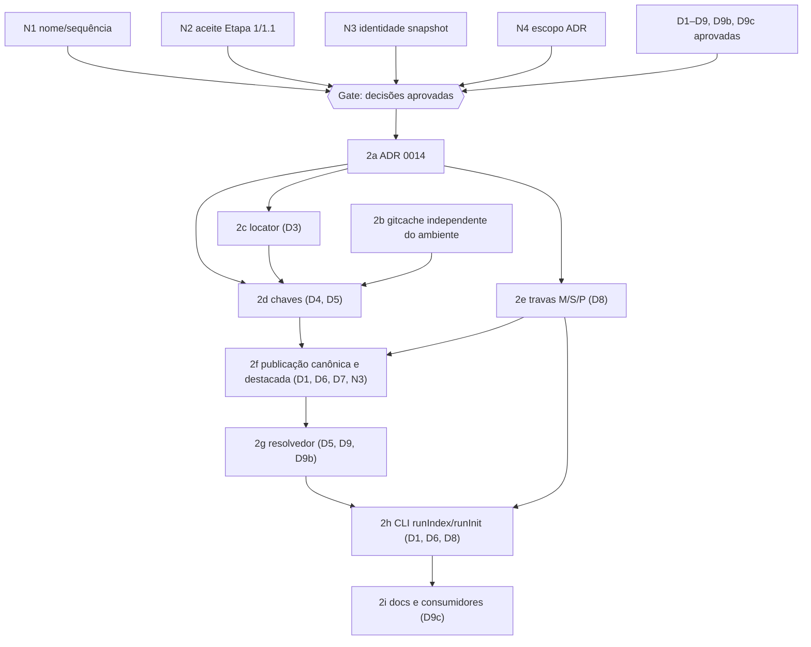

# Plano de Execução e Governança: Gira-G (publicação versionada)

| Campo | Valor |
|---|---|
| Versão | 1.2 |
| Verificação | 2026-10-17 (-03) |
| Código-base verificado | `61b58c281f5a7fae4092f0cbff2ecfd8794dea77` |
| Status | **[PROPOSTA]**. N1–N4 e D1–D9c têm direções decididas pelo dono; O6 aplicada. Spec continua `draft` e implementação não autorizada até resolver os gates de compatibilidade e plataforma. |
| Registro de decisões | [decisão arquitetural da publicação versionada](2026-10-17-decisao-arquitetural-publicacao-versionada.md) |
| Nota de rótulo | Nesses documentos, "Etapa 2" (e 2a–2i) denota a publicação versionada, agora posicionada como continuação do item 1 do plano aprovado (rótulo exemplo "Etapa 1.2"), conforme N1 (a). O item 2 aprovado (atualidade end-to-end e sync multi-repo) permanece reservado. A troca de rótulo nos documentos é um follow-up separado |
| Artefatos ligados | spec [`2026-10-17-gira-versioned-publication`](../../specs/2026-10-17-gira-versioned-publication.md) (`draft` v1), parent [`2026-10-17-gira-versioned-publication`](../../tasks/2026-10-17-gira-versioned-publication.md) (`todo`), propostas originais [v2](2026-10-17-gira-spec-v2-proposta-original.md) e [v1](2026-10-17-gira-spec-v1-proposta-original.md) |
| Requer revisão | §6 (decisões), §8 (critérios por etapa), §14 (lista final) |

Este documento é a parte Gira-G de um plano de governança que cobria dois projetos. A parte G-Ingá está no repositório G-Ingá. O estado da máquina local do dono (checkout, caches, worktrees auxiliares) fica fora deste repositório público.

**Legenda.**
- **[CÓDIGO]** arquivo:linha@SHA, lido.
- **[TESTE DEFINIDO]** teste que existe no código.
- **[TESTE EXECUTADO]** execução observada, com comando e resultado.
- **[CI]** run com URL, SHA e conclusão observados.
- **[RELATO]** afirmação de agente ou pessoa ainda não confirmada.
- **[INF]** inferência.
- **[DESC]** desconhecido.
- **[PROPOSTA]** recomendação não aprovada.
- **[APROVADA]** aprovada pelo dono, com referência.
- **[CONCLUÍDA]** critério de aceite verificado.
- **[REVOGADA]** superada.

---

## 1. Resumo executivo

- `main` (`61b58c2`) está com o CI verde nos três sistemas operacionais [CI].
- A Etapa 2.0 (PR #17) está **[CONCLUÍDA]**.
- As quatro pendências de endurecimento da Etapa 1.1 aparecem resolvidas no código [CÓDIGO]. A revisão adversarial de Etapa 1/1.1 não encontrou bloqueios materiais, e o aceite formal foi registrado na tarefa retroativa após PR #19.
- A spec v2 foi localizada e é idêntica à mensagem em que o agente a apresentou (§2.1). Ela continua sendo **[PROPOSTA]**.

Problemas que motivam a etapa, confirmados no código (§3.5):
- `init` grava `gira.yaml` antes do build;
- o store ignora `XDG_CACHE_HOME`;
- o locator do manifesto guarda o caminho como foi digitado;
- `ls-tree` é chamado sem `-z`;
- não existe trava entre processos.

Achados de governança:
- `aa4e6fe`, `4c2204c` e `0d5f248` entraram em `main` sem PR e sem registro de tarefa. O CI de `main` ficou vermelho no Windows entre esses pushes e a #17.
- "Etapa 2" diverge do item 2 do plano de evolução aprovado (N1).
- D1 pode contrariar a decisão aprovada sobre identidade de snapshots (N3).

**Próximo passo:** N1/N2 e as direções N3/N4/D1–D9c estão registradas. A publicação versionada permanece bloqueada até os gates no registro arquitetural serem evidenciados; nenhuma etapa de implementação foi autorizada.

---

## 2. Inventário de fontes e autoridade

### 2.1 Especificação v2: busca e proveniência

| Onde procurei | Resultado |
|---|---|
| Checkout Gira-G, todas as refs: `git log --all -- '*spec-v2*' '*gira-spec*'`; `git grep` por `nondeterministic_build` e `index_tool_mismatch` em todas as refs | não encontrada |
| G-Ingá, todas as refs locais (mesmo `git grep`) | não encontrada |
| `local://` desta sessão | não encontrada |
| `find / -xdev -name 'gira-spec-v2*'` | nenhum resultado. **Limitação:** `/home` está em outro subvolume, então `-xdev` não desceu até ele [INF] |
| Workspace de sessões de agente anteriores (busca por nome e por conteúdo) | **encontrada** no workspace da sessão de agente `01a14ba8` (`local/gira-spec-v2.md`, 16 861 B, sha256 `1856c991…2c04f54`). Cópia byte a byte: [2026-10-17-gira-spec-v2-proposta-original.md](2026-10-17-gira-spec-v2-proposta-original.md) |
| Conversas do ChatGPT | inacessíveis [DESC] |

**Proveniência.**
- No transcript da sessão `01a14ba8` (linha 110, `2026-10-17T21:21:07Z`), há uma mensagem do assistente cujo texto é **idêntico**, depois de `strip()`, ao arquivo.
- O arquivo foi gravado às `21:45Z` pela chamada `write("local://gira-spec-v2.md", texts[1][1])` (linha 197).
- Conclusão: é o texto original apresentado naquela sessão, não uma reconstrução. A v1 (`gira-spec-v1.md`, sha256 `093a72d2…`) foi recuperada da mesma forma.

As duas specs estão anexadas byte a byte neste diretório, com os hashes conferidos: [v1](2026-10-17-gira-spec-v1-proposta-original.md) e [v2](2026-10-17-gira-spec-v2-proposta-original.md).

**Autoridade.** A spec v2 é **[PROPOSTA]** de um agente. A própria v2 diz "Decisões pendentes D1–D9". A v2 remete à v1 para o algoritmo de fingerprint ("continuam como no turno anterior", v2 §7). Por isso a v1 continua valendo **só** nesse ponto.

**Proposta da v1 superada pela v2 [REVOGADA]:**

| Tema | v1 | v2 |
|---|---|---|
| D5 | servir com aviso | falhar fechado |
| D7 | retenção K=3 com remoção | sem coleta |
| D9 | leitura transitória do legado com aviso | legado nunca é lido automaticamente quando há `gira.yaml` |
| Etapas | 2i era retenção e 2j era docs | 2i passa a ser docs |
| D10 da v1 | `init` não deixa `gira.yaml` se falhar | absorvido por D1 e 2h |

**Requisitos que existem só no prompt atual**, não na v2:
- D9b e D9c;
- em D2, a restrição de não usar `os.UserCacheDir`;
- em D5, `main.date` nos ldflags;
- em D3, a menção à alternativa de caminho relativo à raiz Git.

O plano trata esses itens como **requisitos do responsável ainda não decididos**, e não como parte da v2.

### 2.2 Inventário

Hierarquia aplicada, conforme `GIRA-G_Guia_de_Sources.md` §"Hierarquia":
1. código, testes e commit atuais;
2. ADRs aprovados;
3. PDF Revamp (intenção);
4. `Decisoes_E_Estado`;
5. auditorias e relatórios.

As propostas (spec v1/v2 e este plano) ficam abaixo de todas essas fontes até serem aprovadas.

| Fonte | Local / identificação | Consultada? | Autoridade atribuída | Limitações |
|---|---|---|---|---|
| Código Gira-G | árvore de `7054031` (árvore idêntica a `61b58c2`: `git diff` vazio) | sim, via 2 scouts e leituras diretas | 1 | negativos baseados em grep (sem lock, sem `ReadBuildInfo`) [INF] |
| ADRs Gira-G 0001, 0007, 0009 | `docs/adr/` @61b58c2 | trechos | 2 | ADRs 0002–0006, 0008 e 0010–0013 não relidos |
| CI Gira-G | GitHub Actions via `gh` e REST | sim | evidência | logs completos lidos só dos runs com falha |
| `Gira-G_Revamp_Visao_Arquitetura_Fluxos.pdf` (22 pp., sha256 `bd76ecbd…`) | Sources do projeto (kit inicial) | sim, extração por scout com páginas | 3 (visão; R p.4 diz "não é especificação aprovada") | extração de texto do PDF; tabelas fragmentadas |
| `Gira-G_Analise_Maturidade_Referencias_Roadmap.pdf` (11 pp., sha256 `32928bfe…`) | idem | sim, por scout | complementar (Guia) | marcadores de página só em p.1, 2, 3, 6 e 11, então as demais páginas estão marcadas como "~"; M p.11 diz que o código não foi executado |
| `GIRA-G_Decisoes_E_Estado.md` | idem | sim, lida integralmente | 4; contém decisões aprovadas | **desatualizada**: diz que a Etapa 1.1 está pendente |
| `GIRA-G_Revisao_Pos_Etapa1_Commit_4c2204c.md` | idem | sim, integral | 5 | anterior a `0d5f248` |
| `GIRA-G_Auditoria_Etapa1_Plano_Correcao.md` | idem | sim, por scout | 5 (histórico) | Fase 1 itens 1–2 e matriz R5+ ilegíveis [DESC] |
| `GIRA-G_Guia_de_Sources.md`, `LEIA-ME.md` | idem | sim | meta | — |
| `GIRA-G_SYSTEM_PROMPT_CURTO.md` | idem | **não lido** | — | é instrução de outro ambiente (ChatGPT Project) e não define estado |
| Spec v1 e v2 | §2.1 | sim, integral | [PROPOSTA] | — |
| Prompt da missão (este pedido) | conversa | sim | requisitos do responsável; afirmações de estado = [RELATO] | — |
| Conversas ChatGPT anteriores | — | **não acessíveis** | — | [DESC] |
| Relatos de agentes anteriores | transcript `01a14ba8` | parcialmente | [RELATO] | — |

---

## 3. Quadro de estado: Gira-G

### 3.1 Repositório

| Item | Estado | Evidência |
|---|---|---|
| `origin/main` | `61b58c2` (merge da PR #17) | [CÓDIGO] `git ls-remote` |
| `main` local | `0d5f248`, **2 commits atrás**; `M cmd/gira/main_test.go` (+12/−18) **não compila** | [TESTE EXECUTADO] `mise exec -- go vet ./cmd/gira/` → `cmd/gira/main_test.go:528:33: undefined: tmpHome`, exit 1. Causa: as linhas `t.Setenv` foram parar dentro do literal `composeContent` (diff contra `7054031`) |
| PRs abertas | nenhuma | [CI] REST `pulls?state=open` |
| Issues abertas | #1 "Epic: Gira-G MVP Core & Context Harness" e #2 "RFC: Declare and fetch Target System repos", ambas de 13/out, sem atividade | [CI] |
| Branches remotos | `fix/test-home-isolation` (0 à frente) e `work/ssd-04-doc-mcp-budget` (0 à frente), ambos já em `main` | [CI] compare |
| Commits sem PR | `aa4e6fe` (M0–M6, 46 arquivos, +6157/−611), `4c2204c` (Etapa 1) e `0d5f248` (Etapa 1.1) não estão associados a nenhuma PR | [CI] `commits/<sha>/pulls` vazio |
| Registros de tarefa | nenhum em `tasks/` para Etapa 1, 1.1, 2.0 ou M0–M6. Os últimos registros são de 16/out (single-service-docs e outros; parents `accepted`) | [CÓDIGO] `git ls-tree origin/main tasks/` |

### 3.2 CI relevante

| Run | SHA | Resultado | Observação |
|---|---|---|---|
| [39071307722](https://github.com/EduardoShibukawa/gira-g/actions/runs/39071307722) (pull_request) | `7054031` | success: test ubuntu, macos e windows; validator; floor guard; gate-lint | [CI] |
| [39072167231](https://github.com/EduardoShibukawa/gira-g/actions/runs/39072167231) ci (push) | `61b58c2` | success, 6 jobs | [CI] **o próprio merge foi testado** |
| [39072167009](https://github.com/EduardoShibukawa/gira-g/actions/runs/39072167009) docs | `61b58c2` | success (build e deploy) | [CI] |
| [39067269222](https://github.com/EduardoShibukawa/gira-g/actions/runs/39067269222) | `0d5f248` | **failure**, test (windows-latest) | [CI] `main_test.go:641 … index_missing … C:\Users\RUNNER~1\…\gira.yaml` |
| [39065858560](https://github.com/EduardoShibukawa/gira-g/actions/runs/39065858560) | `4c2204c` | **failure**, test (windows-latest) | [CI] mesmo step |
| [38890630283](https://github.com/EduardoShibukawa/gira-g/actions/runs/38890630283) | `418bcb6` (16/out) | failure, test (ubuntu): `TestBaselineIsMeasuredOnCorpus` | [CI]. Runs posteriores ficaram verdes; a causa não foi investigada [DESC], e o risco atual é baixo [INF] |

**Execução local [TESTE EXECUTADO].**
- Comando: `env HOME=$T/home USERPROFILE=$T/home XDG_CACHE_HOME=$T/xdg go test -count=1 ./...` (go1.24.0 linux/amd64), no worktree @`7054031`, cuja árvore é igual à de `61b58c2`.
- Resultado: todos os pacotes `ok`, exit 0.
- `$T` não recebeu `.cache/gira` nem `xdg/gira`; só `.sigstore` e `xdg/syft`, criados por ferramentas.
- O hash da listagem de `~/.cache/gira` ficou igual antes e depois (`98399bad…`).
- Limite: rodei sem `-race`, que o CI usa, e só no Linux.

### 3.3 Etapas

| Etapa | Estado | Evidência |
|---|---|---|
| Etapa 1 (`4c2204c`) | implementada; revisão adversarial sem bloqueios materiais; aceite formal **registrado** | [CÓDIGO]; [registro](../../tasks/2026-10-17-etapa-1-1-1-retro-acceptance.md) |
| Etapa 1.1 (`0d5f248`) | as 4 pendências resolvidas; revisão adversarial sem bloqueios materiais; aceite formal **registrado** | [registro](../../tasks/2026-10-17-etapa-1-1-1-retro-acceptance.md) |
| Etapa 2.0 (PR #17, `7054031`, merge `61b58c2`) | **[CONCLUÍDA]** | CI nos 3 SO no branch e no merge [CI]; teste local sem escrita no cache [TESTE EXECUTADO]. Não fiz revisão linha a linha do diff para o critério "casos 1–3 afirmam o mesmo comportamento" [DESC] |
| Etapa 2a–2i | não iniciadas, não autorizadas | — |

Critérios (a)–(e) de `Decisoes_E_Estado` §"Condição para avançar", avaliados em `61b58c2`:

| Critério | Evidência |
|---|---|
| (a) `--force` não autoriza perda | `main.go:563-566` passa só `allowSymbolLoss` [CÓDIGO]; `init_test.go:132 TestInit_ForceDoesNotAllowSymbolLoss` [TESTE DEFINIDO] |
| (b) helpers seguros | `store.go:49-52` e `67-70`: `Save`/`SaveFile` usam `PublishOptions{}` [CÓDIGO] |
| (c) durabilidade | `store.go:162` rename, `167-173` `syncDirectory`, `181-194` no-op no Windows [CÓDIGO]; `store_test.go:218-221` [TESTE DEFINIDO] |
| (d) descoberta do manifesto | `main.go:278-297` sobe pelos ancestrais [CÓDIGO]; subdiretório coberto em `TestCLI_LoadIndexResolutionAndFailClosed` (`main_test.go:574`) [TESTE DEFINIDO] |
| (e) testes no SHA final | CI `-race` nos 3 SO em `61b58c2` [CI] |

### 3.4 Estado local

O relatório anterior sobre a máquina do dono (checkout local desatualizado com alteração não compilável, índice residual de teste, commit `bfd3162` fora de `origin/main`, worktrees auxiliares com trabalho não integrado) foi revalidado nesta sessão. Os detalhes ficam no workspace de Work do dono, porque são estado de máquina, não do projeto. Resumo: todos os itens foram confirmados, e nada foi alterado ou apagado.

### 3.5 Comportamento atual relevante para a Etapa 2

Todas as linhas abaixo são [CÓDIGO] @61b58c2, salvo indicação.

| Tema | Fato | Local |
|---|---|---|
| `index` com `--output` | `PublishFile(outputPath)`; gate contra o P anterior | `main.go:466-470`; `store.go:110` |
| `index` sem `--output` | `~/.cache/gira/indexes/<sys>/macro-map.json` via `UserHomeDir`; `.gira/indexes` só se o home falhar | `main.go:473-484` |
| Ordem do `init` | `writeLocalManifest` (552) **antes** de `indexManifest` (563): um build que falha deixa `gira.yaml` | `main.go:552,563` |
| Store e XDG | o store ignora `XDG_CACHE_HOME`; o `gitcache` respeita (`$XDG_CACHE_HOME/gira/repos`, senão `~/.cache/gira/repos`) | `main.go:474-476`; `gitcache/cache.go:31-45` |
| Resolvedor | `--index` explícito; com `gira.yaml`, candidatos `<root>/.gira/indexes/<sys>`, `./.gira/indexes/<sys>`, `~/.cache/…/<sys>`; sem `gira.yaml`: `.gira/macro-map.json`, `.gira/index.json`, `macro-map.json`, `index.json`, e depois descoberta | `main.go:300-396` |
| Erro de ambiguidade | `ambiguous index: multiple systems found …` **sem prefixo de código estável** | `main.go:393` |
| `nudge` | engole os erros do resolvedor | `main.go:1376-1384` |
| Locator do manifesto | caminho como digitado (posicional/`--manifest`); absoluto quando vem de descoberta ou do `init`; `Locator{Path: manifestPath}` com `Repo` vazio | `main.go:423-426,541`; `pipeline.go:337-338,360,422-426`; `domain/models.go:56-62` |
| Bytes do manifesto | `ParseFile` lê uma vez e não guarda os bytes; spans de linha via `yaml.Node` | `manifest.go:20-34,50,96,133,147-148` |
| Identidade do binário | `version="0.1.0-dev"`, `commit="none"`, `date="unknown"`; goreleaser injeta `main.version`, `main.commit` e `main.date`; não há `ReadBuildInfo`; `DefaultExtractorVersion="1.0.0"` é constante | `main.go:128-130`; `.goreleaser.yaml:37-38`; `incremental.go:34-35` |
| `gitcache` | `ls-tree -r --full-name` **sem `-z`**; `git show SHA:path`; sem isolamento de env; clone e fetch com a config do usuário | `cache.go:99,125,149,166-171,206` |
| ADR 0009 | delega ao `git` do host (credenciais) | `0009-…md:35-37` |
| ADR 0007 | "Index Determinism: 100% identical index output across multiple runs from the same commit" | `0007-…md:55` |
| Determinismo testado | `TestBuildIsDeterministicAcrossColdRuns` (uma fixture); `eval.Suite.Run` com 2 indexações frias | `indexer_test.go:49-50`; `eval.go:417-436` [TESTE DEFINIDO] |
| Travas | nenhuma (`flock`/`LockFileEx` ausentes); `golang.org/x/sys v0.30.0 // indirect` | `go.mod:22` |
| `.gira/` no próprio repo | ignorado; o `init` avisa sobre worktree sujo | `.gitignore:14-15`; `main.go:537-538` |
| `skills install --index` | caminho gravado verbatim, sem `Abs`, sem verificar existência, sem aviso; o hook concatena sem aspas | `skills/install.go:157-158,176-179` |
| Remoção de índices | inexistente | `store.go` |
| Gate de perda | `PublishFile` compara com o destino; `BuildIncremental` compara com `prev`, sem caller de produção conhecido [DESC] | `store.go:110`; `incremental.go:692` |
| CI | matriz ubuntu/macos/windows com `go test -v -race ./...`; validator; floor guard; gate-lint (warn-only); sem isolamento de XDG | `.github/workflows/ci.yml` |
| Tamanho dos índices | `gira-g` 4 885 403 B; `g-inga` 759 688 B | [CÓDIGO] `find -printf` em `~/.cache/gira/indexes` |

**Documentação que diverge do código hoje:**
- `README.md:42-44` e `website/docs/guides/quickstart.md:43-44` descrevem uma ordem de resolução diferente da real e não mencionam a exclusividade quando há `gira.yaml`;
- `website/docs/cli/init.md:26,34` generalizam o fallback `.gira/indexes`;
- nenhum documento diz que o store ignora `XDG_CACHE_HOME`;
- o README apresenta o `init` sem dizer que ele deixa `gira.yaml` se falhar.

A spec v1 (S1) também registrou o README:43 em contradição com o código. A lista completa de chamadores e documentos de `--output` está no Apêndice A.3.

---

## 4. G-Ingá

Fora do escopo deste repositório. A síntese de aceite das tarefas OMP-compat 01–09, o timeout do validador, a PR #47 e a higiene de branches estão no repositório G-Ingá, num registro de tarefa próprio.

---

## 5. Divergências entre fontes

| # | Divergência | Trechos | Consequência | Decisão |
|---|---|---|---|---|
| V1 | O que é "Etapa 2" | `Decisoes_E_Estado` §"Plano de evolução aprovado": 1 = integridade/resolução/publicação, **2 = atualidade end-to-end e sync multi-repo**. Spec v2 e prompt: "Etapa 2" = publicação versionada | Aprovar a "Etapa 2" sem desfazer a ambiguidade pode dar a impressão de que o item 2 aprovado foi cumprido | N1 |
| V2 | Snapshot com identidade | `Decisoes_E_Estado` §4 [APROVADA nas Sources]: "Snapshots explícitos devem ser determinísticos e identificar hash do manifesto, versão do schema, versão dos extratores e SHAs das fontes". Spec v2 D1: `index --output P` grava **só** P, sem meta | Como proposto, D1 pode violar uma decisão já aprovada | N3 |
| V3 | Estado da Etapa 1.1 | Sources: "pendente". Código: resolvido em `0d5f248` | As Sources ficam desatualizadas e o gate "Etapa 2 só após revisar 1.1" não fica registrado | N2 e O7 |
| V4 | Versionamento e Git | Revamp p.5, princípio 8: "Git faz o versionamento"; p.16: "Gira-G não implementa um protocolo concorrente" | O store versionado é cache derivado, não conhecimento compartilhável [INF]. Mesmo assim, o ADR 0014 precisa delimitar isso explicitamente | N4 |
| V5 | Nome canônico do índice | Revamp p.16 e p.20 (em aberto, `.gira/index.json`); Maturidade p.3 (pede nome canônico); código usa `macro-map.json` e aceita `.gira/index.json` na resolução sem manifesto | Fica fora do escopo da Etapa 2 | registrar no ADR 0014 como não decidido |
| V6 | Roadmap M0–M6 | Commit `aa4e6fe` "implement M0-M6 roadmap" [RELATO na mensagem]; o PDF de maturidade dá todas as fases como pendentes (análise anterior); não há registro de tarefa | Não há evidência de critério de saída verificado para M0–M6 | O6 (governança) |
| V7 | D3: basename ou relativo à pasta do manifesto | Prompt §4.4 | **Resolvida por análise de código:** para o único locator que guarda o caminho do manifesto (overrides, `Repo` vazio), `Rel(Dir(m), m) == Base(m)`. As duas regras geram o mesmo valor [INF a partir de `pipeline.go:360,422-426`]. A alternativa real é "relativo à raiz Git" | D3 |
| V8 | Spec v1 contra v2 | §2.1 | Itens da v1 em D5, D7 e D9 estão [REVOGADA] | nenhuma |
| V9 | Interpretação de D2 "não usar `os.UserCacheDir`" | Prompt §4.3 | Coerente com o `gitcache`, que usa XDG senão `~/.cache` em todos os SO [CÓDIGO] | D2 |
| V10 | Auditoria D.1/D.2 | Auditoria l.135-142 (abertas) | Resolvidas em `4c2204c` segundo a Revisão e o código atual (`store.go`, `main.go:300-396`) | nenhuma |

---

## 6. Registro de decisões

Formato de cada entrada: **Contexto** · **Alternativas** · **Recomendação [PROPOSTA]** · **Custo** · **Risco** · **Pergunta**. Nenhuma está aprovada.

### 6.1 Novas decisões de enquadramento (bloqueiam a 2a)

**N1. Nome e sequência da "Etapa 2"**
- **Contexto:** V1.
- **Alternativas:**
  - (a) publicação versionada como **continuação do item 1** do plano aprovado (publicação segura), com outro rótulo, por exemplo "Etapa 1.2 / Publicação versionada";
  - (b) mantê-la como "Etapa 2" e renumerar o plano aprovado;
  - (c) fazer primeiro o item 2 aprovado (atualidade e sync).
- **Recomendação:** (a). A publicação versionada resolve o S2 da spec v1 (mapa desatualizado servido como atual), que pertence a "resolução de índice e publicação segura", e é pré-requisito de atualidade confiável [INF].
- **Custo:** renomear nos documentos.
- **Risco:** com (b), dois planos usariam o mesmo número.
- **Pergunta:** "A publicação versionada entra como continuação do item 1 (rótulo novo) ou substitui o item 2 do plano aprovado?"
- **decidido:** (a) por dono, 2026-10-17 (mensagem de decisão da sessão). A publicação versionada é planejada como continuação do item 1, com rótulo próprio (exemplo: "Etapa 1.2"; rótulo dado como exemplo). O item 2 aprovado segue reservado a atualidade end-to-end e sync multi-repo. Não renomear "Etapa 2"/"2a–2i" em massa nesta mudança: o relabel é follow-up separado (ver nota no cabeçalho).

**N2. Aceite formal da Etapa 1 e 1.1 em `61b58c2`**
- **Contexto:** §3.3. Não há registro de tarefa nem PR para `4c2204c`/`0d5f248`, e o CI ficou vermelho no Windows até #17.
- **Alternativas:**
  - (a) aceitar com base no §3.3, registrando o aceite nas Sources e opcionalmente num registro de tarefa retroativo;
  - (b) pedir antes uma revisão adversarial do diff `aa4e6fe..0d5f248`;
  - (c) não aceitar.
- **Recomendação:** (b) restrita ao intervalo git `aa4e6fe..0d5f248`, que cobre os commits `4c2204c` (Etapa 1, +1142/−233) e `0d5f248` (Etapa 1.1, +212/−33), cerca de 1,6 mil linhas alteradas, e **exclui** `aa4e6fe` (M0–M6), seguida de (a).
- **Custo:** uma sessão de revisão.
- **Risco:** basear a Etapa 2 em código que nunca passou por PR.
- **Pergunta:** "Aceita a Etapa 1/1.1 agora com a evidência do §3.3, ou exige revisão adversarial do diff antes?"
- **decidido:** (b) por dono, 2026-10-17 (mensagem de decisão da sessão): revisão adversarial somente leitura de `4c2204c` e `0d5f248` (`aa4e6fe..0d5f248`), depois aceite (a) se não houver bloqueios materiais. `aa4e6fe` (M0–M6) **não** entra nesta revisão e vira frente separada (V6; `tasks/2026-10-17-m0-m6-retro-review.md`).
- **resultado da revisão (2026-10-17):** veredito **sem bloqueios materiais**; critérios (a)–(e) valem em `61b58c2`. Nove achados não bloqueantes estão como follow-ups no [registro retroativo](../../tasks/2026-10-17-etapa-1-1-1-retro-acceptance.md) (`accepted`, `verified_at: 61b58c2`). O aceite formal está registrado; esses achados não foram silenciosamente corrigidos nesta frente.

**N3. Identidade do snapshot destacado**
- **Contexto:** V2.
- **Alternativas:**
  - (a) o snapshot P leva um `meta` embutido ou um sidecar `P.meta.json` com `source_key`, `tool_id`, `version_id`, `schema_version` e SHAs;
  - (b) não leva, e a decisão aprovada §4 é revista;
  - (c) o snapshot leva só o que o mapa já contém (SHAs por repo) e a decisão §4 passa a valer apenas para snapshots canônicos.
- **Recomendação:** (a), na forma de sidecar, para não mudar o schema do mapa.
- **Custo:** um arquivo a mais por snapshot; consumidores como `gira-arch-diff` o ignoram.
- **Risco:** com (b) ou (c), um snapshot fica sem proveniência verificável.
- **Pergunta:** "O snapshot destacado precisa carregar a identidade exigida pela decisão aprovada §4? Se sim, sidecar ou embutido?"

**N4. Escopo do ADR 0014 em relação ao princípio "Git faz o versionamento"**
- **Contexto:** V4.
- **Recomendação:** o ADR 0014 declara que o store versionado é **cache derivado local, regenerável e não compartilhado**, e que o conhecimento compartilhável continua versionado pelo Git (`gira.yaml` e snapshots exportados).
- **Pergunta:** "Confirma essa delimitação para o ADR 0014?"

### 6.2 Decisões da spec v2 (D1–D9) e do prompt (D9b, D9c)

**Atualização de precedência (2026-10-17):** as alternativas e recomendações abaixo preservam o histórico da deliberação. As direções do dono e os bloqueios antes da aprovação final estão no [registro arquitetural](2026-10-17-decisao-arquitetural-publicacao-versionada.md), que prevalece em caso de divergência. Nenhum item desta seção autoriza implementação.

**D1. Semântica de `--output`**
- **Contexto:** hoje `--output` substitui o store (§3.5). Consumidores: `gira-arch-diff`, `bench/phases.json:20`, `benchtest.go:76`, `tools/index-bundle/bootstrap.sh:42,49`, cerca de 15 páginas de documentação e cerca de 15 testes (Apêndice A.3).
- **Alternativas** (spec v1 §1): A manter; A′ destacada (recomendada); B cópia mais store; C diretório-raiz; D remover.
- **Recomendação:** A′ como na v2 §1:
  - `index --output` gera snapshot destacado, sem tocar store nem manifesto;
  - `init` sempre canônico e, com `--output`, grava também uma cópia byte a byte;
  - ordem do `init`: versão, snapshot, manifesto;
  - **mais N3**.
- **Custo:** os testes de `init` passam a gravar no store e precisam de isolamento de XDG; muda a semântica documentada.
- **Risco:** um usuário roda `index --output` esperando atualizar o índice ativo. Mitigação: aviso explícito na saída.
- **Pergunta:** "Aprova A′ (v2 §1), incluindo a regra de sobrescrita de P no `init` (P ausente ou macro-map válido; caso contrário, `--recover-corrupt`) e a ausência de um segundo gate para P?"

**D2. Localização do store**
- **Contexto:** o store usa `~/.cache` e ignora XDG; o `gitcache` usa XDG (§3.5).
- **Alternativas:**
  - (a) `$XDG_CACHE_HOME/gira/indexes`, senão `~/.cache/gira/indexes`, senão `<raiz do projeto>/.gira/indexes`, numa função única compartilhada por leitura e escrita;
  - (b) `os.UserCacheDir`;
  - (c) manter.
- **Recomendação:** (a). Mesma regra do `gitcache`, sem `UserCacheDir`, que mudaria para `~/Library/Caches` no macOS e `%LocalAppData%` no Windows.
- **Custo:** com XDG definido, os índices atuais ficam no caminho legado. **Consequência:** a busca da base do gate na primeira publicação precisa olhar o caminho legado `~/.cache/gira/indexes/<sys>` **mesmo com XDG definido**, além de `<root>/.gira/indexes/<sys>` e `./.gira/indexes/<sys>`.
- **Risco:** o terceiro nível (`.gira/indexes` no projeto) cria artefatos dentro do repositório do usuário quando não há home.
- **Pergunta:** "Aprova (a), incluindo a busca da base de gate no caminho legado `~/.cache` mesmo com XDG?"

**D3. Locator do manifesto**
- **Contexto:** hoje o locator guarda o caminho como digitado (§3.5); a sonda S3 da v1 mostrou mapas diferentes para caminho relativo e absoluto. "Basename" e "relativo à pasta do manifesto" **produzem o mesmo valor** (V7). Nenhum golden JSON contém locator de manifesto; os testes `pipeline_test.go:326-453` já esperam `gira.yaml` puro [TESTE DEFINIDO].
- **Representação exata proposta:** `Locator{Repo: "", Path: filepath.ToSlash(filepath.Base(manifestPath))}`, com o `StartLine`/`EndLine` atuais.
- **Alternativas:**
  - (a) basename;
  - (b) relativo à raiz Git do manifesto (por exemplo `services/x/gira.yaml`);
  - (c) manter.
- **Comparação:**

| Critério | (a) basename | (b) raiz Git |
|---|---|---|
| Manifesto em subpasta | `gira.yaml`, ambíguo para o leitor humano | `services/x/gira.yaml`, localizável |
| Manifesto fora de um repositório | funciona | não há raiz; precisa de fallback, o que cria duas regras |
| Mover o manifesto dentro do repositório | não muda os bytes | muda os bytes |
| Custo de execução | nenhum | um `git rev-parse` por invocação |

- **Recomendação:** (a). Documentar que o locator é relativo à pasta do manifesto. Um consumidor só encontra o arquivo se souber onde está o manifesto.
- **Custo:** a evidência fica "`gira.yaml:10-12`" sem diretório. Hoje `Repo` já está vazio.
- **Risco:** ferramentas de proveniência (scorecard `ProvenanceResolvablePct`) podem não resolver esse locator [DESC: não verifiquei se o scorecard trata locators sem repo].
- **Pergunta:** "Aprova `Path = basename (slash)` para os locators de override, com a documentação 'relativo à pasta do manifesto', em vez de caminho relativo à raiz Git?"

**D4. `source_key` sobre os bytes crus do manifesto**
- **Contexto:** os spans de linha entram nos locators (`manifest.go:20-34`).
- **Alternativas:**
  - (a) bytes crus;
  - (b) forma canônica (YAML normalizado), que perde a correspondência com os números de linha;
  - (c) bytes com normalização de EOL (CRLF → LF) e sem BOM.
- **Recomendação:** (a), como na v2.
- **Custo:** comentários, espaços, BOM ou CRLF mudam a chave. Um checkout Windows com `core.autocrlf=true` gera outra `source_key` para o mesmo commit [INF]. O mapa pode até ser igual, mas a versão fica separada; só há custo de reindexação, sem erro de correção. Com (c), CRLF e LF produziriam a mesma chave, mas o parser também precisaria ver os bytes normalizados, senão a chave deixa de representar o que foi parseado.
- **Risco:** baixo.
- **Pergunta:** "Aprova (a), aceitando que comentário, BOM ou EOL exigem reindexar?"

**D5. Divergência de ferramenta falha fechado**
- **Contexto:** v2 §2. Hoje não há `ReadBuildInfo`; `main.date` entra nos ldflags (`.goreleaser.yaml:37-38`).
- **Recomendação:** como na v2: `index_tool_mismatch`, sem flag de exceção; `--index` continua como saída explícita.
- **Custo a medir na 2d/2h:**
  - número de reindexações por dia no dogfood;
  - tamanho por versão (4 885 403 B para o mapa do `gira-g` hoje);
  - tempo de indexação [DESC];
  - custo de hash do executável [RELATO v1: cerca de 7 MB].
- **Pontos em aberto:**
  - O `-ldflags` aparece em `BuildInfo.Settings`, então `main.date` muda o `tool_id` entre dois builds de release da mesma tag feitos em momentos diferentes. **Sub-pergunta:** excluir `main.date` do `tool_id`? [PROPOSTA: excluir, porque a data não muda o comportamento do binário].
  - Builds de desenvolvimento (`vcs.modified=true`) mudam a cada rebuild.
- **Risco:** atrito no dogfood.
- **Pergunta:** "Aprova o fail-closed sem flag? `main.date` entra no `tool_id`?"

**D6. Durabilidade e manifesto**
- **Contexto:** hoje sync de arquivo e de diretório no Unix; no-op no Windows (§3.5).
- **Recomendação:** tabela da v2 §3, sem `--require-durable`.
- **Semântica a documentar e testar:** no `gira index`, um exit ≠ 0 por sync não confirmado **não** quer dizer que nada foi publicado. A versão pode estar visível e é lida com validação de hash.
- **Custo:** usuários de Windows recebem sempre um aviso.
- **Risco:** nenhuma garantia contra queda de energia, sobretudo no Windows.
- **Pergunta:** "Aprova a tabela da v2 §3, incluindo exit 0 com aviso no Windows e a ausência de `--require-durable`?"

**D7. Sem coleta automática**
- **Recomendação:** como na v2 §5. `--recover-corrupt` só coloca em quarentena. Documentar a limpeza manual: apagar `versions/<id>` só quando nenhum `head` e nenhum `gira.yaml` conhecido apontar para a versão, sempre com o Gira-G parado.
- **Custo:** o disco cresce. No dogfood, cerca de 4,9 MB por rebuild seguido de reindexação; esse número é o tamanho atual observado, e o crescimento é [INF].
- **Pergunta:** "Aprova o adiamento do GC, com o procedimento manual documentado?"

**D8. Travas M → S → P**
- **Recomendação:** como na v2 §4:
  - arquivos de trava conforme a tabela da v2;
  - `flock` / `LockFileEx` via `x/sys` (passa de dependência indireta a direta);
  - timeout de 60 s com `index_locked`;
  - `lock_unavailable` falhando fechado;
  - sem `--no-lock`.
- **Custo:** `.gira/locks/` aparece no projeto do usuário. O repositório do Gira-G já ignora `.gira/`; outros projetos podem não ignorar, e aí o `init` avisa sobre worktree sujo.
- **Risco:** NFS, FUSE e SMB; editores externos; hardlinks; a janela entre a comparação de hash e o rename (§9).
- **Pergunta:** "Aprova D8 como na v2 §4, incluindo a falha fechada em sistemas de arquivos sem suporte?"

**D9. Índice legado**
- **Recomendação:** como na v2 §6:
  - com `gira.yaml`, o legado nunca é lido;
  - sem `gira.yaml`, os arquivos locais explícitos continuam valendo (`main.go:337-356`) e a descoberta só considera heads versionados;
  - o legado serve como base do gate na primeira publicação, com mensagem dizendo qual base foi usada.
- **Pergunta:** "Aprova D9?"

**D9b. Descoberta sem manifesto exige o `tool_id` atual**
- **Recomendação:** sim. Uma versão de outra ferramenta resulta em `index_tool_mismatch`; múltiplas linhagens preservam o erro de ambiguidade.
- **Ponto em aberto:** o erro atual de ambiguidade não tem código estável (`main.go:393`). Preservar o texto ou introduzir `index_ambiguous`? [PROPOSTA: introduzir o código e manter o texto como mensagem]. Isso muda o contrato de erro e precisa de aprovação.
- **Pergunta:** "Aprova D9b? Introduz `index_ambiguous`?"

**D9c. `skills install --index` com caminho legado congelado**
- **Contexto:** o caminho é gravado verbatim, relativo ou absoluto, sem verificação (§3.5). Não há teste de `Install` com `Index` [DESC].
- **Alternativas:**
  - (a) manter, documentar e avisar quando o caminho cair na estrutura legada (`*/gira/indexes/<sys>/macro-map.json`);
  - (b) também tornar o caminho absoluto (`filepath.Abs`) antes de gravar;
  - (c) rejeitar caminho legado.
- **Recomendação:** (a)+(b). Um caminho relativo numa configuração MCP depende do cwd do host [INF].
- **Testes:** `Install` com caminho legado avisa; com caminho relativo grava absoluto; com caminho de snapshot não avisa.
- **Pergunta:** "Aprova o aviso? Converte para absoluto?"

### 6.3 Decisões do G-Ingá

No repositório G-Ingá.

## 7. Grafo de dependências

- **Caminho crítico:** decisões → 2a → 2c → 2d → 2f → 2g → 2h → 2i.
- **Em paralelo:**
  - 2b, que não depende de D1–D9, só do ADR 0009, e pode ser autorizada **antes** da 2a;
  - 2e, em paralelo com 2c e 2d, depois da 2a;
  - a higiene da máquina local do dono, que fica fora deste repositório público.
- **Arquivos compartilhados:** 2c, 2g e 2h mexem em `cmd/gira/main.go`; 2d, 2e e 2f mexem em `internal/store/`. Em cada área, um único dono de integração.

---

## 8. Plano por etapa

**Regras comuns a todas as etapas:**
- Cada etapa exige autorização própria. Uma etapa concluída **não** autoriza a seguinte.
- Fluxo: branch e PR, CI nos 3 SO, depois você faz o merge. Commits e push via `mise exec -- git …`. Nada de `--no-verify`, e nada de pipe de validador no mesmo comando do commit.
- Tier esperado pelo `/work`: **heavy** na 2a (H3/H4, contrato e ADR); **standard** nas demais, com escalonamento se E1–E5 ocorrerem.
- Registro em `tasks/` e `specs/` conforme `.claude/skills/work/references/artifact-contracts.md`.
- Testes que tocam store ou índice isolam `HOME`, `USERPROFILE` **e `XDG_CACHE_HOME`** com `t.Setenv`.
- **Relatório obrigatório por etapa:**
  - invariantes;
  - arquivos afetados;
  - comandos e saídas literais;
  - CI por SO (link, SHA, conclusão);
  - limitações;
  - itens [DESC];
  - verificação de que o cache real não foi tocado (hash da listagem de `~/.cache/gira` antes e depois).
- **Gate comum:** `node tools/validate/validate.js` pass; `mise run check` (`go test -race ./...`) pass localmente; CI verde em `test (ubuntu|macos|windows)`, validator e floor guard; `golangci-lint run --new-from-rev=origin/main` sem achados novos.

### 2a. ADR 0014

| Campo | Conteúdo |
|---|---|
| Objetivo | Consolidar a spec v2, as decisões aprovadas (D1–D9c, N1–N4), a garantia condicional (P1–P4) e os riscos residuais |
| Escopo | `docs/adr/0014-*.md`; `specs/` e `tasks/` do parent heavy; atualização de `docs/decisions.md` se for o índice de ADRs |
| Pré-condições | D1–D9c e N1–N4 respondidas; **N2 aceita** |
| Tarefas | 1. Redigir o ADR com status `proposed`; 2. Tabela de contraexemplos (v1 §3) e lista de entradas determinantes; 3. Mapear as decisões rejeitadas como alternativas; 4. Revisão adversarial (Opus, conforme CLAUDE.md); 5. Você muda para `accepted` |
| Aceite | Todas as decisões citadas como [APROVADA] com data e referência; nenhuma proposta descrita como aprovada; validador pass; a revisão não deixa nenhum achado bloqueante aberto |
| Comandos | `mise exec -- node tools/validate/validate.js` |
| Gate | Você aprova o ADR |

### 2b. Leituras do Git independentes do ambiente

| Campo | Conteúdo |
|---|---|
| Objetivo | Bytes do índice independentes da gitconfig do usuário nas leituras; clone e fetch continuam com a config do usuário (ADR 0009:35-37) |
| Escopo | `internal/gitcache/cache.go` e testes |
| Pré-condições | Autorização própria. **Não depende** do ADR 0014 |
| Tarefas | 1. `ls-tree -r -z --full-name` com parsing de NUL (`cache.go:149,166-171`); 2. Leitura por `cat-file blob <oid>` ou equivalente; 3. Env só para leituras: `GIT_CONFIG_NOSYSTEM=1`, `GIT_CONFIG_GLOBAL=<os.DevNull>`, `GIT_NO_REPLACE_OBJECTS=1`; 4. Testes |
| Aceite | (i) Arquivo `proto/café.proto` e nome com tab indexam com `core.quotePath` padrão (era S5 da v1: falhava); (ii) `quotePath` true ou false → `sha256` do mapa idêntico; (iii) `refs/replace` no cache não muda os bytes; (iv) teste que confirma que clone e fetch ainda leem a config do usuário (por exemplo, `url.<x>.insteadOf` numa `GIT_CONFIG_GLOBAL` temporária); (v) passa nos 3 SO |
| Comandos | `mise exec -- go test -count=1 -race ./internal/gitcache/... ./internal/indexer/...`; `mise run check` |
| Riscos | `os.DevNull` no Windows (`NUL`) com o `git` do runner [DESC] |

### 2c. Locator normalizado

| Campo | Conteúdo |
|---|---|
| Objetivo | Invocação relativa ou absoluta do mesmo manifesto gera bytes idênticos |
| Escopo | `cmd/gira/main.go` (`indexManifest`) ou `internal/extractors/pipeline.go` (`ApplyOverrides`), conforme o ADR; docstring de `indexer.Options` |
| Pré-condições | 2a aceita; D3 aprovada |
| Tarefas | 1. Normalizar conforme D3; 2. Regressão S3: `gira index gira.yaml` vs `gira index /abs/gira.yaml` vs execução em subdiretório (descoberta) vs `init` (caminho absoluto); 3. Atualizar `pipeline_test.go` se a forma mudar |
| Aceite | Os quatro modos produzem o mesmo `sha256`; o locator é exatamente o aprovado em D3; nenhum golden muda sem justificativa (hoje não há golden com locator de manifesto) |
| Comandos | `mise exec -- go test -count=1 -race ./cmd/gira/ -run 'Index|Init|Locator'`; `./internal/extractors/...` |

### 2d. Chaves (`source_key`, `tool_id`, `version_id`, `lineage_key`)

| Campo | Conteúdo |
|---|---|
| Objetivo | Identidade determinística com codificação injetiva (`u64be(len) ‖ bytes` por campo, com tag de domínio), conforme a v1 §3 |
| Escopo | `internal/store/key.go` (novo) e testes; leitura única dos bytes do manifesto no `cmd/gira` |
| Pré-condições | 2a; 2c (o locator entra na chave); 2b recomendada antes (P1) |
| Tarefas | 1. Ler o manifesto uma vez e guardar os bytes para parse e chave; 2. `tool_id` a partir de `debug.ReadBuildInfo` e dos ldflags, conforme D5 (inclusive a sub-decisão sobre `main.date`), com hash do executável se `vcs.modified=true`, sem `vcs.revision` ou com `commit=="none"`; 3. Testes de contraexemplo; 4. Fuzz de injetividade |
| Aceite | Cada linha da tabela de contraexemplos da v1 §3 muda a chave; `("ab","c") ≠ ("a","bc")`; build modificado inclui o hash do executável; mesmas entradas → mesma chave em 3 SO; medição registrada do custo do hash do executável |
| Comandos | `mise exec -- go test -count=1 -race ./internal/store/...`; `go test -fuzz=FuzzKeyEncoding -fuzztime=60s ./internal/store/` (local) |
| Adversarial (com 2b) | Mesmo mapa ao variar cwd, caminho relativo/absoluto do manifesto, `HOME`/`USERPROFILE`/`XDG_CACHE_HOME`, `TZ`, `LANG`, `core.quotePath`, `refs/replace`, nomes não-ASCII e tab, 3 execuções frias e 2 ambientes isolados |

### 2e. Travas M, S e P

| Campo | Conteúdo |
|---|---|
| Objetivo | Um único escritor por manifesto, store e snapshot; falha fechada |
| Escopo | `internal/store/lock_unix.go`, `lock_windows.go` (build tags), `go.mod` (`x/sys` direto) |
| Pré-condições | 2a; D8 |
| Tarefas | 1. Primitiva com polling e timeout de 60 s; 2. Derivação dos caminhos M, S e P (v2 §4); 3. Hook de teste para registrar a ordem de aquisição; 4. Injeção de erro de trava |
| Aceite | (i) Dois processos se excluem nos 3 SO; (ii) grafias relativa, absoluta e via symlink do mesmo manifesto se excluem (no Windows, symlink depende de privilégio: registrar como skip justificado ou usar junction [DESC]); (iii) timeout → `index_locked`; (iv) processo filho morto (`kill -9` / `TerminateProcess`) libera a trava; (v) erro injetado → `lock_unavailable` sem nada gravado; (vi) o hook prova M→S→P e liberação em ordem inversa |
| Comandos | `mise exec -- go test -count=1 -race ./internal/store/ -run Lock` |
| Limitações a documentar | NFS, FUSE, SMB e exclusão entre máquinas; editores externos; hardlinks; `.gira/locks/` sem estar no `.gitignore` |

### 2f. Publicação canônica e destacada

| Campo | Conteúdo |
|---|---|
| Objetivo | `PublishVersion` (versões imutáveis, heads, `meta.json` estrito) e `PublishDetached` (P, mais o sidecar se N3 = a); `PublishFile` removido |
| Escopo | `internal/store/store.go` e testes |
| Pré-condições | 2d, 2e; D1, D6, D7, N3 |
| Aceite | Falha **antes** do rename → nada visível. Falha **depois** do rename da versão → versão válida e visível, head intacto, nova execução idempotente que avança o head. Gate rejeita → nada gravado. Head corrompido ou apontando para versão ausente → falha fechada. Mesmo id com bytes diferentes → `nondeterministic_build`, sem sobrescrita. Sync falho no Unix → `visible_unconfirmed` com erro. CI Windows afirma `unconfirmed` com exit 0. Validação do `meta` conforme v1 §3 → `index_corrupt` |
| Comandos | `mise exec -- go test -count=1 -race ./internal/store/...` |

### 2g. Resolvedor

| Campo | Conteúdo |
|---|---|
| Objetivo | Resolver por manifesto, `source_key` e `tool_id`; nunca apresentar mapa desatualizado como atual |
| Escopo | `cmd/gira/main.go` (`loadIndex`, 300-396); `Store.List` |
| Pré-condições | 2f; D5, D9, D9b |
| Aceite | S1 e S2 da v1 → `index_missing`, não `[]`; versão de outra ferramenta → `index_tool_mismatch`, sem carregar nada e com caminho e `tool_id` na mensagem; legado com `gira.yaml` não é carregado; descoberta ignora o legado e exige o `tool_id` atual (D9b); ambiguidade preservada (com código, se aprovado); `--index` inalterado; `nudge` continua engolindo erros, registrado como residual, salvo decisão contrária |
| Comandos | `mise exec -- go test -count=1 -race ./cmd/gira/ -run 'LoadIndex|Resolution'` |

### 2h. CLI

| Campo | Conteúdo |
|---|---|
| Objetivo | Integrar em `runIndex` e `runInit` |
| Escopo | `cmd/gira/main.go` (`runIndex` 402-443, `runInit` 495-567, `indexManifest` 448-485); `init_test.go`; `main_test.go`; `e2e_test.go` |
| Pré-condições | 2e, 2f, 2g; D1, D6, D8 |
| Aceite | (i) Primeira inicialização com build falhando → `gira.yaml` **não** criado (hoje é criado, `main.go:552`); (ii) `init --force` rejeitado pelo gate → `gira.yaml`, head e P byte a byte inalterados; (iii) `init --output P` → versão canônica e P com o mesmo `sha256`, e o resolvedor encontra a versão sem `--index`; (iv) `index --output P` → listagem do store idêntica antes e depois; (v) sync não confirmado no Unix → manifesto não gravado, exit ≠ 0, e nova execução grava; (vi) manifesto alterado por fora entre a leitura e o rename → conflito; (vii) sobras `.tmp` e órfãs → tratadas conforme o contrato do ADR |
| Comandos | `mise exec -- go test -count=1 -race ./cmd/gira/...`; `mise run check` |

### 2i. Documentação e consumidores

| Campo | Conteúdo |
|---|---|
| Objetivo | Documentação igual ao código |
| Escopo | `README.md`; `website/docs/{intro,cli/index,cli/init,cli/map,guides/quickstart,guides/change-maker-workflow}.md`; `website/versioned_docs/version-0.1.0/` (decidir se documentos versionados são editados [DESC]); `doc.md:26` e `serve.md:25`; `.claude/skills/catalog/gira-arch-diff/SKILL.md:14`; `bench/phases.json`; `tools/index-bundle/bootstrap.sh`; `internal/benchtest/benchtest.go` (`t.Setenv` de XDG); `internal/skills/install.go` (D9c) |
| Pré-condições | 2h; D9c |
| Aceite | Cada afirmação sobre resolução, store, `--output`, durabilidade e travas aponta para um teste. Avisos de "snapshot destacado" e "índice legado fixo" presentes. `node tools/validate/validate.js` e o workflow `docs` (build) pass. Divergências do §3.5 resolvidas |
| Comandos | `mise exec -- node tools/validate/validate.js`; `mise run docs:build` |

### Operações de higiene

Todas estas operações exigem autorização explícita. Não são decisões técnicas.

| ID | Operação | Procedimento seguro proposto |
|---|---|---|
| O-local | Higiene da máquina local (checkout desatualizado, índice residual de teste, worktrees auxiliares e WIP não integrado) | mantida fora deste repositório público, no workspace de Work do dono; nenhuma ação destrutiva sem autorização |
| O6 | Governança dos commits diretos (`aa4e6fe`, `4c2204c`, `0d5f248`) | Retroativo: N2 decidida (b), M0–M6 em frente separada. Futuro: **aprovada e aplicada** pelo orquestrador em 2026-10-17 via API do GitHub: proteção clássica de branch em `main`, PR obrigatória (0 aprovações), checks obrigatórios `test (ubuntu-latest)`, `test (macos-latest)`, `test (windows-latest)`, `validator`, `floor guard` (app GitHub Actions id 15368, strict=false), `enforce_admins=true`, force-push e exclusão proibidos. `gate-lint (warn-only)` **não** é obrigatório enquanto for warn-only. Pré-checagem: os 5 nomes observados como check-runs no head da PR #18; `ci.yml` dispara em `pull_request` para main sem filtro de caminho, e os jobs `validator`/`floor guard` rodam se `pull_request` ou ref main |
| O7 | Atualizar as Sources (`Decisoes_E_Estado.md`) | Depois de N1, N2 e D*, conforme o §11 |

---

## 9. Riscos residuais

| Risco | Prob. | Impacto | Mitigação | Responsável | Reavaliar em |
|---|---|---|---|---|---|
| Entrada oculta não enumerada (P1) | média | alto: duas versões com o mesmo id e mapas diferentes, sem detecção até alguém republicar | adversarial de 2b/2d; `nondeterministic_build` | agente de 2d | 2d e a cada extractor novo |
| `DefaultExtractorVersion` constante | alta | médio, mitigado pelo `tool_id` | `tool_id` cobre o binário | 2d | ADR 0014 |
| Queda de energia, sobretudo no Windows | baixa | alto | apenas detecção na leitura; reindexação | ADR 0014 | 2f |
| Exclusão entre máquinas (NFS/SMB/FUSE) | baixa | médio | documentar; falhar fechado quando detectável | 2e | 2e |
| Editor externo, hardlink, janela antes do rename | baixa | baixo | comparação de hash; documentar | 2h | 2h |
| `.gira/locks/` sem estar no `.gitignore` | média | baixo | dica no `init` | 2h | 2i |
| Reindexação a cada update ou rebuild | alta | médio: atrito no dogfood | medir; D5 sobre `main.date` | 2d | após 2h, com 1 semana de dogfood |
| Disco sem limite (cerca de 4,9 MB por versão no gira-g) | alta | baixo/médio | procedimento manual; GC futuro | ADR 0014 | quando o store passar de 1 GB [PROPOSTA de limiar] |
| `serve mcp` com mapa em memória | média | médio | documentar; reinício | — | futuro |
| `nudge` engole erros | média | baixo | registrar | — | 2g |
| Linhagem nova sem base de gate | média | médio | mensagem "baseline: none" | 2f | 2f |
| Commits sem PR em `main` | ocorreu | médio | O6 aplicada (proteção de branch, 2026-10-17); N2 (b) em curso; M0–M6 em frente separada | você | feito / em curso |
| Documentação diverge do código hoje | ocorreu | médio: usuários seguem o README errado | 2i, ou correção antecipada se você quiser | — | 2i |

---

## 10. Coordenação de agentes

| Pode começar agora (sem decisão) | Agente | Observação |
|---|---|---|
| Investigar a falha `TestBaselineIsMeasuredOnCorpus` (run 38890630283) | scout | só leitura; baixa prioridade |
| Revisão adversarial de `aa4e6fe..0d5f248` (commits `4c2204c` e `0d5f248`; exclui `aa4e6fe`) (N2 b) | reviewer (Opus) | só leitura; N2 (b) escolhida |
| Inventário de `website/versioned_docs` e decisão sobre editá-los | scout | só leitura |

| Depende de autorização (operacional) | Agente |
|---|---|
| Higiene local (O-local) | task (Sonnet), fora deste repositório |
| 2b (pode ser autorizada antes da 2a) | task (Sonnet) |

| Não pode começar | Bloqueio |
|---|---|
| 2a | N1–N4, D1–D9c |
| 2c, 2d, 2e | 2a aceita |
| 2f | 2d e 2e |
| 2g | 2f |
| 2h | 2g e 2e |
| 2i | 2h |

**Regras para os agentes:**
- Cada agente recebe a etapa, os critérios do §8 e as decisões aprovadas literalmente.
- Nada de build, lint ou testes no meio da execução; validação uma vez no final.
- Um dono de integração por área (`cmd/gira/main.go`, `internal/store/`).
- Sem push ou merge por agente sem a sua instrução.

---

## 11. Procedimento de atualização

1. **Este plano** é o único documento de estado da Etapa 2 enquanto não houver ADR. A cada atualização:
   - incrementar a versão;
   - substituir as tabelas de estado (§3, §4), sem acrescentar histórico;
   - registrar mudanças só numa linha do changelog, no fim do documento.
2. **Registro de decisões (§6)** só cresce: muda-se o status (`[PROPOSTA]` → `[APROVADA] (data, referência da sua mensagem)` ou `[REVOGADA] por <id>`), sem apagar texto.
3. **Repositórios:** as decisões aprovadas vão para o ADR 0014; a execução vai para `tasks/` e `specs/`, conforme o contrato de artefatos. O estado não é duplicado aqui depois disso: o plano passa a apontar para o registro.
4. **Sources** (`Decisoes_E_Estado.md`) são atualizadas **apenas** quando uma decisão é aprovada ou uma etapa é aceita. Uma linha por fato, com SHA, sem logs de operação. Não colar relatórios de sessão.
5. **Evidência:** CI vale só para o SHA indicado. Afirmações de agentes ficam [RELATO] até serem verificadas.
6. **Destino deste plano:** versionado em `docs/plans/` por decisão do dono ("s", 2026-10-17). Quando o ADR 0014 for aceito, este plano passa a apontar para o ADR e para o parent, sem duplicar o estado deles.

---

## 12. Apêndice de evidências

### A.1 Gira-G
- PR #17: https://github.com/EduardoShibukawa/gira-g/pull/17. Merge `61b58c281f5a7fae4092f0cbff2ecfd8794dea77` em 2026-10-17T21:43:51Z; head `7054031098308f8a1788e3cd7303fea7593c57e7`; 1 arquivo (`cmd/gira/main_test.go`); sem reviews.
- Runs: 39071307722, 39072167231, 39072167009, 39067269222, 39065858560, 38890630283 (URLs no §3.2).
- Commits sem PR: `aa4e6fe`, `4c2204c6ad339c6df4f31af6d79534ca9159d790`, `0d5f248465d0f035de27d4fde9d78247a000d0fb`.
- `144fa337572bd012184336fd53c5bfc6c57aee47` (em `main`) e `bfd3162481968794fd277ec452eef136a6b33c29` (só local).
- ADRs: `docs/adr/0001-index-stores-locators-no-model-client.md:3`, `0007-evaluation-design-and-thresholds.md:55`, `0009-target-system-declaration-and-repo-fetching.md:35-37`; não existe 0014.

### A.3 Chamadores e documentos de `index`/`init --output` (@61b58c2)

| Grupo | Locais |
|---|---|
| Chamadores | `bench/phases.json:20`; `internal/benchtest/benchtest.go:76`; `tools/index-bundle/bootstrap.sh:42,49`; `.claude/skills/catalog/gira-arch-diff/SKILL.md:14` |
| Documentação | `README.md:43-44,50,57,66-67`; `website/docs/intro.md:24,27`; `cli/index.md:25,43,59`; `cli/init.md:26,34,45,48`; `cli/map.md:20`; `guides/change-maker-workflow.md:29`; `guides/quickstart.md:44,49,52,66`; espelhos em `website/versioned_docs/version-0.1.0/` |
| Testes | `cmd/gira/main_test.go:449,524,541,551`; `init_test.go:30,71,106,127,149,177,195`; `e2e_test.go:190-198` |
| Fora do escopo | `--output` de `export` (942), `view` (992) e `skills manifest` (1305) |

### A.4 Sources
Kit inicial de Sources do projeto (fora do repositório), com hashes no §2.2. Referências de página usadas:
- Revamp: p.4–5 (tese e princípios), p.10 (update, "não publicar estado parcial"), p.16 (persistência e nomenclatura), p.20 (decisões em aberto).
- Maturidade: p.3 (nome canônico), p.6 (estados de frescor), cerca de p.8–9 (M2: fingerprints, gate, "saída determinística, reindexação idempotente", "cache por conteúdo + versão do extractor + schema").

### A.5 Não recuperado

| Item | Situação |
|---|---|
| Conversas do ChatGPT | [DESC] |
| Logs completos dos runs verdes | não lidos |
| Duração do teste de 120 s em execução local | só [RELATO] nos registros |
| Revisão linha a linha do diff da PR #17 | não feita |
| Efeito do D3 no scorecard de proveniência | [DESC] |
| Custo real do hash do executável e tempo de indexação do gira-g | [DESC] |
| Comportamento de symlink e de `NUL` como `GIT_CONFIG_GLOBAL` no runner Windows | [DESC] |
| `GIRA-G_SYSTEM_PROMPT_CURTO.md` | não lido |

---

## 13. Próxima ação

| Próxima ação | Quem |
|---|---|
| N1/N2 respondidas; aceite da Etapa 1/1.1 registrado; direções de N3/N4/D1–D9c documentadas no registro arquitetural | feito |
| Resolver os gates técnicos do registro arquitetural; depois decidir separadamente se e quando autorizar a implementação heavy | dono, depois agente |

---

## 14. Lista final de decisões para você

Ordem pelas dependências. As decisões técnicas e as autorizações operacionais estão separadas.

### 14.1 Técnicas: Gira-G
1. ~~**N1:**~~ **respondida: (a)**, 2026-10-17.
2. **N2:** **respondida: (b)**, 2026-10-17; revisão concluída sem bloqueios materiais; aceite formal registrado em `tasks/2026-10-17-etapa-1-1-1-retro-acceptance.md`.
3. **N4:** **decidida:** store local, derivado e regenerável; Git continua sendo a fonte de versionamento.
4. **D1:** **decidida:** A′, condicionada a snapshot destacado autocontido com metadados embutidos e semântica explícita de publicação parcial.
5. **N3:** **decidida:** metadados de proveniência embutidos; schema/consumidores ainda exigem auditoria.
6. **D2:** **decidida:** XDG → `~/.cache` → `.gira/indexes`, resolver único e busca de gate no caminho legado.
7. **D3:** **direção decidida:** relativo à raiz Git normalizado com `/`; política fora da raiz continua bloqueadora.
8. **D4:** **decidida:** `source_key` sobre bytes crus do manifesto.
9. **D5:** **decidida em parte:** mismatch fail-closed; `main.date` continua aberto até auditoria semântica.
10. **D6:** **decidida:** tabela de durabilidade da v2, sem `--require-durable`, com testes por plataforma.
11. **D7:** **decidida:** sem GC; quarentena explícita e limpeza manual documentada.
12. **D8:** **decidida:** travas M→S→P, timeout de 60 s, falha fechada e sem bypass.
13. **D9:** **decidida:** legado não é carregado automaticamente com `gira.yaml`; pode servir de base estrita para o primeiro gate.
14. **D9b:** **decidida:** exigir `tool_id` atual e erro estável `index_ambiguous`.
15. **D9c:** **decidida:** avisar para caminho legado e normalizar o caminho para absoluto.

**Bloqueio comum:** não aprovar a spec nem autorizar implementação até completar as auditorias e verificações descritas no [registro arquitetural](2026-10-17-decisao-arquitetural-publicacao-versionada.md).

### 14.2 Técnicas: G-Ingá

No repositório G-Ingá.

### 14.3 Operacionais (autorizações)
16. **2b:** autorizar a etapa de `gitcache` antes do ADR 0014?
17. ~~**O6:**~~ **aprovada e aplicada** em 2026-10-17 (ver §8, O6).

---

---

### Changelog
- 1.0 (2026-10-17): versão inicial, versionada a partir do plano do workspace de Work. Parte G-Ingá e estado de máquina removidos.
- 1.1 (2026-10-17): N1 (a), N2 (b) e O6 registradas como decididas/aplicadas; intervalo da revisão do §10 corrigido; M0–M6 aberta como frente separada.
- 1.2 (2026-10-17): corrige status de aceite formal da Etapa 1/1.1; registra direções arquiteturais e aponta para os gates de aprovação final.
